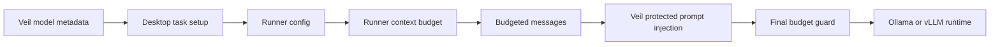

# Context Length Calculation Implementation Plan

## Goal

Add token-aware context budgeting to Umbratic so the runner avoids sending oversized prompts, preserves the most useful conversation context, and can adapt to different model context windows without requiring an exact tokenizer on day one.

The easiest implementation is not full tokenizer accounting. The reference systems all make practical tradeoffs:

- [[Codex Harness]] uses provider/model metadata and server-reported usage when available, with rough byte-based estimates for local decisions.
- [[Hermes Harness]] resolves context length from config, provider metadata, Ollama native probes, cache, and fallback catalogs, then uses rough `chars / 4` estimates with per-message/tool overhead.
- Osaurus uses a centralized `chars / 4` estimator, an 85% safety margin, reserved budget categories, and deterministic trimming of old conversation/tool history.

Umbratic should start with the Osaurus/Hermes style because it matches the current TypeScript runner and Go Veil architecture with the least risk.

## Current Umbratic Shape

The relevant code lives in `UmbraticAI`, while this note tracks the plan in the `Umbratic` knowledge base.

Current behavior:

- `packages/runner/src/loop.ts` builds model requests from `session.messages`.
- `compactToolHistoryMessages()` compacts old structured assistant/tool segments by count, not by token budget.
- Tool output is clipped by byte limits (`maxToolContextBytes`, `maxToolResultBytes`).
- `apps/desktop/src/main/main.ts` builds large first-turn prompt text with fixed character caps for skills, history, key files, and attachments.
- `infrastructure/veil/internal/http/server.go` injects protected system, route, runtime-profile, and template messages after the runner sends its request.
- `infrastructure/veil/internal/model/model.go` currently exposes only model IDs, not context length metadata.

Important constraint: because Veil adds protected prompt messages server-side, the runner can do most useful history trimming, but final hard-limit enforcement eventually belongs in Veil.

## Recommended Architecture



## Design Decision

Use a rough, centralized estimator first:

- Text: `ceil(charCount / 4)`.
- Message overhead: small fixed overhead per message, either `+4` like Osaurus or `+10` like Hermes. Prefer `+10` for Umbratic because OpenAI-compatible JSON/tool envelopes are the main risk.
- Tool calls: count the full serialized `tool_calls` envelope, not only function arguments.
- Tool schemas: estimate `JSON.stringify(tools)` with the same `chars / 4` rule.
- Images: count each image content part as a flat estimate, initially `1600` tokens.
- Safety margin: use 85% of the resolved model window.
- Output reservation: default `4096` tokens, capped to 25% of effective budget for small models.
- Veil protected prompt reserve: default `4096` tokens until Veil can report its exact protected-prompt cost.

Avoid adding `tiktoken` or model-specific tokenizers in the first pass. They add dependency and model-mapping complexity without solving the bigger current issue: Umbratic has no shared budget manager or context-window metadata path.

## Phase 1: Runner Budget Manager

Add `packages/runner/src/contextBudget.ts`.

Core exports:

```ts
export type ContextBudgetOptions = {
  contextLength?: number;
  safetyMargin?: number;
  maxResponseTokens?: number;
  protectedPromptReserveTokens?: number;
  recentPairsToKeep?: number;
};

export function estimateTextTokens(value: string | undefined | null): number;
export function estimateMessageTokens(message: ChatMessage): number;
export function estimateMessagesTokens(messages: ChatMessage[]): number;
export function estimateToolSchemaTokens(tools: unknown): number;
export function trimMessagesToBudget(messages: ChatMessage[], options: ContextBudgetOptions): {
  messages: ChatMessage[];
  estimatedTokensBefore: number;
  estimatedTokensAfter: number;
  overBudget: boolean;
  compacted: boolean;
};
```

Trimming strategy:

1. Preserve a leading `system` message.
2. Preserve the first real user task.
3. Preserve the recent tail, ideally the last 3 assistant/tool pairs or text turns.
4. Summarize old `tool` messages and old prose workspace tool-context messages.
5. If still over budget, drop old middle units.
6. Drop assistant tool-call messages together with their corresponding tool results so the model never sees orphaned tool history.
7. Insert one stable note when content is removed:

```text
[Note: Earlier messages were compacted to fit the context window. Re-read files or rerun tools if exact details are needed.]
```

Keep the existing `compactToolHistoryMessages()` behavior at first, but run the token budget pass after it. This reduces risk and preserves current tests.

## Phase 2: Wire The Runner

Update `packages/runner/src/config.ts`:

- Add optional `contextLength`.
- Add optional `maxResponseTokens`.
- Add optional `protectedPromptReserveTokens`.
- Validate positive integers only.
- Default `contextLength` to `128000` when unknown.

Update `packages/runner/src/session.ts`:

- Add a small session-scoped budget state if sticky compaction is implemented now.
- MVP can skip full sticky watermarking, but the plan should leave room for it:

```ts
contextBudget?: {
  compactionNotesInserted: boolean;
};
```

Update `packages/runner/src/loop.ts`:

- Build `tools` before finalizing messages, because tool schema cost matters.
- Replace `messagesForModel(session)` with `messagesForModel(session, tools)`.
- Use the budget manager for both OpenAI-compatible and Ollama requests.
- Emit a lightweight runner event only if useful later, such as:

```json
{
  "type": "context.compacted",
  "estimatedTokensBefore": 90000,
  "estimatedTokensAfter": 61000
}
```

That event can be omitted in the MVP if it would force UI type changes.

## Phase 3: Context Length Metadata In Veil

Update `infrastructure/veil/internal/model/model.go`.

Extend model metadata:

```go
type ModelInfo struct {
    ID            string `json:"id"`
    ContextLength int    `json:"context_length,omitempty"`
}
```

Resolution order:

1. `VEIL_CONTEXT_LENGTH` environment override.
2. vLLM/OpenAI-compatible metadata:
   - `GET /v1/models/{model}`
   - `GET /v1/models`
   - recognized fields: `context_length`, `max_context_length`, `max_model_len`, `max_tokens`.
3. Ollama native probe:
   - `POST /api/show` with `{ "name": model }`
   - prefer runtime `num_ctx` for local Ollama when present.
   - fallback to any `model_info.*context_length` value.
4. Fallback to `128000`.

Update `infrastructure/veil/internal/http/server.go`:

- Have `/api/health` optionally return context length in addition to status.
- Or add a small `/api/models` route if the desktop should fetch richer metadata separately.

MVP recommendation: enrich `/api/health` minimally:

```json
{
  "status": "ok",
  "model": "configured-model",
  "context_length": 131072
}
```

## Phase 4: Pass Metadata Through Desktop

Update `apps/desktop/src/main/types.ts`:

```ts
export type LocalModelInfo = {
  providerId: LocalProviderId;
  providerName: string;
  modelId: string;
  displayName: string;
  baseUrl: string;
  contextLength?: number;
};
```

Update `apps/desktop/src/main/main.ts`:

- Parse the richer Veil health response.
- Put `contextLength` on `configuredEndpointModel()`.

Update `apps/desktop/src/main/runnerAdapter.ts`:

- Include `contextLength` in `buildUmbraticRunnerConfig()`.
- Include `protectedPromptReserveTokens`, initially `4096`.

## Phase 5: Veil Final Guard

After runner-side budgeting is stable, add server-side budget awareness in Veil.

Reason: Veil is the only layer that sees the final prompt after protected prompts and templates are injected.

Implementation:

- Add a Go rough estimator mirroring the runner constants.
- Estimate final `messages + tools`.
- If over budget, compact only client-provided history, not protected system messages.
- Preserve all protected messages.
- Return a clean 413 or 400 only when the protected prompt plus latest user request alone cannot fit.

This should be a second pass because doing it first duplicates more logic in Go and is harder to validate through the current runner tests.

## Phase 6: Provider Error Recovery

Borrow Hermes' distinction between two error classes:

- Prompt too long: compact history and, only if the provider reports a lower real limit, update cached/resolved context length.
- Output cap too large: reduce `maxResponseTokens` for the retry, but do not shrink the context window.

This belongs in Veil because it sees runtime HTTP errors directly.

## Test Plan

Runner unit tests in `packages/runner/tests/loop-server.test.mjs`:

- `estimateTextTokens` uses ceiling division and returns 0 for empty content.
- Tool-call envelopes are counted, including id/name/arguments.
- Old structured tool history is compacted before request.
- A tiny `contextLength` triggers token-budget compaction.
- Assistant tool-call messages and tool results are dropped as atomic units.
- The leading system message, first user request, and newest user request survive.
- Ollama prose fallback still works.

Config tests in `packages/runner/tests/config.test.mjs`:

- Positive `contextLength` is accepted.
- Invalid, zero, negative, and non-number values are ignored.

Veil tests in `infrastructure/veil/internal/model/model_test.go`:

- Parses `context_length`.
- Parses `max_model_len`.
- Parses Ollama `/api/show` `num_ctx`.
- Parses Ollama `model_info.*context_length`.
- Falls back to `128000`.
- Honors `VEIL_CONTEXT_LENGTH`.

Desktop tests:

- `buildUmbraticRunnerConfig()` passes `contextLength` to the runner config.
- Health parsing tolerates old `{ "status": "ok" }` responses.

## Rollout Order

1. Add runner estimator and token-budget trimming behind config defaults.
2. Add runner tests for tiny-window compaction.
3. Pass a hardcoded/default `contextLength` through runner config.
4. Add Veil context-length discovery and health response metadata.
5. Pass Veil metadata through desktop to runner.
6. Add Veil final guard.
7. Add provider error recovery.

## Open Questions

- Should Umbratic expose context usage in the UI, or keep it internal until compaction is proven?
- Should `protectedPromptReserveTokens` be static, or should Veil report the exact protected prompt estimate?
- Should chat attachments reserve image tokens in desktop before they reach the runner?
- Should Umbratic support user-configurable context length in endpoint settings, similar to Hermes `model.context_length`?

## MVP Acceptance Criteria

- A long tool-heavy session no longer sends every old tool result verbatim.
- A configured small context window causes deterministic compaction before the HTTP request.
- The latest user request and recent tool results remain intact.
- The runner test suite passes.
- Existing byte clipping behavior remains as a secondary safety net.

