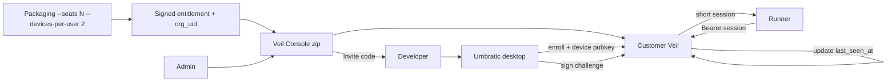

# Enterprise Licensing and UID Access Control implementation plan

> [!summary]
> Company mode replaces the shared Veil bearer token with a one-time **Invite code** from Veil Console. The developer pastes Veil URL + Invite code on Connections, the desktop creates a device key once, then renews short sessions silently. Seat count and a configurable devices-per-user limit (default **2**) live in a signed entitlement embedded when Umbratic packages that customer's Console zip with an `org_uid`. v1 trusts the customer not to redistribute the zip; a future optional monthly org_uid license check can harden that later. Local mode stays available. Identity and last-seen activity stay inside the customer's Veil.

Implements [[Research/Enterprise Licensing Privacy and Confidentiality|Enterprise Licensing, Privacy, and Confidentiality]]. Console shell and packaging layout stay owned by [[Veil Console Implementation Plan|Veil Console Implementation Plan]]; this plan owns product identity, seats, invite codes, and desktop/runner session changes.

## Plan at a glance

| Item | Decision |
|---|---|
| Status | `DRAFT` |
| Owner | Umbratic product + Veil/desktop |
| Target | `UmbraticCode`: `apps/desktop`, `packages/runner`, `infrastructure/veil`, `infrastructure/veil-console` |
| First release | Signed seat entitlement + Invite-code enroll + 2 devices/user (configurable) + Console revoke/last-seen |
| Core approach | Extend Connections paste UX and Veil auth; no SSO or cloud identity service |
| Important constraint | Invite code enrolls a device; only device-key possession authenticates. Seat/device limits come from a **signed** entitlement. v1 does **not** phone home to stop zip redistribution |
| Evidence | Focused tests for enroll, seat cap, device cap, revoke, last-seen, session renew, redaction; one walkthrough |

## Outcome

A company buys N seats. Umbratic builds their Veil Console release zip with a signed entitlement (`org_uid`, `max_authorized_users = N`, `max_devices_per_user = 2`). An admin activates Veil, creates users, and copies a one-time **Invite code** to each developer. That person opens Umbratic → Connections → pastes Veil URL + Invite code → Save & connect. After that, company chat is seamless. They can still switch to **Local** anytime. Console shows invite codes issued, enrolled device keys, revoke actions, and each user's/device's last successful request time. A third device for one user is rejected unless the entitlement's devices-per-user value is raised later. Redistributing the customer zip is a trust/contract issue in v1, not an online license police check.

## Success looks like

- [ ] Admin issues one Invite code per user from Console; user never types a UID
- [ ] Connections accepts Veil URL + Invite code and completes enroll + first session
- [ ] Later launches renew silently; Local mode remains selectable
- [ ] Hard seat cap and `max_devices_per_user` (default 2) enforced in Veil
- [ ] Console lists invite codes and devices, supports revoke anytime, shows last request time
- [ ] Shared `VEIL_AUTH_TOKEN` cannot bypass company-mode user auth
- [ ] Entitlement seat/device fields cannot be raised by local edit (signature fails)
- [ ] Focused automated checks + final walkthrough pass

## Scope

### Included

- Per-customer signed entitlement (`org_uid`, seats, `max_devices_per_user`) from the Console packaging script
- Built-in product users and devices inside customer Veil
- One-time Invite codes bound to a user (hash at rest, short TTL, single use)
- Desktop device key (Ed25519) in Electron main + `safeStorage`
- Opaque short-lived Veil sessions for the runner (no durable Veil secret in `UMBRATIC_RUNNER_CONFIG`)
- Console: create users, issue Invite codes, list codes/devices/keys metadata, revoke anytime, show last successful request (`last_seen_at`)
- Keep Local / personal loopback mode available alongside Company server mode
- Migration off today's single shared client token for company Server mode

### Deferred or excluded

- SSO / SAML / OIDC / Entra / Google / AD / LDAP
- Email invites or password-reset mail
- Hardware fingerprinting (MAC, disk serial, etc.)
- Usage-based billing and Umbratic-hosted user accounts
- Multi-region Veil clusters and HA identity stores
- **Online anti-redistribution / monthly org_uid license phone-home** (explicit future option; not v1)
- Deployment-key binding that blocks every cloned customer zip (not required for v1 trust model)
- Full telemetry/privacy hardening program beyond keeping identity local

### Decisions and assumptions

| Item | Decision or assumption | What changes if wrong |
|---|---|---|
| End-user UX | Paste **Invite code** (+ Veil URL). UID stays server-side | Extra field or QR-only flow |
| Devices per user | Entitlement field `max_devices_per_user`, **default 2**; one named constant / config knobs so raising to 3 later is a packaging/entitlement change, not a protocol rewrite | Commercial policy only |
| Packaging | `build-release-zip` takes `--seats` and embeds signed entitlement + generated `org_uid` | Separate entitlement file after purchase |
| Local mode | **Always allowed**; Local does not consume company seats | Later MDM force-Server is optional and out of scope |
| License enforcement | v1 **trusts** the customer with the zip; seat/device caps enforced locally inside their Veil | Add optional monthly org_uid check later |
| Wording | Product copy uses **Invite code** | — |
| Auth crypto | Ed25519 device key + challenge/response + opaque session | Different store or token format |

## User experience

Shortest complete flow:

1. Admin runs packaged Console, activates the signed entitlement, creates **Alice**.
2. Console shows a one-time **Invite code** (copy once) and records that it was issued.
3. Alice opens Umbratic → Connections → Company server → pastes Veil URL + Invite code → **Save & connect**.
4. App enrolls this device, stores the encrypted device key, obtains a short session, and is ready for company chat.
5. Later launches renew silently. Alice can still choose **Local** for personal/local Veil.
6. Admin opens Console users/devices: sees invite codes issued, enrolled devices (public-key fingerprint / device label), revoke controls, and **Last active** (last successful authenticated request to Veil).

| State | What the user sees or can do |
|---|---|
| Loading | Connecting / verifying server |
| Empty / not enrolled | Veil URL + Invite code fields; Local still available |
| Enrolling | Progress; cancel only before Invite code is consumed |
| Error/retry | Plain language: invalid/expired invite, seat full, device limit, unreachable server |
| Success / enrolled | Org short id, this-device status, disconnect/replace; Local still available |

Accessibility notes:

- Invite field is a password-style input with accessible name **Invite code**
- Errors announced without echoing the code
- Keyboard-only path through Save & connect, Disconnect, and Local/Company toggle

```text
Connections
┌──────────────────────────────────────┐
│ Mode: ( ) Local  (•) Company server  │
│ Veil URL   [https://veil.acme...]    │
│ Invite code[••••••••••••••••••••]    │
│              [ Save & connect ]      │
└──────────────────────────────────────┘
```

Console (admin):

```text
Users                         Seats 12 / 30
┌─────────────────────────────────────────────┐
│ Alice · usr_… · Last active 2m ago          │
│  Invite codes: 1 redeemed, 0 pending        │
│  Devices:                                   │
│   • Work laptop · …fingerprint · Revoke     │
│   • Home Mac    · …fingerprint · Revoke     │
│  [ Issue invite code ]                      │
└─────────────────────────────────────────────┘
```

## Architecture



### Responsibilities

| Area | Owner |
|---|---|
| Signed entitlement + `org_uid` at package time | `infrastructure/veil-console/deploy` release script + Umbratic signing |
| User/device/seat store, enroll, challenge, session, last_seen | `infrastructure/veil` |
| Invite issue/list/revoke, device revoke, last-active UI | `infrastructure/veil-console` |
| Device key, enroll IPC, session renew | `apps/desktop` Electron main |
| Connections Invite code UX + Local toggle | `apps/desktop` renderer |
| Attach replaceable session to Veil calls | `packages/runner` |

### Contracts and limits

- **Invite code:** single-use, TTL (default 24h), bound to one `user_uid`, stored hashed; plaintext shown once in Console; Console keeps issuance metadata (created_at, redeemed_at, revoked/expired) without storing the raw code after display
- **Device private key:** Electron main only; `safeStorage`; never in renderer, preload results, runner config, logs
- **Session:** opaque ~15 min; memory-only in main + runner; renew by challenge
- **Seat invariant:** `active(licensed_user) <= entitlement.max_authorized_users` in one locked transaction
- **Device invariant:** `active_devices(user_uid) <= entitlement.max_devices_per_user`
  - Ship default **`max_devices_per_user = 2`**
  - Keep the limit as a single entitlement field plus one shared named constant / packaging flag (`DEFAULT_MAX_DEVICES_PER_USER` / `--devices-per-user`) so raising the default later is a config/entitlement change, not new protocol work
- **Last active:** on each successful authenticated product request (after session validation), Veil updates `device.last_seen_at` and rolls up `user.last_seen_at`; Console reads those fields. Coarse timestamps only — no prompt content
- **Entitlement:** signature covers `org_uid`, seats, `max_devices_per_user`, term; local edits fail closed
- **Company Server mode:** shared `VEIL_AUTH_TOKEN` is not a chat/telemetry bypass
- **Local mode:** unchanged ephemeral loopback credential; does not use Invite codes or company seats

Minimum enroll request:

```json
{
  "invite_code": "umbj_...",
  "public_key": "base64url-ed25519",
  "device_label": "Work laptop"
}
```

### Important design decisions

- **Choose:** Product wording **Invite code** (one-time enroll), not “Bearer token.”
- **Choose:** Bake seats + `org_uid` into the customer release zip as a **signed** entitlement. Editing the zip must not raise seats.
- **Choose:** v1 **trust model** for redistribution — Umbratic does not phone home to validate the zip monthly. Caps are enforced inside the customer’s Veil. A future optional monthly `org_uid` license check can be added without changing enroll UX.
- **Choose:** Local mode remains available on every desktop, including company-managed ones.
- **Do not:** Ask users for User UID + code.
- **Do not:** Put seat counts in unsigned config or use MAC/hardware IDs.
- **Preserve:** Runner loopback auth; Veil as the only model gateway.

## Implementation

### 1. Signed customer entitlement in Console packaging

Build:

- Extend `build-release-zip.sh` / `veil-console:release` with `--seats` and `--devices-per-user` (default from `DEFAULT_MAX_DEVICES_PER_USER = 2`)
- Generate `org_uid`, embed signed entitlement, verify on first activation
- Document trust model: zip redistribution is contractual in v1; leave a clear extension point for future org_uid heartbeat

Likely files/modules:

- `infrastructure/veil-console/deploy/build-release-zip.sh`
- `infrastructure/veil-console/deploy/bundle/*`
- Entitlement verify in `infrastructure/veil` (+ Console bootstrap)

Preserve:

- Reproducible binaries; only entitlement payload is customer-specific
- No employee identities in the zip

Verify:

- Altered seat or devices-per-user fails signature
- Untampered zip activates with expected caps

### 2. Veil identity, seats, enroll, sessions, last_seen

Build:

- Company-mode enroll / challenge / session / logout instead of single-token compare
- Persist org, users, devices, invite hashes, challenges, sessions, seat events
- Enforce seat + `max_devices_per_user` atomically using the entitlement field (not a hard-coded `2` scattered in call sites)
- Update `last_seen_at` on successful authenticated product requests
- Keep Local/dev single-token path for non-company mode only

Likely files/modules:

- `infrastructure/veil/internal/http/server.go`
- `infrastructure/veil/internal/config/config.go`
- New identity/session modules under `infrastructure/veil/internal/`

Preserve:

- Existing chat/model routes and Veil→runtime boundary
- Stable non-sensitive auth error codes

Verify:

- Cap rejects N+1 users and devices-per-user+1 devices
- Invite alone without device key cannot chat
- `last_seen_at` advances after a successful chat request
- Replay/expired challenge fails

### 3. Console: invites, devices, revoke, last active

Build:

- Replace shared client-token product path with per-user Invite codes
- UI/API: list users, seat usage, invite issuances (status: pending/redeemed/expired/revoked), enrolled devices (label + public-key fingerprint), **Revoke** invite or device anytime, **Last active** from Veil
- Show Invite code plaintext only once at issue time; afterward show status metadata only
- Control channel only; product sessions cannot administer

Likely files/modules:

- `infrastructure/veil-console/internal/web/*` (today `token.html`, `/token/rotate`)
- `infrastructure/veil-console/internal/auth/auth.go`, `internal/state/state.go`
- Console→Veil control ops for users/devices/invites/seats

Preserve:

- Console owner login / recovery owned by Console plan
- Loopback-first management model

Verify:

- Code shown once; redeem twice fails
- Revoke device blocks next protected request
- Last active visible after a request; absent/never for unused invites

### 4. Desktop Connections + device key + runner session slot

Build:

- Relabel Server secret field to **Invite code**; after enroll, show enrolled state
- Keep Local / Company server toggle; Local path unchanged
- Electron main: device key, redeem invite, challenge/sign, `safeStorage`
- Runner: no durable Veil secret at start; replaceable short session over loopback control
- Narrow IPC: status / enroll / disconnect — never return key or live session to renderer

Likely files/modules:

- `apps/desktop/src/renderer/main.tsx`
- `apps/desktop/src/preload/preload.ts`
- `apps/desktop/src/main/storage.ts`, `main.ts`, `runnerAdapter.ts`
- `packages/runner/src/config.rs`, `provider.rs`

Preserve:

- Local mode behavior and existing secret redaction patterns

Verify:

- Renderer never sees Invite code after submit, private key, or session
- Local still connects without an Invite code
- Long task renews session; revoked device cannot renew

### 5. First vertical proof

Build:

- 2-seat / 2-device entitlement → invite → enroll → chat → second device ok → third device fails → third user fails → revoke → last active visible in Console → Local still works on same desktop

## Focused verification

| Area | Automated proof | Manual proof |
|---|---|---|
| Main behavior | Invite → session → chat; last_seen updates | Paste Invite code, connect, send one prompt |
| Failure boundary | Seat full, device limit, bad/expired invite, revoke | Visible recovery copy |
| Existing behavior | Local mode + existing suites | Toggle Local and chat |
| UX/accessibility | Connections + Console list/revoke states | Keyboard path; light/dark |

### Required walkthrough

1. Build Console zip with `--seats 2` (devices-per-user default 2).
2. Activate; create user A; copy Invite code; confirm Console lists the pending invite.
3. Enroll desktop 1; confirm chat; confirm Last active updates.
4. Enroll desktop 2; confirm both work.
5. Attempt desktop 3; confirm rejection.
6. Create user B; enroll; attempt user C; confirm seat cap.
7. Revoke a device; confirm that device cannot renew; other device still works.
8. On an enrolled desktop, switch to Local and confirm personal mode still works.

### Commands

```shell
cargo test --locked --package umbratic-runner --all-targets
go test ./...   # from infrastructure/veil and veil-console
npm --workspace @umbratic/desktop test
npm run test:all
```

## Security and privacy

- [ ] Invite codes and sessions validated only by Veil / Electron main
- [ ] Seat and device checks happen before model access
- [ ] Request size and auth failure rate limits on enroll/challenge
- [ ] Codes, keys, and sessions never logged; last_seen is timestamp-only
- [ ] No new broad renderer IPC; no shared company bearer bypass
- [ ] v1 accepts redistribution risk under customer trust/contract; do not pretend online DRM exists yet

## Data and compatibility

- Identity tables in customer-managed Veil state
- Existing Server bearer becomes `legacy_server_token`; never reinterpreted as Invite code or device credential
- Feature-flag company identity beside legacy token during pilot; then disable shared token for company Server chat/telemetry
- Rollback: flag off restores shared-token company Server path; do not auto-delete Veil DB

## Dependencies

No identity-provider SDK, auth framework, ORM, or policy engine. Reuse Electron `safeStorage`, existing Go/Rust crypto/HTTP, and Console’s reviewed password-hashing path.

## Rollout and rollback

- **Enable:** `company_identity_mode` on pilot customer zips
- **Watch:** enroll failures, seat/device-cap hits, renew failures, revoke effectiveness (local Console metrics; no employee identity to Umbratic)
- **Rollback trigger:** cannot enroll/renew, or caps wrong
- **Rollback action:** disable flag / restore shared-token Server path; keep Local unaffected

## Risks

| Risk | Prevention | Fallback |
|---|---|---|
| Customer redistributes zip to another org | v1: contract + signed org/seat caps only; document trust model | Future optional monthly `org_uid` license check |
| Invite code shared like a password | One-time redeem + device cap + Console revoke/list | Reissue invite; revoke devices |
| Runner keeps stale static api key | Session slot + refresh-required | Single retry before stream starts |
| Hard-coded `2` scattered in code | Single entitlement field + `DEFAULT_MAX_DEVICES_PER_USER` | Bump packaging default / reissue entitlement |

## Completion record

Before `COMPLETE`:

- changed files and dependency pins
- focused + `npm run test:all` results
- walkthrough result (including Local + revoke + last active)
- known limits (no phone-home DRM; SSO deferred)

## Plan quality check

- [x] Outcome and scope are unambiguous
- [x] Architecture and ownership are understandable at a glance
- [x] UX includes the main flow and important states
- [x] Implementation slices are concrete enough to begin
- [x] Security and data boundaries have trusted owners
- [x] Verification covers success, highest-risk failure, and existing behavior
- [x] Testing is focused; extra suites/benchmarks only if justified later
- [x] Rollback does not silently destroy user data

## UmbraticCode change map (current → needed)

| Area | Current | Needed |
|---|---|---|
| Connections UI | Bearer token field | **Invite code** → enrolled status; Local remains |
| Preload IPC | `get/saveModelEndpointSettings` | Narrow enroll/status/disconnect |
| Main storage | Durable server secret | Device key ciphertext + non-secret ids; sessions memory-only |
| Runner launch | Veil secret in `provider.apiKey` | Replaceable short session over loopback control |
| Runner | Static `api_key` | Session slot, refresh, redaction |
| Veil auth | Single-token `authorized()` | Invite enroll, challenge, session; seat/device; `last_seen_at` |
| Console | One shared `veil_token` | Invite issue/list/revoke, device revoke, last active, seats |
| Packaging | Binaries only | `--seats` / `--devices-per-user` + signed entitlement + `org_uid` |

## Open questions

1. **Bake seats into each customer zip vs generic zip + separate entitlement file?** Bake-in remains the default assumption; separate file is better if seat upgrades become frequent.
2. **Invite code TTL** when a laptop is wiped before redeem — keep 24h default, or make Console choose 24h / 7d?
3. **Future monthly org_uid check:** when added, should it be fail-open (warn only) or fail-closed after grace? (Not in v1.)

## Recommended first vertical slice

1. Package a 2-seat signed zip (`max_devices_per_user = 2`).
2. Activate Console/Veil.
3. Create one user; copy Invite code; see it listed in Console.
4. Paste URL + Invite code in Connections; enroll.
5. Runner completes one chat; Last active updates.
6. Reject third device and third user; revoke one device.
7. Confirm Local mode still works on the same desktop.
