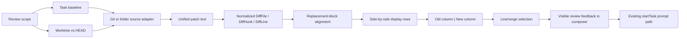

# Git Diff Review Panel Implementation Plan

## Goal

Turn UmbraticCode's existing review sidebar into a readable local code-review surface for changes in a task or ordinary Git worktree.

The first release should:

- show every changed file relative to a clearly named baseline;
- render old and new code in synchronized side-by-side columns;
- preserve context, hunk boundaries, and correct old/new line numbers;
- align edited lines and highlight the changed spans inside each accepted pair;
- let the user comment on one line or a contiguous line range;
- place those comments visibly into the next composer prompt;
- continue to support folder tasks, added/deleted files, untracked files, and binary-file summaries;
- leave pull-request adapters and remote review submission for a later phase.

This applies the portable parts of [[tuicr Diff and Pull Request Review Architecture]] without taking on pull-request review yet.

> [!important] Product boundary
> Review comments are user content. The renderer must show the generated feedback in the composer and send it through the existing `prompt` path. It must not add hidden review instructions, system prompts, or model behavior to the Electron harness.

## Scope Decisions

### Included

- Local Git repositories.
- Isolated task worktrees.
- Local-mode tasks that edit the user's ordinary worktree.
- Non-Git folder tasks through the existing snapshot baseline.
- Tracked, staged, unstaged, untracked, added, modified, deleted, renamed, and binary-file states where Git exposes them.
- Side-by-side and narrow-width unified presentation.
- Single-line and contiguous-range comments on either the old or new side.
- Intra-line changed spans for confidently paired replacement lines.

### Deferred

- GitHub pull requests, GitLab merge requests, and remote review submission.
- Review approvals, remote threads, and forge authentication.
- Comparing two versions of a pull-request patch with `git range-diff`.
- AST-aware or tree-sitter alignment.
- Arbitrary non-contiguous line selections.

## Current UmbraticCode Shape

The current implementation already has the review lifecycle, task refresh, file summaries, approval footer, and a resizable right sidebar.

Relevant paths:

- Review collection and refresh: [main.ts](../UmbraticCode/apps/desktop/src/main/main.ts)
- Review/task contracts: [types.ts](../UmbraticCode/apps/desktop/src/main/types.ts)
- Renderer, parser, panel, and composer: [main.tsx](../UmbraticCode/apps/desktop/src/renderer/main.tsx)
- Review styling: [styles.css](../UmbraticCode/apps/desktop/src/renderer/styles.css)
- IPC exposure: [preload.ts](../UmbraticCode/apps/desktop/src/preload/preload.ts)
- Existing renderer fixture: `composerTestReviewFiles` in [main.tsx](../UmbraticCode/apps/desktop/src/renderer/main.tsx)

Current behavior and limitations:

| Area | Current behavior | Gap |
|---|---|---|
| Review data | `ReviewFile` stores `path`, a three-value status, and raw unified diff text | No normalized files, hunks, lines, old paths, binary metadata, or stable anchors |
| Git baseline | Isolated worktrees compare to `task.baseCommit` | Good basis for task review |
| Local-mode baseline | The app snapshots the folder before the task and compares it after the run | Shows model/task changes, but not necessarily the full worktree diff against `HEAD` |
| Untracked files | Discovered separately and synthesized as added-file patches | Preserve this behavior in worktree scope |
| Folder diff | Uses an in-memory full-file LCS and emits one full-file hunk | Quadratic for large files and not suitable as the universal diff engine |
| Parser | `parseUnifiedDiff()` counts changes and emits only added/deleted rows | It discards context lines, hunk headers, and pairing information |
| Renderer | One stream with old/new gutters and colored rows | No side-by-side comparison or intra-line emphasis |
| Panel width | Defaults to 520 px and caps the overlay near 840 px | Too narrow for two readable code columns |
| Comments | No line selection or review-comment state | Cannot turn anchored feedback into a follow-up prompt |
| Tests | IPC exposure and general storage are covered | No direct parser, alignment, Git-collection, or review-comment tests |

## Recommended Architecture



Keep four concerns separate:

1. **Source and baseline selection** obtains one cumulative patch.
2. **Normalization** converts every patch into the same line-aware model.
3. **Alignment** creates display rows and intra-line spans without knowing about React.
4. **Review UI** handles navigation, selection, comments, and composer insertion.

This boundary makes a future pull-request adapter an additional source, not a second renderer.

## Review Scope And Baseline Semantics

The UI should name the comparison instead of using the ambiguous label “changes.”

### Task changes — default for a completed model run

- Isolated worktree: `task.baseCommit` to the task worktree, including staged, unstaged, and untracked files.
- Local-mode Git task: preserve the existing start-of-task snapshot so pre-existing user changes are not attributed to the model.
- Folder task: preserve the existing start-of-task snapshot.

Label: **Task changes**.

### Worktree changes — available for Git repositories

- Compare `HEAD` to the combined index and working tree.
- Include staged and unstaged tracked changes.
- Discover untracked, non-ignored files and synthesize `/dev/null -> file` patches.
- Do not include ignored files.

Label: **Worktree vs HEAD**.

Use a compact scope control in the review top bar. Default to **Task changes** when a task review exists; otherwise use **Worktree vs HEAD**. Display the abbreviated baseline commit or “task start” beside the scope so the user always knows what is being compared.

> [!note] Why keep both scopes
> Replacing the local snapshot with `git diff HEAD` would mix pre-existing user edits with the model's work. Keeping task review and full-worktree review distinct answers both use cases without misattribution.

## Normalized Diff Contract

Add a DOM-free module at `apps/desktop/src/shared/reviewDiff.ts` and include `src/shared` in both desktop TypeScript configs. Keep parsing and alignment pure so Node unit tests can load the module without Electron or React.

Recommended serializable contract:

```ts
export type DiffLineOrigin = "context" | "addition" | "deletion";
export type DiffSide = "old" | "new";

export type DiffLine = {
  origin: DiffLineOrigin;
  content: string;
  oldLine: number | null;
  newLine: number | null;
};

export type DiffHunk = {
  id: string;
  header: string;
  oldStart: number;
  oldCount: number;
  newStart: number;
  newCount: number;
  lines: DiffLine[];
};

export type ReviewFile = {
  path: string;
  oldPath?: string;
  status: "added" | "modified" | "deleted" | "renamed" | "copied" | "binary";
  additions: number;
  deletions: number;
  binary: boolean;
  patch: string;
  contentHash: string;
  hunks: DiffHunk[];
};
```

Implementation details:

- Preserve the raw patch during the migration for hashing, diagnostics, and compatibility.
- Parse `diff --git`, `---`, `+++`, rename/copy metadata, file modes, binary markers, hunk coordinates, and `\\ No newline at end of file`.
- Increment both line counters for context, only old for deletions, and only new for additions.
- Give every hunk a stable content-derived ID that ignores hunk-header line offsets. Include the file path when constructing a full anchor.
- Validate stored legacy `ReviewFile` values in `storage.ts`; normalize raw `diff` records on read or refresh instead of assuming new fields exist.
- Bound patch and file sizes. Large or binary files should render a summary rather than blocking the renderer.

Do not put syntax-highlighted React spans in this contract. Syntax styling and intra-line spans are presentation data derived from the normalized source text.

## Alignment And Intra-Line Diff

Add pure exports to `reviewDiff.ts` or a sibling `reviewAlignment.ts`:

```ts
export type IntraLineSpan = { text: string; changed: boolean };

export type DiffCell = {
  side: DiffSide;
  line: number | null;
  content: string;
  origin: DiffLineOrigin | "empty";
  spans?: IntraLineSpan[];
};

export type SideBySideRow = {
  id: string;
  kind: "context" | "modification" | "addition" | "deletion";
  left: DiffCell;
  right: DiffCell;
};
```

Alignment algorithm:

1. Duplicate context lines into both cells.
2. Consume each consecutive deletion run and its immediately following addition run.
3. For small replacement blocks, sequence-align old and new lines using normalized text similarity and gap costs.
4. Accept a line pair only above a documented similarity threshold; weak pairs remain a deletion-only row and an addition-only row.
5. For accepted pairs, run a token/character diff and mark changed spans on both sides.
6. For large blocks, use `tuicr`'s deterministic positional zip and pad the shorter side.

Recommended safety limits for the first pass:

- semantic alignment only when each side has at most 200 lines;
- intra-line diff only when both lines are at most 2,000 characters;
- normalize whitespace for matching only, never for display;
- cap dynamic-programming cells and fall back before allocating an unbounded matrix;
- use stable deterministic tie-breaking so rows do not jump between refreshes.

Tokenize punctuation and whitespace separately so a change like `client.run(oldId)` to `client.run(newId)` highlights `oldId` and `newId`, not the entire line. Preserve tabs and original text in the displayed cells.

## Review Panel Interaction Design

### Layout

- Increase the review panel's useful wide width to approximately 70–80% of the app window, capped by the viewport rather than 840 px.
- At wide sizes, use a narrow file navigator and a diff canvas. The selected file stays visible while its hunks scroll.
- Make side-by-side the default when the diff canvas is at least 760 px wide.
- Below that threshold, switch to a unified layout using the same normalized model and anchors.
- Keep old and new column headers, gutters, center divider, and horizontal scroll positions stable.
- Render hunk headers and a small amount of context. Add “show more context” later only if the source adapter can obtain it safely.
- Keep file headers sticky and show file status, additions, deletions, and comment count.
- Add a “Side by side / Unified” view toggle, but remember the last choice locally instead of adding a settings screen.

### Readability

- Use tabular line numbers, selectable code text, and `white-space: pre` by default.
- Provide an explicit wrap toggle. When wrapping is enabled, pad both cells so the center divider and paired rows stay aligned.
- Use restrained addition/deletion backgrounds plus stronger intra-line spans.
- Keep syntax highlighting optional for the first implementation. Correct diff emphasis and line alignment are more important; a later highlighter must run per file and must not alter anchors.
- Verify light and dark themes, high-contrast focus rings, reduced motion, and keyboard navigation.

### File and hunk navigation

- Clicking a file selects it rather than expanding every file into one long list.
- Provide previous/next file and previous/next hunk actions.
- Keep the current “open in IDE” action.
- Preserve the current file when a review refresh still contains it; otherwise select the nearest remaining file.

## Line And Range Comments

Use a source anchor, not a rendered row index:

```ts
export type ReviewCommentDraft = {
  id: string;
  taskId: string;
  patchHash: string;
  filePath: string;
  hunkId: string;
  side: DiffSide;
  startLine: number;
  endLine: number;
  body: string;
  excerpt: string;
};
```

Interaction:

1. Hovering or focusing a line-number gutter reveals an add-comment control.
2. Clicking selects one source line on that side.
3. Shift-click extends a contiguous range within the same file, hunk, and side.
4. A compact inline form appears immediately below the selected display row.
5. Saving adds the comment to a “Feedback for next prompt” tray.
6. The user can edit or remove comments before sending.
7. “Add feedback to prompt” serializes all tray items into the visible composer and focuses it.

Suggested visible prompt format:

```markdown
Please address this review feedback:

- `apps/desktop/src/renderer/main.tsx`, new lines 6568-6571:
  Keep the old and new gutters aligned when a line wraps.
```

For deletion-side feedback, say `old line` or `old lines`; for addition/context feedback on the right, say `new line` or `new lines`. Include a short quoted excerpt only when it helps disambiguate the request, and cap it to avoid bloating the prompt.

The first version can keep unsaved inline text in renderer state. Saved tray items should survive file collapse and review refresh. If the patch hash changes:

- retain comments whose file, hunk content ID, side, and source lines still resolve;
- mark unresolved comments as stale;
- require the user to re-anchor or delete stale comments before adding them to the prompt.

Once inserted into the composer, the feedback is already persisted by the existing `updateChatDraft` flow. No hidden IPC prompt field is needed.

## Implementation Phases

### Phase 1: Extract and test the normalized diff core

- Add `src/shared/reviewDiff.ts` with contracts and unified-patch parsing.
- Update `tsconfig.json` and `tsconfig.main.json` to include the shared module.
- Expand `ReviewFile` in `src/main/types.ts` and the renderer's API types.
- Normalize legacy stored review files in `src/main/storage.ts`.
- Replace renderer-only `parseUnifiedDiff()` with the shared parser.
- Keep the current unified renderer temporarily, but feed it normalized lines.
- Add fixtures for multiple hunks, context, no-newline markers, added/deleted/renamed files, spaces in paths, binary changes, and malformed input.

Deliverable: no visual redesign yet, but every review file has correct hunk and line metadata.

### Phase 2: Make Git collection explicit and complete

- Extract review collection from `main.ts` into `src/main/reviewSource.ts` so it can be unit tested.
- Add a review-scope input to `refreshTaskReview` and the preload API.
- Implement **Task changes** using the existing task baselines.
- Implement **Worktree vs HEAD** for Git repositories.
- Use Git-generated unified patches for tracked files rather than rebuilding them in the renderer.
- Continue synthesizing added-file patches for untracked files.
- Preserve folder snapshots as a separate adapter; add size limits to the full-file LCS or replace it with a bounded line diff.
- Extend status handling for rename, copy, and binary metadata.
- Return baseline label/OID and patch hash with the review response.

Deliverable: the user can deliberately switch between model/task changes and the complete ordinary worktree diff.

### Phase 3: Add the side-by-side engine and renderer

- Add pure positional pairing first and tests matching the `tuicr` behavior.
- Add bounded similarity-based sequence alignment for replacement blocks.
- Add token/character intra-line spans for accepted pairs.
- Extract React components from the monolithic `main.tsx` into `src/renderer/review/ReviewPanel.tsx`, `DiffFileView.tsx`, and `DiffRow.tsx`.
- Replace the current expanded-card stream with a selected-file navigator and synchronized columns.
- Add the unified narrow-width renderer from the same model.
- Update `styles.css` for wide layout, sticky gutters/headers, wrapping, themes, focus, and reduced motion.
- Expand the existing composer test fixture with insertion shifts, long lines, and multi-hunk files.

Deliverable: modified code is readable side by side, with exact changed substrings emphasized.

### Phase 4: Add anchored comments and composer integration

- Add gutter selection and shift-range selection.
- Add the inline editor and feedback tray.
- Add pure anchor/serialization helpers in `src/renderer/review/reviewComments.ts`.
- Reconcile saved comments when refresh changes the patch.
- Insert serialized feedback through `setPrompt()` and the existing draft persistence flow.
- Focus the composer at the end of inserted feedback and leave sending under user control.
- Add accessible labels and keyboard equivalents for selection, save, edit, delete, and add-to-prompt.

Deliverable: one or more line/range comments can become a visible, editable follow-up prompt.

### Phase 5: Polish, performance, and rollout

- Virtualize only after measuring; start with file-at-a-time rendering and bounded algorithms.
- Add loading, empty, stale, binary, too-large, malformed-patch, and refresh-error states.
- Preserve selection, scroll, view mode, wrap choice, and comments across a benign refresh.
- Add telemetry only for aggregate review actions; never send code, paths, excerpts, or comment bodies.
- Verify the running Electron app at realistic narrow and wide window sizes in both themes.
- Keep the old renderer behind a short-lived feature flag if rollout risk warrants it, then remove it after validation.

## File-Level Change Map

| File | Planned responsibility |
|---|---|
| `apps/desktop/src/shared/reviewDiff.ts` | Serializable model, parser, hashes, alignment, intra-line spans |
| `apps/desktop/src/main/reviewSource.ts` | Task/worktree/folder adapters and Git patch collection |
| `apps/desktop/src/main/types.ts` | Review scope, normalized files, baseline metadata |
| `apps/desktop/src/main/storage.ts` | Backward-compatible normalization of persisted task reviews |
| `apps/desktop/src/main/main.ts` | Thin orchestration and scoped refresh IPC handler |
| `apps/desktop/src/preload/preload.ts` | Scoped review refresh contract |
| `apps/desktop/src/renderer/review/ReviewPanel.tsx` | Review shell, scope/view controls, navigation, feedback tray |
| `apps/desktop/src/renderer/review/DiffFileView.tsx` | File/hunk rendering and responsive mode selection |
| `apps/desktop/src/renderer/review/DiffRow.tsx` | Paired cells, gutters, spans, selection affordances |
| `apps/desktop/src/renderer/review/reviewComments.ts` | Anchors, refresh reconciliation, prompt serialization |
| `apps/desktop/src/renderer/main.tsx` | App state integration and composer insertion only |
| `apps/desktop/src/renderer/styles.css` | Wide/narrow layouts, rows, selections, inline editor, themes |
| `apps/desktop/tests/review-diff.test.mjs` | Parser, line numbers, alignment, and intra-line golden tests |
| `apps/desktop/tests/main-review-source.test.mjs` | Temporary-repository Git scope tests |
| `apps/desktop/tests/review-comments.test.mjs` | Anchors, stale reconciliation, and prompt serialization |
| `apps/desktop/tests/preload-ipc.test.mjs` | Updated scoped refresh IPC contract |

## Test Plan

### Pure diff tests

- Context increments both counters; deletion and addition increment only their own side.
- Multiple hunks retain their boundaries and coordinates.
- Added, deleted, renamed, copied, binary, and no-newline patches normalize correctly.
- A deletion run followed by an addition run produces paired rows and padding.
- An inserted line does not shift every later modification pair.
- Weakly similar lines remain separate deletion/addition rows.
- Intra-line spans reconstruct the original old and new strings exactly.
- Large blocks and long lines use the bounded fallback.
- Malformed patches fail safely without crashing the panel.

### Git source tests

Create a temporary repository and verify:

- unstaged tracked edits;
- staged edits;
- a file with both staged and unstaged changes;
- untracked files;
- deleted and renamed files;
- binary files;
- ignored files are excluded;
- worktree scope compares with `HEAD`;
- task scope does not attribute pre-existing local changes to the model;
- isolated worktree scope compares with the recorded base commit.

### Comment tests

- Old/new side and single/range labels serialize correctly.
- A comment anchors to source line numbers, not visual row indexes.
- Valid comments survive an offset-only hunk move.
- Changed or missing hunks mark comments stale.
- Prompt insertion is deterministic and does not duplicate a previously inserted tray.
- Excerpts and total generated feedback are capped.

### UI and accessibility verification

- Side-by-side at wide widths and unified fallback at narrow widths.
- Light and dark themes.
- Horizontal scroll, wrapping, long paths, tabs, and very long lines.
- Mouse and keyboard line/range selection.
- Visible focus states and meaningful accessible names.
- Panel resize without layout shift or clipped actions.
- Refresh while a file, range, and comment editor are active.
- Running-app inspection using the existing `composerTest` fixture.

Required project checks before completion:

```shell
npm --workspace @umbratic/desktop run test:all
npm run desktop:build
npm run test:all
```

## Acceptance Criteria

- A modified file opens with old code on the left and new code on the right.
- Context appears on both sides with correct, independent line-number gutters.
- Insertions and deletions are padded without shifting the center divider.
- Common edited lines pair sensibly even when an insertion shifts the replacement block.
- Accepted line pairs highlight the exact changed tokens/characters.
- The user can inspect all task changes or switch to the complete worktree diff against `HEAD`.
- Staged, unstaged, and untracked changes appear in worktree scope.
- A user can comment on one source line or a contiguous source-line range on either side.
- Saved feedback appears visibly and editably in the next composer prompt before sending.
- Refresh never silently moves a comment to unrelated code; unresolved anchors are marked stale.
- Added, deleted, binary, folder-task, empty, error, and large-file states remain usable.
- The app passes focused tests, full tests, type checks, production build, and running-app visual QA.

## Risks And Mitigations

| Risk | Mitigation |
|---|---|
| Side-by-side is cramped in the existing sidebar | Use a substantially wider review canvas and responsive unified fallback |
| Similarity pairing implies a false correspondence | Require a confidence threshold and leave weak pairs unpaired |
| Dynamic programming stalls on large diffs | Cap block size/cells and use positional fallback |
| Full-file snapshot LCS consumes excessive memory | Bound it and keep it isolated from the Git patch path |
| Comments drift after the model edits again | Anchor to patch hash, file, hunk content ID, side, and source lines; mark failures stale |
| Worktree view attributes user edits to the model | Keep “Task changes” and “Worktree vs HEAD” as distinct, named scopes |
| Stored tasks break when `ReviewFile` changes | Normalize legacy raw-patch records during storage read/refresh |
| Review feedback becomes invisible model context | Insert it into the visible composer and reuse ordinary draft/prompt flow |
| Syntax highlighting delays the core experience | Treat it as optional polish after correct alignment and intra-line diff |

## Recommended Build Order

1. Normalize and test patch parsing.
2. Add explicit task/worktree scope collection.
3. Ship positional side-by-side rendering.
4. Add bounded semantic pairing and intra-line spans.
5. Add line/range comments and visible composer insertion.
6. Complete accessibility, performance, and visual QA.
7. Reuse the same normalized model for pull-request adapters later.

This order keeps each milestone shippable and ensures comment anchors are built on stable source-line semantics rather than the current visual row stream.
