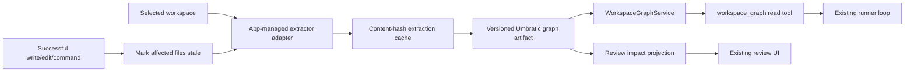

# Graph-Aware Workspace Intelligence Implementation Plan

## Outcome

Add a local, source-backed workspace graph to UmbraticCode that improves architecture discovery and review impact analysis without changing the Veil trust boundary or making the app dependent on Graphify's full product surface.

This plan implements the recommendations in [[Graphify Deep Dive - Best Ideas for UmbraticCode]].

## Non-negotiable architecture boundaries

1. **Runner owns workspace facts.** Extraction, cache access, graph traversal, and source-path validation belong in `packages/runner` or an app-managed local helper.
2. **Veil owns model behavior.** No graph-generated prompt, skill-selection heuristic, or model policy belongs in Electron or the runner.
3. **The graph is untrusted evidence.** Workspace labels, comments, and document text are sanitized, bounded, and returned as quoted data with provenance.
4. **No MCP or second agent loop.** The graph is exposed through Umbratic's existing typed tool registry.
5. **No required remote semantic pass.** The first release indexes code and deterministic rationale locally.
6. **No persistent background automation.** Refresh while a workspace/task is active, on explicit request, and after known successful mutations.
7. **Search/read remain the fallback and source of truth.** A missing, stale, or degraded graph must never block a task.

## Target architecture



The graph artifact should live in an app-managed local data directory, keyed by a hash of the canonical workspace path and repository identity, rather than in the repository. This avoids dirtying worktrees and prevents a generated artifact from being accidentally committed. The runner config should receive the approved cache root explicitly; it must not infer arbitrary external paths.

## Product contract

### Model-facing tool

Add one read-only tool rather than several graph-specific tools:

```ts
type WorkspaceGraphArgs =
  | { action: "summary" }
  | { action: "query"; query: string; depth?: number; limit?: number }
  | { action: "explain"; symbol: string; limit?: number }
  | { action: "path"; from: string; to: string; maxDepth?: number }
  | { action: "affected"; files?: string[]; symbols?: string[]; depth?: number; direction?: "incoming" | "outgoing" | "both" };
```

The result envelope should be stable and concise:

```ts
type WorkspaceGraphResult = {
  schemaVersion: 1;
  graphRevision: string;
  freshness: "fresh" | "stale" | "building" | "degraded";
  generatedAt: string;
  summary: string;
  nodes: GraphNodeEvidence[];
  edges: GraphEdgeEvidence[];
  truncation?: { nodeLimit: number; edgeLimit: number; omitted: boolean };
  warnings: string[];
};
```

Every node/edge returned to the model must include source location when known. Every edge must include `confidence: "extracted" | "inferred" | "ambiguous"` and an `evidence` field that explains the extractor or resolver rule.

### Review projection

For a review patch, compute:

- changed symbols by intersecting diff hunks with indexed source ranges;
- incoming dependents and outgoing dependencies within a small depth;
- directly connected tests;
- touched architectural communities and cross-community bridges;
- uncertainty and staleness warnings.

The first UI version should be a compact “Potential impact” section in the existing review panel. It should show counts and a short ranked list, with source navigation. It must not render a full force graph.

## Internal data contract

Start with a versioned JSON artifact. Move to SQLite only when measured workspace size or update latency requires it.

```ts
type WorkspaceGraphV1 = {
  schemaVersion: 1;
  workspaceFingerprint: string;
  revision: string;
  builtAt: string;
  extractor: { id: string; version: string };
  files: Record<string, { hash: string; size: number; language?: string; indexedAt: string }>;
  nodes: GraphNodeV1[];
  edges: GraphEdgeV1[];
  communities?: GraphCommunityV1[];
};
```

Node IDs must be stable and namespaced, for example:

```text
file:<normalized-relative-path>
symbol:<normalized-relative-path>:<kind>:<qualified-name>:<start-line>
rationale:<normalized-relative-path>:<start-line>:<content-hash-prefix>
package:<ecosystem>:<normalized-name>
```

Path identity must use normalized workspace-relative paths. Absolute paths must never enter the artifact or telemetry.

## Implementation phases

### Phase 0 — Evaluation contract and dependency decision

**Purpose:** establish whether graph retrieval helps Umbratic before committing to a large extraction subsystem.

Add:

- `packages/runner/tests/fixtures/workspace-graph/` with small TypeScript, Go, Python, and mixed-language repositories;
- a task set for architecture, path, dependency, change-impact, and “no answer in graph” questions;
- baseline results using current `search` + `read`;
- graph-assisted results with identical model, turn, and token limits.

Measure:

- key-fact coverage;
- source-location correctness;
- unsupported or false relationships;
- tokens sent to the model;
- time to first useful evidence;
- index build and refresh latency;
- peak memory and artifact size.

Decide whether the first extractor is:

1. a pinned Graphify package in the app-managed Python runtime;
2. a smaller Tree-sitter helper built specifically for Umbratic;
3. a hybrid: Graphify adapter for evaluation, followed by a focused maintained extractor.

Requirements for a Graphify adapter:

- pin package/version and verify hashes through the supply-chain policy;
- retain the MIT license and attribution;
- invoke it through a dedicated argument-array process API, never a shell string;
- normalize its output into `WorkspaceGraphV1`;
- enforce timeout, memory/artifact-size limits, and process cancellation;
- treat output as untrusted and schema-validate it before storage.

**Exit criteria**

- The evaluation fixtures and scoring script are reproducible.
- Graph-assisted retrieval improves either correctness or token cost materially on the selected task set.
- The extractor dependency decision and supported language floor are recorded.

### Phase 1 — Graph artifact reader and query engine

**Purpose:** build the stable product boundary before automatic extraction.

Add under `packages/runner/src/workspaceGraph/`:

- `types.ts` — versioned graph and evidence types;
- `schema.ts` — runtime validation and migration dispatch;
- `store.ts` — atomic load/save, size cap, corruption quarantine;
- `index.ts` — node, label, file, and adjacency indexes;
- `query.ts` — seed scoring plus bounded traversal;
- `explain.ts` — node and edge evidence formatting;
- `path.ts` — bounded shortest-path search;
- `affected.ts` — changed-file/symbol traversal;
- `format.ts` — token/byte-bounded model output;
- `service.ts` — freshness and concurrency facade.

Use deterministic ordering everywhere. Query ranking should combine:

- exact/qualified symbol match;
- filename/path match;
- definition and source-location evidence;
- current git status and recent-read boost from the existing file index;
- limited graph centrality;
- confidence penalty for inferred/ambiguous edges.

Do not let centrality dominate exact matches. Avoid returning high-degree utility nodes merely because they connect broadly.

**Exit criteria**

- Version 1 fixtures load deterministically.
- Corrupt, oversized, or unknown-version artifacts fail closed and preserve search/read fallback.
- Query, explain, path, and affected results are stable across repeated runs.
- Every output respects node, edge, byte, and traversal-depth limits.

### Phase 2 — Register `workspace_graph` in the current tool runtime

**Purpose:** expose graph evidence without changing the runner loop.

Change:

- `packages/runner/src/tools/definitions.ts` — add the read-only definition;
- `packages/runner/src/tools/types.ts` and config types — add the tool name;
- `packages/runner/src/tools/planner.ts` — expose it only when the graph service is configured;
- `packages/runner/src/session.ts` — attach one workspace graph service per session/workspace;
- desktop tool settings/types only if the capability is user-toggleable;
- runner event types for build/freshness events, not raw graph content.

The definition should use:

- `risk: "read"`;
- `executionMode: "parallel"`;
- `exposure: "direct"`;
- strict discriminated argument validation;
- a description that tells the model to verify exact code with `read` before editing.

Pass results through the existing result finalizer and context compression. Add a `graph` content kind or use structured JSON summarization only if it preserves source locations and confidence labels.

**Exit criteria**

- The tool is advertised and executable from the same per-turn tool plan.
- It cannot read a graph for a different workspace.
- Stale/unavailable states return useful model-visible warnings, not exceptions that end the task.
- Existing search/read/tool tests remain unchanged in behavior.

### Phase 3 — App-managed deterministic extraction

**Purpose:** build and refresh the graph automatically.

Add an extractor adapter interface:

```ts
interface WorkspaceGraphExtractor {
  readonly id: string;
  readonly version: string;
  probe(): Promise<ExtractorCapability>;
  extract(input: ExtractRequest, signal: AbortSignal): Promise<ExtractionFragment[]>;
}
```

The adapter must receive a manifest of approved workspace-relative files from the existing `WorkspaceIndex`; it must not perform an unconstrained second filesystem crawl. Reuse `shouldSkipEntry`, `pathInside`, binary checks, and maximum-file-size policy.

Add content-hash caching:

- hash file bodies with SHA-256;
- cache one validated extraction fragment per file hash and extractor version;
- rebuild the derived graph from live fragments;
- remove fragments for deleted files;
- invalidate only extractor-version-incompatible entries;
- write the final artifact atomically through a temporary file and rename.

Refresh triggers:

- workspace/task activation when no graph exists;
- explicit user/model refresh request;
- debounced refresh after successful `write` or `edit`;
- after `command` only when Git status or indexed file metadata changed;
- before review impact analysis if the graph is stale and refresh fits the latency budget.

Do not run a permanent watcher after the app/task closes.

**Exit criteria**

- Unchanged workspaces perform no extraction work after hash validation.
- One changed file re-extracts only that file plus required resolver scope.
- Cancellation leaves the previous valid graph intact.
- No generated file appears in the selected repository.
- Unsupported languages degrade to file/package-level nodes rather than failing the build.

### Phase 4 — Cross-file resolution and confidence discipline

**Purpose:** make relationships useful without overstating certainty.

Start with a narrow relation vocabulary:

- `contains`;
- `imports` / `imports_from`;
- `calls`;
- `inherits` / `implements`;
- `references`;
- `depends_on`;
- `declared_in`;
- `tested_by`;
- `documents` / `justifies`.

Rules:

- direct syntax evidence is `extracted`;
- resolution with one type-qualified target may be `extracted` or high-confidence `inferred`, depending on language guarantees;
- name-only cross-file matching is `inferred` and must include the rule used;
- multiple plausible targets are `ambiguous`, never silently duplicated as facts;
- cross-language `calls`/`uses` require explicit bridge evidence;
- source ranges and file hashes must correspond to the graph revision.

Add deterministic rationale extraction for `WHY`, `NOTE`, `SAFETY`, `SECURITY`, ADR, RFC, and repository-instruction references. Do not summarize free-form documents with a model in this phase.

**Exit criteria**

- Every edge has confidence, evidence rule, and at least one source reference.
- Resolver precision is measured per supported language fixture.
- Ambiguous matches are surfaced but excluded from default impact traversal unless requested.

### Phase 5 — Diff-aware review impact

**Purpose:** connect the graph to Umbratic's strongest existing product flow.

Add a shared review-impact contract under `apps/desktop/src/shared/` and compute it in the main/runner boundary from:

- normalized review files and hunks;
- the graph revision and indexed symbol ranges;
- a bounded incoming/outgoing traversal;
- test-path heuristics and explicit test relationships.

Rank findings by:

1. direct changed-symbol match;
2. one-hop extracted incoming dependency;
3. connected test evidence;
4. cross-community bridge touched;
5. deeper or inferred relationships.

Add a restrained section to `apps/desktop/src/renderer/review/ReviewPanel.tsx`:

- freshness label;
- changed symbols count;
- likely dependents;
- related tests;
- warnings for ambiguous/stale evidence;
- click to open the exact file/line through existing IDE launch behavior.

Do not add a graph canvas in this phase. Follow the desktop `AGENTS.md` requirements for light/dark mode, keyboard navigation, empty/loading/error states, truncation, reduced motion, and realistic-window visual verification.

**Exit criteria**

- The impact section is absent or calmly empty when no graph exists.
- A stale graph is never presented as current.
- Every visible finding navigates to source or explains why no location is available.
- Review loading does not block on a full rebuild beyond the defined latency budget.

### Phase 6 — Architecture briefing and graph diff

**Purpose:** improve task cold starts after core graph quality is proven.

Compute and cache:

- central symbols with synthetic/noise-node filtering;
- weakly connected components and communities;
- cross-community bridges;
- import cycles;
- graph statistics and confidence distribution;
- diff from the prior successful graph revision.

Expose these through `workspace_graph { action: "summary" }`. Optionally show a compact project “Code map” view after review impact has production evidence.

Community detection must be deterministic for unchanged graph topology. If a new dependency is introduced, prefer a small audited implementation or extractor-provided community labels over pulling a large graph stack into the desktop bundle.

**Exit criteria**

- Briefings cite concrete symbols and files.
- Graph revisions produce stable diffs.
- Noise filters prevent files, primitives, mocks, and generic configuration keys from dominating hubs.

### Phase 7 — Optional semantic enrichment, only under policy

This phase is optional and should require a separate privacy/product decision.

If implemented:

- Veil owns the protected extraction prompt and route;
- the user/admin explicitly enables document semantic indexing;
- content never bypasses the configured private Veil boundary;
- semantic nodes/edges are always `inferred` with model and prompt-policy version metadata;
- code remains on the deterministic local path;
- deletion and retention policies cover semantic cache entries;
- telemetry records only counts, durations, and version hashes.

This phase is not required for code intelligence, impact review, or architecture summaries.

## Files likely to change

| Area | Files |
|---|---|
| Graph core | new `packages/runner/src/workspaceGraph/*` |
| Tool exposure | `packages/runner/src/tools/definitions.ts`, `types.ts`, `planner.ts`, `plan.ts` |
| Session/config | `packages/runner/src/session.ts`, `config.ts`, server request validation |
| Existing file index | `packages/runner/src/tools/workspaceIndex.ts` for hash/manifest hooks, while keeping responsibilities separate |
| Context/result shaping | `packages/runner/src/context/*`, `packages/runner/src/tools/results.ts` |
| Events/telemetry | `packages/runner/src/events.ts`, desktop event adapter, redacted telemetry summaries |
| Capability probe | `apps/desktop/src/main/capabilities.ts` |
| Review contract | `apps/desktop/src/shared/reviewDiff.ts` plus a new graph-impact contract |
| Review UI | `apps/desktop/src/renderer/review/ReviewPanel.tsx` and nearby components/styles |
| Packaging | desktop packaging scripts and supply-chain policy if an extractor runtime is bundled |

## Testing strategy

### Unit tests

- schema version validation and migration rejection;
- stable node IDs and normalized paths;
- content-hash cache hit/miss/delete behavior;
- extracted/inferred/ambiguous relation rules;
- seed ranking, confidence penalties, traversal direction, and caps;
- shortest paths with cycles and disconnected nodes;
- changed-hunk to symbol-range mapping;
- output sanitization, byte caps, and deterministic ordering;
- graph corruption and oversized-artifact handling.

### Integration tests

- build, query, edit one file, incrementally refresh, and query the new revision;
- cancel extraction and retain the prior valid graph;
- mixed parallel `workspace_graph`, `search`, and `read` calls;
- graph unavailable/degraded while a normal task succeeds through search/read;
- worktree review impact against staged, unstaged, added, renamed, and deleted files;
- workspace A cannot load workspace B's artifact;
- provider history and context compaction preserve graph evidence.

### Security tests

- symlink and path traversal attempts;
- malicious labels containing control characters, HTML, Markdown fences, or prompt-like instructions;
- crafted huge node/edge arrays and adjacency explosions;
- corrupt cache fragments and partial atomic writes;
- extractor process timeout, crash, output flood, and cancellation;
- no absolute paths, snippets, or labels in exported telemetry.

### Product evaluation

Maintain a small representative repository suite and compare:

- current search/read only;
- graph query followed by read;
- graph impact review versus human-identified affected files/tests.

Do not enable graph-first guidance by default unless it improves measured outcomes without unacceptable false-confidence failures.

## Telemetry and privacy

Allowed redacted fields:

- extractor ID/version hash;
- graph schema version and revision hash prefix;
- file/node/edge/community counts;
- confidence distribution counts;
- cache hits/misses;
- build/query durations and outcome codes;
- artifact byte size;
- freshness at query/review time;
- result counts and truncation flags.

Forbidden fields:

- absolute or relative source paths;
- symbol/node labels;
- source snippets or rationale text;
- raw queries when they may contain code or secrets;
- graph artifacts or adjacency lists.

## Rollout

1. Ship the graph reader/query engine behind a development capability flag with fixtures only.
2. Add the pinned extractor adapter and evaluate on local representative projects.
3. Enable `workspace_graph` for internal builds when the graph is ready; retain transparent search/read fallback.
4. Add review impact behind a separate flag and compare findings with actual reviewer behavior.
5. Make graph indexing a default local capability only after latency, precision, artifact size, and failure behavior meet thresholds.
6. Add architecture briefing; consider visualization and semantic documents later.

The capability should be removable without changing the core runner loop. Avoid persisting a permanent user-facing toggle until there is a real administrative or performance need.

## Risks and mitigations

| Risk | Mitigation |
|---|---|
| False call/dependency edges | Confidence/evidence fields, conservative resolver, source verification |
| Stale graph after commands | Git/file metadata dirty check, freshness labels, bounded refresh |
| Large monorepo cost | File/language caps, incremental cache, partial index, graceful degradation |
| Runtime/package bloat | Adapter boundary, pinned optional extractor, measured supported-language floor |
| Prompt injection from labels/comments | Sanitize and quote evidence; never inject into system prompts |
| Review UI overload | Ranked compact section with progressive disclosure |
| Graph becomes a second truth system | Keep source hashes/locations; require `read` before edits |
| Active worktree conflicts | Implement in small phases against current files and characterization tests |

## Definition of done

The first production milestone is complete when:

- Umbratic builds a versioned local graph without writing generated files into the repository;
- unchanged files are served from a content-hash cache;
- every relation has source provenance, evidence rule, and confidence;
- one typed read-only tool provides summary, query, explain, path, and affected actions;
- graph output is bounded, sanitized, deterministic, and compatible with current context compression;
- graph absence, corruption, staleness, or unsupported languages never blocks search/read workflows;
- review can show source-linked likely dependents and tests for changed symbols;
- all graph data remains local and telemetry contains only redacted aggregate facts;
- focused tests, `npm run test:all`, and `npm run desktop:build` pass;
- visual review covers the impact panel's light/dark, loading, empty, stale, error, keyboard, and reduced-motion states.

## Recommended first milestone

> [!todo] Milestone 1: evidence before automation
> Implement the graph schema, fixture loader, query/explain/path/affected engine, and `workspace_graph` tool against checked-in fixtures. Run the evaluation against current `search` + `read`. Only then choose and package the automatic extractor.

This sequence tests the user value and product contract before taking on the largest dependency and packaging risk.
