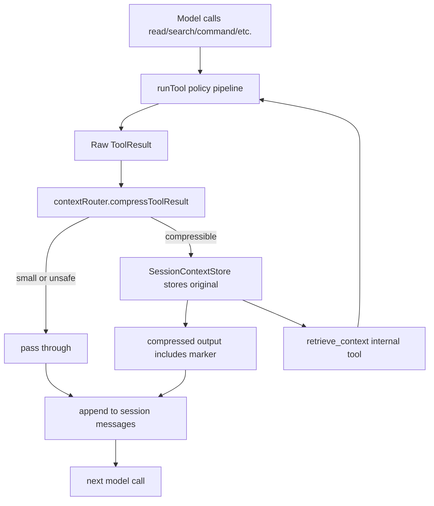

# Headroom Patterns Implementation Plan

## Goal

Add the highest-value Headroom lessons to Umbratic without importing Headroom's full codebase or product surface.

The implementation should be:

- local-first
- TypeScript-first in the runner
- deterministic
- reversible when it drops information
- dependency-light
- compatible with Veil as the only managed model boundary
- specific to Umbratic's current tools and review workflow

This plan builds on [[Headroom and UmbraticAI Learnings]], [[Context Length Calculation Implementation Plan]], and [[FFF Search and Read Implementation Plan]].

## Guiding decisions

1. Do not add Headroom as a runtime dependency.
2. Do not add ML compression, Rust/PyO3, or native binaries in the first pass.
3. Do not add a second model proxy beside Veil.
4. Do not broaden the public tool surface beyond what Umbratic needs.
5. Prefer reversible compaction over lossy summarization.
6. Keep prompts stable, but do not over-optimize for provider prefix caching before local context correctness works.
7. Store raw originals only in the task-local runner process unless a later reviewed design adds persistence.

## Target architecture



The implementation lives mostly in `UmbraticAI/packages/runner`. Desktop and Veil changes are small telemetry and prompt-boundary updates.

## Phase 1: Context unit model

Add `UmbraticAI/packages/runner/src/context/types.ts`.

Suggested types:

```ts
export type ContextContentKind =
  | "search"
  | "directory"
  | "file"
  | "command"
  | "json"
  | "log"
  | "diff"
  | "plain_text";

export type ContextCompressionStrategy =
  | "passthrough"
  | "search_top_lines"
  | "directory_grouped"
  | "log_errors_tail"
  | "json_array_sample"
  | "text_head_tail"
  | "tool_history_summary";

export type ContextCompressionResult = {
  output: string;
  modified: boolean;
  strategy: ContextCompressionStrategy;
  kind: ContextContentKind;
  originalBytes: number;
  outputBytes: number;
  markerHash?: string;
  reason?: string;
};
```

Keep all constants in one file:

- minimum bytes before compression
- maximum displayed output bytes
- maximum stored original bytes
- maximum entries per session
- TTL seconds
- line windows for logs and reads

Use byte/char estimates first. Token estimates can come from [[Context Length Calculation Implementation Plan]].

## Phase 2: SessionContextStore

Add `UmbraticAI/packages/runner/src/context/sessionContextStore.ts`.

Responsibilities:

- store original tool output by hash
- include metadata: tool call id, tool name, title, strategy, kind, byte counts, created time
- expire entries by TTL
- cap entry count with oldest-entry eviction
- cap stored original size
- return windows of the original content so retrieval cannot explode the next context

Suggested API:

```ts
export type StoredContextEntry = {
  hash: string;
  toolCallId: string;
  toolName: string;
  title: string;
  original: string;
  compressed: string;
  kind: ContextContentKind;
  strategy: ContextCompressionStrategy;
  originalBytes: number;
  compressedBytes: number;
  createdAtMs: number;
  retrievalCount: number;
};

export class SessionContextStore {
  store(input: Omit<StoredContextEntry, "hash" | "createdAtMs" | "retrievalCount">): StoredContextEntry;
  retrieve(hash: string, options?: { offset?: number; limit?: number }): StoredContextEntry | null;
  hasEntries(): boolean;
  stats(): { entries: number; storedBytes: number };
}
```

Hashing:

- use `sha256(original).slice(0, 16)` or `slice(0, 24)`
- detect accidental collision by comparing original content
- fail loudly on impossible collision instead of silently overwriting

Persistence:

- no disk in MVP
- no cross-task or cross-user memory
- entries die when the runner process exits

## Phase 3: Marker format and retrieval tool

Add `UmbraticAI/packages/runner/src/context/markers.ts`.

Suggested marker:

```text
<<umbratic-context:HASH kind=log strategy=log_errors_tail originalBytes=48122 shownBytes=11204>>
```

Compressed output should end with a short instruction:

```text
Use retrieve_context with hash HASH if exact omitted output is required.
```

Add an internal tool:

```ts
retrieve_context({
  hash: string,
  offset?: number,
  limit?: number
})
```

Implementation options:

1. Add `retrieve_context` to `toolSpecs` but hide it unless `session.contextStore.hasEntries()`.
2. Keep it outside user-toggleable `RunnerToolName` so it cannot be disabled accidentally.
3. In `runTool()`, handle `retrieve_context` before the normal enabled-tool check.

Recommended first shape:

- add `internalToolSpecs(session)` in `tools/index.ts`
- update `enabledModelToolSpecs(enabledTools, options)` to include `retrieve_context` when `options.includeContextRetrieval` is true
- update `runTool(ctx, emit, toolCall)` so `ctx.contextStore` is optional and internal retrieval is handled first

Example retrieval output:

```text
Retrieved context HASH
Kind: log
Strategy: log_errors_tail
Bytes shown: 0-12000 of 48122

...
```

For safety, retrieval still returns a bounded window. The model can ask for another offset if needed.

## Phase 4: Content router lite

Add `UmbraticAI/packages/runner/src/context/contentRouter.ts`.

Input:

```ts
compressToolResult(input: {
  toolName: string;
  toolCallId: string;
  title: string;
  output: string;
  status: ToolResultStatus;
  contextStore: SessionContextStore;
}): ContextCompressionResult
```

Rules:

- If status is not success, preserve the full error up to the current byte limit.
- If output is small, passthrough.
- If output includes blocked-path or secret redaction markers, do not store raw output unless it is already redacted.
- If parsing fails, passthrough or head/tail with retrieval marker.
- Always preserve command exit code, final stderr lines, first error lines, and failing test names.

Strategies:

### `search_top_lines`

Use for `search`.

- Keep all results if small.
- If large, keep first N path hits and first N content hits.
- Preserve file paths and line numbers exactly.
- Store full original for retrieval.

### `directory_grouped`

Use for `read` when title is a directory or output starts with `Directory:`.

- Preserve directory name, depth, entries shown, total, and listing status.
- Group many files by top-level directory.
- Keep explicit continuation offset if listing is partial.
- Store full listing.

### `log_errors_tail`

Use for `command`.

- Preserve command title, exit code, and status.
- Keep first 40 lines.
- Keep lines matching error/fail/exception/panic/traceback/warning.
- Keep last 80 lines.
- Deduplicate repeated identical lines after a small threshold.
- Store full redacted output.

### `json_array_sample`

Use when output parses as JSON array or object with a large array.

- Keep schema/keys visible.
- Keep first few and last few items.
- Preserve items with error/status/failure fields.
- Preserve unique-looking IDs and counts.
- Store original JSON.

### `text_head_tail`

Use for generic large text.

- Keep heading/title lines.
- Keep first section and last section.
- Add retrieval marker.

Do not implement code AST compression in MVP. Umbratic's `read` already gives line windows, and source files should be re-read exactly when needed.

## Phase 5: Wire into runner loop

Update `UmbraticAI/packages/runner/src/session.ts`:

- add `contextStore: SessionContextStore` to `Session`

Update `UmbraticAI/packages/runner/src/loop.ts`:

- build model tool specs with `includeContextRetrieval: session.contextStore.hasEntries()`
- after each `runTool()` returns, pass the result through `compressToolResult`
- store compressed output in `toolResults`
- emit context events when compression or retrieval happens
- use compressed output in `formatToolResultContent()` and `formatToolContextMessage()`

Important order:

1. tool executes
2. tool output is redacted by existing code
3. context router compresses the redacted output
4. original redacted output is stored in `SessionContextStore`
5. compressed output is appended to the conversation

That preserves the existing secret-redaction boundary.

## Phase 6: Events and diagnostics

Update `UmbraticAI/packages/runner/src/events.ts`.

Add:

```ts
| {
    type: "context.compressed";
    taskId: string;
    toolCallId: string;
    toolKind: string;
    kind: ContextContentKind;
    strategy: ContextCompressionStrategy;
    hash?: string;
    originalBytes: number;
    outputBytes: number;
    at: string;
  }
| {
    type: "context.retrieved";
    taskId: string;
    toolCallId: string;
    hash: string;
    offset: number;
    bytesShown: number;
    totalBytes: number;
    at: string;
  }
```

Update `diagnostics.ts`:

- write event type, tool kind, strategy, byte counts, hash prefix
- do not write raw original or compressed content

Update `apps/desktop/src/main/main.ts`:

- translate runner context events into backend UI events
- no visible UI required in MVP, but task history can show concise status if useful

Update `apps/desktop/src/main/telemetry.ts`:

- count compression events by strategy and kind
- count total original/output bytes
- count retrieval events
- include retrieval rate per task

## Phase 7: Budget-aware compaction

Use [[Context Length Calculation Implementation Plan]] for the budget manager. Add the Headroom-specific rule:

- compress live-zone oversized tool outputs before trimming old history
- when old tool history is compacted, prefer replacing it with summaries that point to context hashes if the originals are still in the session store
- never orphan assistant tool-call messages from their tool result messages

In `loop.ts`, the sequence should become:

1. build tool specs
2. compact old structured tool history by current logic
3. run token/byte budget trim
4. send to Veil

Later, Veil can add its final guard after protected prompt injection.

## Phase 8: Prompt section stability

Keep Veil protected prompts as the stable policy source.

In desktop prompt assembly:

- keep headings stable
- keep "User request" at the end
- keep volatile workspace previews and capability probes in their own sections
- do not include timestamps unless needed
- continue including full skill instructions only for explicit request or strong match

Add one runner/Veil instruction:

```text
When a tool result contains an umbratic-context marker, use retrieve_context only if the exact omitted content is necessary. Do not retrieve just to restate output.
```

Do not expose compression internals to the final user answer unless they explain a limitation or retrieval was necessary.

## Phase 9: Failure-learning proposals

After the context store is stable, add a reviewable learning pass.

Input sources:

- failed tasks
- `required_tool.failed`
- repeated permission denials
- repeated command failures by class
- repeated context retrievals after the same strategy

Output:

- a proposed edit to a system skill
- or a new local skill draft
- never auto-apply without review

This can live in desktop first:

- `apps/desktop/src/main/learning.ts`
- "suggest skill update" UI action later

Do not implement background jobs or durable memory in MVP.

## Phase 10: Tests

Runner tests:

- small output passes through
- large command output compresses with marker
- failures preserve error lines
- JSON arrays keep first/last/error rows
- directory output keeps listing status
- retrieve_context returns bounded original window
- retrieve_context is not visible before a context entry exists
- retrieval of unknown hash returns validation error
- context store evicts old entries
- redacted output is what gets stored
- old structured tool history remains valid after compaction

Desktop tests:

- runner context events convert into UI events
- telemetry bundle summarizes compression without raw text
- required-tool contract still works when tool outputs are compressed
- review-ready state still derives from actual file diffs, not compressed messages

Veil tests:

- existing request policy still rejects `system` and `model`
- tools pass through unchanged
- message byte limits still protect the server

Supply-chain tests:

- `npm run supply-chain:check`
- no new install scripts
- no non-exact dependency specs

## Acceptance criteria

- The model-visible ordinary tool surface remains read/write/edit/search/command plus temporary `retrieve_context` only when compressed context exists.
- Large tool outputs are not silently clipped without a retrieval path.
- Context compression never returns blocked secrets that existing tools would refuse.
- Failed command/test diagnostics remain visible without retrieval.
- Redacted telemetry reports strategy counts and byte savings, not raw prompt/tool text.
- Runner tests pass.
- Desktop tests pass.
- Veil tests pass.
- `npm run test:all` passes before merge.

## Non-goals

- No Headroom proxy.
- No ML compression.
- No image compression router.
- No persistent memory database.
- No cross-agent shared context.
- No public MCP or connector expansion.
- No native compression binaries.
- No automatic skill mutation.
- No savings dashboard in MVP.

## Implementation order

1. Add `context/types.ts`, `context/sessionContextStore.ts`, and `context/markers.ts`.
2. Add `retrieve_context` as an internal runner tool.
3. Add `contentRouter.ts` with command/log and text head-tail strategies first.
4. Wire compression into `loop.ts` after tool execution.
5. Add context events and diagnostics.
6. Add telemetry summaries.
7. Add JSON/directory/search-specific strategies.
8. Integrate token-budget trimming from [[Context Length Calculation Implementation Plan]].
9. Add prompt guidance for retrieval markers.
10. Add reviewable failure-learning proposals later.

## First-pass file map

Runner:

- `UmbraticAI/packages/runner/src/context/types.ts`
- `UmbraticAI/packages/runner/src/context/markers.ts`
- `UmbraticAI/packages/runner/src/context/sessionContextStore.ts`
- `UmbraticAI/packages/runner/src/context/contentRouter.ts`
- `UmbraticAI/packages/runner/src/session.ts`
- `UmbraticAI/packages/runner/src/loop.ts`
- `UmbraticAI/packages/runner/src/tools/index.ts`
- `UmbraticAI/packages/runner/src/tools/common.ts`
- `UmbraticAI/packages/runner/src/events.ts`
- `UmbraticAI/packages/runner/src/diagnostics.ts`

Desktop:

- `UmbraticAI/apps/desktop/src/main/main.ts`
- `UmbraticAI/apps/desktop/src/main/types.ts`
- `UmbraticAI/apps/desktop/src/main/telemetry.ts`

Veil:

- no MVP code change required beyond existing tests
- later: final context guard after protected prompt injection

## Summary

The smallest useful Headroom import is not code. It is a runtime pattern:

```text
large tool output -> content-aware compaction -> local original store -> retrieval marker -> retrieval tool -> telemetry feedback
```

That pattern fits UmbraticAI's current runner and review architecture cleanly. It keeps Umbratic lightweight while making tool-heavy tasks less brittle and less wasteful.

