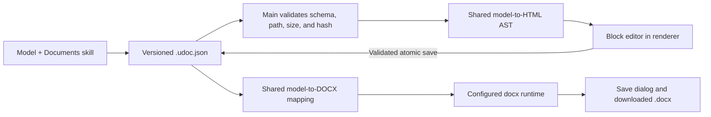

# In-composer document drafting and revision implementation plan

> [!summary]
> Make a document draft a small, versioned text artifact that Umbratic can render as safe HTML, edit directly inside the composer, and export as DOCX. Adapt only the useful semantic-model and HTML-rendering logic from the checked-in `mammoth.js` source. Do not install Mammoth, ship the copied repository, parse arbitrary DOCX, or edit OOXML.

## Plan at a glance

| Item | Decision |
|---|---|
| Status | `DRAFT` — implementation and verification have not started |
| Target | `UmbraticCode/apps/desktop` |
| Source of truth | `.umbratic/artifacts/docx/<name>.udoc.json` |
| User experience | Rendered document editor inside the conversation |
| Export | User chooses `Download DOCX…`; Electron main generates the file |
| Mammoth use | Adapt a small semantic model, node-to-HTML dispatch, node collapsing, and escaping |
| Mammoth revision | `mammoth.js` commit `1a495a98856180e25d3b166b51319b165e0ce348`, version `1.12.0` |
| Explicit exclusion | No Mammoth package, DOCX unzip/XML import path, or arbitrary HTML |
| Existing DOCX | Continue to open externally; direct import/edit is deferred |

## Outcome

When a model creates a composer document draft, the conversation shows a document card. Opening it displays a calm document editor that looks like formatted HTML rather than JSON. The user can type directly, change a paragraph style, edit lists and tables, undo local edits, and download the current version as a DOCX.

The editable source is a normal JSON text file with a small semantic document model. HTML and DOCX are two deterministic views of that source:

- the renderer converts the model to safe HTML/React nodes for editing;
- Electron main converts the same model to DOCX through the configured `docx` authoring runtime.

There is no round-trip through generated HTML and no attempt to turn HTML back into a Mammoth document. The semantic model remains authoritative.

## Success looks like

- [ ] The Documents skill creates a valid `.udoc.json` artifact when the composer draft harness is available.
- [ ] The card opens under the correct assistant turn and displays the formatted document.
- [ ] Typing, paste-as-plain-text, paragraph styles, lists, links, and table-cell edits update the source without exposing JSON.
- [ ] Autosave is atomic, rejects a stale source hash, and never accepts an arbitrary path.
- [ ] Undo/redo works for the current editing session.
- [ ] `Download DOCX…` writes a structurally valid DOCX to a user-selected location.
- [ ] Headings, paragraphs, inline emphasis, links, lists, line/page breaks, and simple tables match between the composer and DOCX.
- [ ] The renderer never executes document HTML, scripts, styles, URLs, or event handlers.
- [ ] Existing composer, review, attachment, and direct DOCX workflows remain intact.
- [ ] Focused tests, desktop build/test gates, and one realistic create-edit-download walkthrough pass.

## Scope

### Included

- New composer-native documents created as `.udoc.json`.
- Direct user editing of semantic document blocks.
- Title, subtitle, headings 1–3, normal paragraphs, quotes, code blocks, ordered/unordered lists, simple tables, links, bold, italic, underline, strike, subscript, superscript, line breaks, and page breaks.
- Existing Umbratic design presets.
- Atomic save, stale-file protection, copy, undo/redo, and DOCX download.

### Deferred

- Importing or editing arbitrary `.docx` files.
- Images, drawings, text boxes, comments, tracked changes, footnotes/endnotes, fields, bookmarks, forms, headers/footers authored per document, and custom OOXML.
- Full Word pagination or layout inside the composer.
- Arbitrary CSS, inline style strings, embedded HTML, scripts, remote resources, or unsupported URLs.
- Collaboration and simultaneous multi-user editing.

Existing DOCX files retain `Open externally`. Advanced DOCX work and supplied-template edits continue through the existing DOCX-first skill workflow.

## User experience

### Main flow

1. The model creates `proposal.udoc.json`.
2. The completed assistant turn shows a `Proposal` document card with `Open`, `Copy`, and `Download DOCX…`.
3. `Open` displays the formatted document in the conversation body while the prompt remains visible.
4. Clicking a block places a caret in that block. A restrained toolbar changes its semantic role or inline emphasis.
5. Edits save automatically after a short debounce. `Saved`, `Saving…`, `Unsaved`, and `Conflict` are visible text states.
6. `Download DOCX…` validates the latest saved version, opens the operating-system save dialog, generates the DOCX, and reports success or a useful failure.

### Layout

```text
┌──────────────────── Document editor ─────────────────────────────┐
│ ← Conversation       Proposal             Saved      Download ▾ │
│ [Normal ▾] [Bold] [Italic] [Link] [List] [Undo] [Redo]          │
│                                                                 │
│ Proposal title                                                  │
│ A formatted, directly editable paragraph…                       │
│                                                                 │
│ • A list item                                                   │
│ • Another list item                                             │
│                                                                 │
├─────────────────────────────────────────────────────────────────┤
│ [ normal conversation prompt                              ] Send │
└─────────────────────────────────────────────────────────────────┘
```

### Editing rules

- Edit one paragraph, list item, code block, or table cell at a time.
- Use a block-scoped `contenteditable` surface, not one document-wide editable DOM.
- Accept plain text on paste. Do not accept pasted HTML or external images.
- Preserve inline marks while typing. Normalize the edited block back into the allowlisted inline model after each input.
- Enter splits a paragraph/list item; Backspace at an empty block merges or removes it; Tab/Shift+Tab changes list depth or table focus.
- Structural toolbar actions update the model; they do not run browser formatting commands.
- The JSON source is never shown in the default experience. A developer-only source view may be added later.
- Only the newest artifact version is editable. Historical cards are read-only.
- While the owning task is running, the editor is read-only. While it is awaiting review, a successful autosave refreshes the existing review metadata so approval includes the user's edit.

### Required states

| State | Behavior |
|---|---|
| Loading | Show the document name and progress; allow returning to conversation |
| Invalid source | Explain that the draft cannot be opened and offer external/source-file open |
| Saving | Keep editing available and show `Saving…` |
| Save conflict | Stop autosave, preserve local edits, and offer `Reload` or `Save a copy` |
| Export unavailable | Explain that the DOCX runtime is unavailable; keep editing and JSON copy available |
| Export failure | Preserve the draft and show a retryable error |
| Empty | Show one empty normal paragraph with the caret ready |

### Accessibility

- Use real headings, lists, tables, and textboxes in the rendered accessibility tree.
- Give the editor an accessible document name and each toolbar control an accessible name/state.
- Announce save, conflict, and download results through a polite live region.
- Keep toolbar focus separate from document selection and restore focus to the edited block.
- Verify keyboard-only use, visible focus, light/dark themes, 200% text scaling, and narrow/default/wide layouts.

## Architecture



### Ownership

| Concern | Owner |
|---|---|
| Draft schema, validation, normalization, IDs, and limits | Shared TypeScript |
| Card, safe HTML/React rendering, block editing, undo/redo, and save status | Renderer |
| Artifact membership, path/hash checks, atomic save, save dialog, and export | Electron main |
| DOCX construction and presets | Existing configured `docx` runtime plus an Umbratic adapter |
| Model authoring rules | `system-skills/umbratic-documents/SKILL.md` |

The renderer receives only validated draft data and document-specific IPC. It never receives general filesystem, process, dialog, or package-loading access.

## Canonical draft contract

Add `src/shared/documentDraft.ts` with a JSON-safe version of the useful Mammoth document model:

```ts
type DraftDocument = {
  schemaVersion: 1;
  id: string;
  title: string;
  fileName: string; // basename ending in .docx
  preset:
    | "standard_business_brief"
    | "compact_reference_guide"
    | "narrative_proposal"
    | "simple_word_default"
    | "form_or_questionnaire";
  children: DraftBlock[];
};

type DraftBlock =
  | {
      type: "paragraph";
      id: string;
      style: "title" | "subtitle" | "heading1" | "heading2" | "heading3" | "normal" | "quote" | "code";
      numbering?: { ordered: boolean; level: 0 | 1 | 2 | 3 };
      children: DraftInline[];
    }
  | { type: "table"; id: string; rows: DraftTableRow[] };

type DraftTableRow = {
  id: string;
  header: boolean;
  cells: Array<{
    id: string;
    colSpan?: number;
    rowSpan?: number;
    children: DraftBlock[];
  }>;
};

type DraftText = {
  type: "text";
  id: string;
  value: string;
  marks?: Array<"bold" | "italic" | "underline" | "strike" | "subscript" | "superscript">;
};

type DraftInline =
  | DraftText
  | { type: "link"; id: string; href: string; children: DraftText[] }
  | { type: "break"; id: string; kind: "line" | "page" };
```

Validation rules:

- Accept only `schemaVersion: 1`, known keys, known enum values, and unique stable IDs.
- Limit the source to 5 MiB, 5,000 blocks, 20,000 inline nodes, four list levels, and tables no larger than 100 rows × 20 columns.
- Require at least one paragraph; normalize an empty document to one empty normal paragraph.
- Allow links only for `https:`, `http:`, and `mailto:`. Add `rel="noreferrer noopener"` when opened.
- Allow links to contain text nodes only. Reject nested links, tables inside tables, page breaks inside tables, non-finite spans, and invalid Unicode.
- Preserve unknown future schema versions as files but do not open or rewrite them.

Use `SHA-256(canonicalJson)` as the optimistic-concurrency version. Canonical JSON uses stable key order and a trailing newline.

## Exactly what to adapt from Mammoth

Source: `mammoth.js` at commit `1a495a98856180e25d3b166b51319b165e0ce348`, BSD-2-Clause.

### Adapt

| Mammoth source | Logic to adapt | Umbratic destination |
|---|---|---|
| `lib/documents.js` | The small document/paragraph/run/text/link/table/break node vocabulary | `src/shared/documentDraft.ts` |
| `lib/document-to-html.js` | Type dispatch and converters for paragraphs, runs, text, links, tables, and breaks | `src/shared/documentDraftHtml.ts` |
| `lib/html/ast.js` | `element`, `text`, and void-element nodes | `src/shared/documentDraftHtml.ts` |
| `lib/html/simplify.js` | Remove empty nodes and collapse adjacent identical non-fresh inline elements | `src/shared/documentDraftHtml.ts` |
| `lib/writers/html-writer.js` | Text and attribute escaping rules | `src/shared/documentDraftHtml.ts` |
| `lib/options-reader.js` | Only the heading, normal paragraph, strong, and ordered/unordered list mappings | Constants in `src/shared/documentDraftHtml.ts` |

### Do not copy

- `lib/index.js`, `lib/main.js`, the CLI, promises/results wrappers, transforms, or Markdown writer.
- `lib/unzip.js`, `lib/zipfile.js`, any `lib/docx/**` or `lib/xml/**` code.
- Mammoth's dependencies, package metadata, browser bundle, tests, images, style-map parser, comments, notes, or embedded-file access.
- Any dynamic HTML writer feature that accepts tag names, attributes, styles, or callbacks from document data.

This keeps the adaptation small and prevents the feature from becoming a DOCX importer.

Retain the Mammoth BSD-2 copyright notice in each source file containing adapted code and add the full license to the product's third-party notices. Do not copy the entire `mammoth.js` directory into the application or package it.

## Required conversion logic

### Semantic model to safe HTML AST

Implement a fixed dispatch table. Tag names and attributes come from code, never from the document:

```ts
export function documentToHtmlAst(document: DraftDocument): HtmlNode[] {
  return simplifyHtml(groupNumberedParagraphs(document.children).flatMap(blockToHtml));
}

function blockToHtml(block: DraftBlock): HtmlNode[] {
  if (block.type === "table") return [convertTable(block)];
  if (block.numbering) return [convertListItem(block)];

  const tag = {
    title: "h1",
    subtitle: "p",
    heading1: "h2",
    heading2: "h3",
    heading3: "h4",
    normal: "p",
    quote: "blockquote",
    code: "pre",
  }[block.style];

  return [element(tag, safeAttributesFor(block), inlineToHtml(block.children), true)];
}

function inlineToHtml(nodes: DraftInline[]): HtmlNode[] {
  return nodes.flatMap((node) => {
    if (node.type === "break") return [element("br", {}, [], true)];
    if (node.type === "link") {
      return [element("a", safeLinkAttributes(node.href), inlineToHtml(node.children), false)];
    }

    let output: HtmlNode[] = [text(node.value)];
    for (const mark of orderedMarks(node.marks)) {
      output = [element(tagForMark(mark), {}, output, false)];
    }
    return output;
  });
}
```

Implement `convertTable`, `convertRow`, and `convertCell` with fixed `table`, `thead`, `tbody`, `tr`, `th`, and `td` tags. Clamp spans during validation, then stringify them. Group adjacent numbered paragraphs by `ordered` and `level`, producing nested `ol`/`ul` and `li` elements. Adapt Mammoth's fresh/non-fresh collapse rule so adjacent runs with the same mark become one element.

Render the resulting AST as React elements. Do not use `dangerouslySetInnerHTML`.

### Editable block normalization

Each editable block may produce only text, allowed inline tags, and `<br>`. Normalize the block DOM immediately after input:

```ts
function editableDomToInlineNodes(root: HTMLElement): DraftInline[] {
  return root.childNodes.flatMap((node) => {
    if (node.nodeType === Node.TEXT_NODE) return [draftText(node.textContent ?? "")];
    if (!(node instanceof HTMLElement)) return [];

    const tag = node.tagName.toLowerCase();
    if (tag === "br") return [draftBreak("line")];
    if (tag === "a") return safeLink(node.getAttribute("href"), editableDomToInlineNodes(node));
    if (ALLOWED_MARK_TAGS.has(tag)) return applyMark(tag, editableDomToInlineNodes(node));

    // Keep text from browser-inserted wrappers, but never keep their tag or attributes.
    return editableDomToInlineNodes(node);
  });
}
```

On paste, call `preventDefault()` and insert `clipboardData.getData("text/plain")`. Do not use `execCommand`, accept pasted HTML, or persist renderer-produced tag/attribute strings.

### Save

Expose:

```ts
saveDocumentDraft({
  taskId,
  artifactId,
  expectedHash,
  document,
}): Promise<{ hash: string; savedAt: string }>
```

Electron main must:

1. Resolve the artifact from the task-owned registry; never accept a path.
2. Recheck workspace containment, symlinks, current hash, schema, and limits.
3. Serialize canonical JSON.
4. Write a temporary sibling file, flush/close it, and atomically rename it over the source.
5. Return the new hash. On mismatch, return `stale` without writing.

Keep renderer undo history in memory as bounded model patches. Autosave the current state after 500 ms of inactivity and on block blur. Do not create one task/review entry for every keystroke.

### DOCX export

Expose:

```ts
downloadDocumentDraft({
  taskId,
  artifactId,
  expectedHash,
}): Promise<
  | { ok: true; fileName: string }
  | { ok: false; code: "stale" | "invalid" | "runtime_unavailable" | "cancelled" | "export_failed" }
>
```

Electron main must re-read and validate the saved source, then open the save dialog itself. The renderer must not supply the destination path.

Map the draft model to the existing `docx` runtime:

```ts
function draftToDocxChildren(draft: DraftDocument): Array<Paragraph | Table> {
  return draft.children.map((block) => {
    if (block.type === "table") return draftTableToDocx(block);

    return new Paragraph({
      style: docxStyleFor(block.style),
      numbering: block.numbering ? numberingFor(block.numbering) : undefined,
      children: block.children.flatMap(inlineToDocxRuns),
      pageBreakBefore: block.children.some(isPageBreak) || undefined,
    });
  });
}

function inlineToDocxRuns(node: DraftInline): Array<TextRun | ExternalHyperlink | PageBreak> {
  if (node.type === "break") {
    return node.kind === "line" ? [new TextRun({ break: 1 })] : [new PageBreak()];
  }
  if (node.type === "link") {
    return [new ExternalHyperlink({ link: node.href, children: node.children.flatMap(inlineToDocxRuns) })];
  }
  return [new TextRun({
    text: node.value,
    bold: node.marks?.includes("bold"),
    italics: node.marks?.includes("italic"),
    underline: node.marks?.includes("underline") ? { type: UnderlineType.SINGLE } : undefined,
    strike: node.marks?.includes("strike"),
    subScript: node.marks?.includes("subscript"),
    superScript: node.marks?.includes("superscript"),
  })];
}
```

Resolve the selected preset into fixed page, typography, spacing, numbering, and table rules before calling `Packer.toBuffer`. Validate the generated buffer as a DOCX package before writing it to the user-selected destination. Cancel must be silent and non-destructive.

The adapter should be the only place that imports `docx`. Do not load packages in the renderer or generate OOXML strings.

## Implementation

### 1. Add the draft model and Mammoth-derived renderer

Build:

- Add the schema, canonical serializer, validator, normalizer, and ID helpers.
- Add the fixed HTML AST, converters, simplifier, and escaping logic listed above.
- Add the BSD-2 attribution.
- Add fixtures for one representative document and each supported block/inline type.

Likely files:

- `src/shared/documentDraft.ts`
- `src/shared/documentDraftHtml.ts`
- `tests/document-draft.test.ts`
- third-party notices file already used by the repository, or create the narrowest appropriate notice file

Verify:

- The model renders the expected semantic element tree.
- Text and link attributes are escaped.
- Invalid schema, duplicate IDs, unsupported URLs, excessive nesting, and limits are rejected.
- No Mammoth runtime code or dependency enters the built package.

### 2. Add trusted artifact reads and saves

Build:

- Discover only `.umbratic/artifacts/docx/*.udoc.json` files changed by the completed task.
- Emit metadata with artifact ID, task ID, display name, relative source path, size, hash, and preset.
- Add document-specific read/save IPC with task membership, real-path containment, symlink, hash, schema, and size validation.
- Save atomically and return stable errors: `not_found`, `outside_workspace`, `stale`, `invalid`, `too_large`, and `unavailable`.
- Refresh the owning task's review files and patch hash after a user save while the task awaits review.

Likely files:

- `src/shared/backendEvents.ts`
- `src/main/documentDrafts.ts`
- `src/main/main.ts`
- `src/main/types.ts`
- `src/preload/preload.ts`
- `src/renderer/vite-env.d.ts`

Verify:

- Valid task artifacts open and save.
- Arbitrary path, wrong task, traversal, symlink escape, stale hash, malformed JSON, and oversized input fail without writing.
- Events and telemetry contain metadata only, never document content.

### 3. Build the in-composer editor

Build:

- Add the document card, workspace, block renderer/editor, semantic toolbar, copy, save status, conflict recovery, and bounded undo/redo.
- Render from the shared HTML AST as React nodes.
- Normalize every edited block through the allowlisted inline parser.
- Keep one draft open at a time and keep the normal prompt dock visible.

Likely files:

- `src/renderer/documents/DocumentArtifactCard.tsx`
- `src/renderer/documents/DocumentComposer.tsx`
- `src/renderer/documents/EditableDocumentBlock.tsx`
- `src/renderer/main.tsx`
- `src/renderer/styles.css`

Verify:

- Direct typing, split/merge, paste, styles, marks, links, lists, table cells, keyboard navigation, undo/redo, and autosave work.
- Pasted HTML becomes plain text.
- Browser-inserted unsupported elements/attributes are removed from the model.
- Light/dark, narrow/wide, 200% text, long content, and focus states are usable.

### 4. Add DOCX download and skill contract

Build:

- Add the one-way draft-model-to-DOCX adapter and preset mappings.
- Add main-owned save dialog and download IPC.
- Add the `document-draft-harness` capability fact so the Documents skill knows when to create `.udoc.json`.
- Update the Documents skill with the exact source contract and fallback rules.

Likely files:

- `src/main/documentDraftDocx.ts`
- `src/main/documentDrafts.ts`
- `src/main/capabilities.ts`
- `src/main/system-skills/umbratic-documents/SKILL.md`
- `tests/document-draft-docx.test.ts`

Verify:

- Each supported node maps to a real DOCX construct.
- The five design presets produce structurally valid output.
- Cancel writes nothing; missing runtime preserves the draft and reports the gap.
- Packaged-app verification proves the exporter and skill are present.

## Documents skill contract

When the harness capability is available, the skill must:

1. Use `.udoc.json` for new documents intended for in-composer drafting.
2. Write only schema version 1 and the supported node set.
3. Choose one existing design preset and use semantic paragraph/list/table structures.
4. Keep facts and assumptions disciplined as before.
5. Let the harness render, save, and download the document; do not create parallel HTML or DOCX files.
6. Continue direct DOCX-first behavior for existing DOCX edits, supplied templates, tracked changes/comments, advanced layout, or when the harness is unavailable.
7. Present only the document card/final DOCX to the user, not the JSON source, unless the user asks for it.

The skill should contain one compact valid JSON example. It should not contain Mammoth internals, UI implementation details, or copied library documentation.

## Focused verification

| Boundary | Automated proof | Manual proof |
|---|---|---|
| Schema and HTML | Representative document, every supported node, escaping, limits | Compare formatted editor with source fixture |
| Editing | Input normalization, paste-as-text, split/merge, undo/redo | Keyboard-only editing of a short brief |
| Trusted save | Valid save plus wrong task, path escape, stale hash, and malformed source | Cause a conflict and use `Save a copy` |
| DOCX export | Node/preset mappings and structural package check | Open downloaded DOCX and compare content/hierarchy |
| Privacy | Negative assertions for content in events/telemetry | Inspect local telemetry export |
| Regression | Existing composer/review tests, desktop test gate, build | Conversation, attachment open, and review remain usable |

Required commands:

```shell
node --test <focused document draft tests>
npm --workspace @umbratic/desktop run typecheck
npm --workspace @umbratic/desktop run test:all
npm run desktop:build
npm run supply-chain:check
```

Because the exporter changes packaged runtime behavior, also run:

```shell
npm --workspace @umbratic/desktop run package
npm --workspace @umbratic/desktop run verify:package
```

### Required walkthrough

1. Ask the model for a styled proposal.
2. Confirm it creates one `.udoc.json` artifact and the conversation shows one document card.
3. Open it, edit a heading, paste text containing HTML, change a paragraph to a list, and edit a table cell.
4. Confirm paste is plain text, the view remains formatted, autosave reaches `Saved`, and restart restores the changes.
5. Download the DOCX, open it, and compare title hierarchy, paragraphs, marks, links, list numbering, page break, and table structure.
6. Modify the source externally, attempt another edit, and confirm the composer preserves local work while showing a conflict.

## Security and privacy checklist

- [ ] Only task-registered `.udoc.json` artifacts under the exact artifacts directory can be read or saved.
- [ ] Main revalidates real path, symlink, task ownership, hash, schema, and limits.
- [ ] Renderer input cannot choose tags, attributes, CSS, output paths, or package names.
- [ ] Document HTML is rendered from fixed React elements without `dangerouslySetInnerHTML`.
- [ ] Paste strips HTML and remote resources.
- [ ] Export uses validated model data and the main-owned save dialog.
- [ ] No document text, links, paths, or edit bodies enter telemetry.
- [ ] Adapted Mammoth code retains BSD-2 attribution.

## Compatibility and rollback

`.udoc.json` is a new optional artifact type and does not migrate existing chats or DOCX files. Unknown future schema versions remain untouched and externally openable.

Keep the feature behind one switch until the walkthrough passes. Roll back by hiding `.udoc.json` cards and unregistering read/save/download IPC. Do not delete draft sources or downloaded DOCX files. Existing direct DOCX creation and external-open behavior remain the fallback.

Rollback immediately for a path-boundary bypass, executable document content, source corruption, lost edits, telemetry leakage, or materially incorrect DOCX export.

## Completion record

Before marking the plan `COMPLETE`, record:

- adapted Mammoth functions and the retained BSD-2 notice;
- changed files and the exact `docx` runtime decision;
- focused and existing test command results;
- screenshots of editing, save conflict, and download states;
- the required walkthrough result and a sample downloaded DOCX;
- packaged-app result, known limitations, and rollback readiness.
