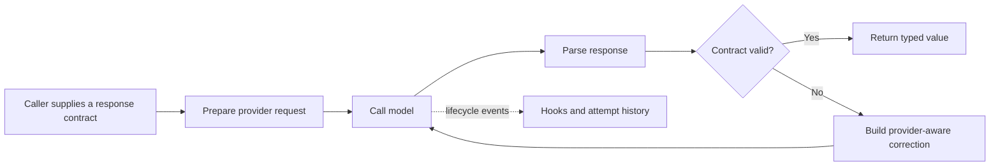
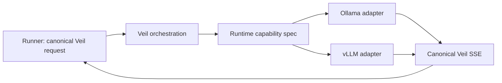
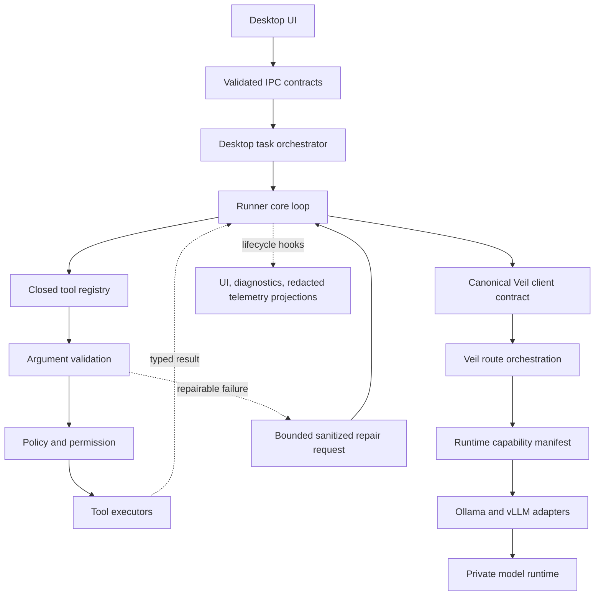

# Instructor Deep Dive - Lessons for UmbraticCode

## Executive conclusion

`instructor` is excellent at turning an unreliable model response into a typed, observable, retryable software boundary. Its most valuable idea is not support for many providers. It is the consistent pipeline that every provider must fit:



Umbratic should adopt that **contract discipline**, not Instructor's full abstraction stack. The highest-value implementation is a canonical, validated protocol between Veil, the runner, and the desktop; a capability manifest for the small set of supported runtimes; and bounded, failure-aware repair for malformed tool calls. Provider-specific behavior must remain in Veil, preserving Umbratic's existing security boundary.

> [!important] Main recommendation
> Treat model output, tool calls, runner events, and cross-process IPC as hostile or fallible data until they pass an explicit contract. When validation fails, produce a small typed failure, record the attempt, and retry only when the failure is safe and plausibly repairable.

Umbratic should **not** make every assistant answer structured JSON, introduce a public provider marketplace, or move model logic into Electron. Those would work against the current product boundary.

## Scope and method

This review covered the complete file inventory of `instructor/` and `UmbraticCode/`, a symbol-level scan of their source trees, their package/build configuration, repository instructions, architecture documents, and targeted line-level reading of the execution-critical modules and tests.

The comparison included:

- Instructor's v1 compatibility surface and v2 core, provider manifests, registries, handlers, request preparation, parsing, retry/reask, hooks, errors, streaming, multimodal handling, DSL types, lazy imports, typing tests, provider tests, documentation tests, examples, and CI configuration.
- Umbratic's Electron renderer and main process, preload boundary, local runner, tool registry and implementations, policy and permissions, context store and compression, Veil HTTP boundary, prompt assembly, runtime adapters, telemetry, artifact/capability systems, system skills, and tests.
- Existing design context in [[Index]], [[Codex vs Hermes Harness Comparison]], and [[Context Length Calculation Implementation Plan]].

The raw sizes explain part of the architectural difference:

| Area | Source files | Approximate source lines |
|---|---:|---:|
| Instructor Python package | 195 | 21,992 |
| Instructor Python tests | 173 discovered / 151 test-named | 19,327 total / 18,844 test-named |
| Umbratic runner TypeScript | 25 | 4,113 |
| Umbratic desktop TypeScript/TSX | 23 | 17,087 |
| Umbratic Veil Go | 14 | 3,030 |

Instructor is a mature library whose complexity comes from provider and response-mode breadth. Umbratic is a product harness whose complexity is concentrated in desktop state, local execution, policy, and cross-process integration. Direct feature-count comparisons would therefore be misleading.

## What Instructor does especially well

### 1. It chooses one high-leverage abstraction

Instructor's public idea is small: the caller supplies a `response_model`, then receives a value validated against that model. The library preserves the host provider's familiar client shape instead of asking callers to adopt an unrelated orchestration framework.

This is good API design because the abstraction pays for itself at the exact point where model uncertainty becomes application risk. Schema generation, provider request formatting, JSON extraction, validation, retry, and error reporting all serve the same promise.

The lesson for Umbratic is to identify similarly narrow promises. Good candidates are:

- A tool call entering the runner has a known name and schema-valid arguments.
- A runner event crossing IPC has one versioned discriminated-union shape.
- A Veil stream has one canonical event format regardless of Ollama or vLLM.
- A completed turn has a typed internal outcome even when its user-facing text remains free-form.

### 2. Validation is part of the control loop, not a final assertion

Instructor does not merely parse once and throw. Its request lifecycle treats JSON decode and model-validation failures as recoverable model feedback. A mode/provider handler builds a reask containing the relevant validation error, and the retry layer calls the model again under a bounded policy.

This is more powerful than a generic network retry:

- Transport failures and semantic failures are distinguished.
- The model receives actionable correction context.
- Provider-specific conversation formats remain inside provider handlers.
- Exhaustion produces `InstructorRetryException` with failed attempts, the last completion, accumulated usage, and request context.

Umbratic already returns tool failures to the conversation and stops repeated or continuously failing tool turns. That is a solid foundation. The missing layer is a deliberate **repair policy**: which failures are repairable, what sanitized correction should be returned, how many repair attempts are allowed, and what attempt evidence should survive for diagnostics.

### 3. The v2 core separates orchestration from wire-format knowledge

Instructor v2 defines provider-agnostic protocols for request handlers, response parsers, reask handlers, stream extractors, message converters, and template handlers. Provider packages own provider wire formats. The core registry looks up a `(provider, mode)` combination and orchestrates the selected functions.

That separation has practical value:

- Adding a provider is mostly additive.
- Provider conditionals do not spread through the central retry loop.
- Handlers can be tested without making a live model call.
- Unsupported combinations can fail early with a list of valid modes.
- The same orchestration applies to sync, async, streaming, and non-streaming paths.

Umbratic has the beginnings of this separation, especially Veil's `internal/model`, `internal/prompts`, `internal/policy`, and `internal/http` packages. However, runtime detection and wire-format normalization still appear in both Veil and `packages/runner/src/loop.ts`. Instructor's lesson is to finish the boundary: Veil should normalize Ollama/vLLM behavior into one protocol, and the runner should consume that canonical protocol without endpoint-shape heuristics.

### 4. Capability data is centralized

`instructor/instructor/v2/core/provider_specs.py` is a strong single-source-of-truth design. A frozen `ProviderSpec` records:

- canonical provider and aliases;
- handler and client modules;
- supported and unsupported modes;
- legacy-mode normalization;
- factory and SDK bindings;
- basic and asynchronous test modes;
- optional dependency behavior.

Derived maps such as alias lookup, public factory attributes, and handler specifications come from this manifest. Tests then assert that registry contents, factories, aliases, and advertised modes agree.

This is better than duplicating capability knowledge across routing code, UI labels, tests, and documentation. It makes contradictions mechanically detectable.

Umbratic would benefit from the same pattern at a smaller scale. Its manifest should describe **runtime protocol capabilities**, not a marketplace of public providers.

### 5. Errors are domain objects with useful context

Instructor's error surface distinguishes configuration, parsing, incomplete output, validation context, provider errors, and exhausted retries. It preserves exception chains and attaches context needed to reproduce or understand a failed request.

Umbratic already has good tool statuses and error codes such as `permission_denied`, `policy_blocked`, `validation_error`, `runtime_error`, and `timeout`. The improvement is to make the same discipline span the entire turn:

- model transport;
- stream decoding;
- tool-call assembly;
- argument parsing and validation;
- execution;
- model repair;
- terminal loop guards.

A caller should be able to tell whether a task stopped because the model produced invalid arguments, a command failed, policy blocked the operation, the user denied permission, the runtime stream was malformed, or the model repeated itself.

### 6. Observability is designed into the lifecycle

Instructor's hooks expose meaningful lifecycle points such as pre-call kwargs, completion response, parse error, last attempt, and completion error. Hooks are outside the core behavior: logging, metrics, tracing, and debugging can subscribe without being hard-coded into parsing logic.

Umbratic's typed runner events and redacted telemetry are already strong. Instructor suggests one additional separation: emit canonical lifecycle events from a small hook/event bus, then let UI projection, local diagnostics, and redacted telemetry consume them independently. This would reduce the pressure to add telemetry or UI-specific work inside the runner loop.

### 7. It handles streaming as a first-class parsing problem

Instructor does not treat streaming as merely concatenated text. It supports incremental JSON extraction, iterable values, partial models, parallel tool calls, sync and async generators, and incomplete-output detection. Streaming responsibilities are explicit in handler protocols.

Umbratic already assembles tool-call deltas, coalesces UI events, preserves reasoning separately, limits result sizes, and compacts tool history. These are good product-oriented choices. The next step is explicit stream conformance: a canonical chunk/event model with protocol adapters in Veil and golden fixtures for fragmented tool arguments, reasoning fields, finish conditions, invalid SSE lines, and premature EOF.

### 8. Optional dependencies and imports are treated as API quality

Instructor uses lazy public exports and provider-local imports so importing the base package does not require every provider SDK. It tests lazy imports, missing optional dependencies, and the installed-package public surface.

Umbratic has a related problem in local document, OCR, compiler, Python, and system-skill runtimes. Its capability probes are already a good answer. The transferable lesson is to test the **absence path** as rigorously as the happy path: the application should start, describe the missing capability clearly, and avoid importing or spawning an optional runtime until the feature is selected.

### 9. The test suite mirrors the architecture

Instructor's tests cover several layers:

- registry and provider/mode invariants;
- isolated handler request/parse/reask behavior;
- deterministic provider compatibility;
- retry and error context;
- streaming, partial, iterable, and multimodal edge cases;
- lazy and optional dependency imports;
- public typing surface and installed-package behavior;
- documentation snippets and examples;
- live provider evaluations where appropriate.

The important lesson is not simply “more tests.” The suite verifies architectural promises at the layer where each promise is owned. Parametrized tests consume the provider matrix rather than manually reproducing the same list.

### 10. It is willing to migrate its own architecture

Instructor v2 exists because the earlier design accumulated provider-specific modes and scattered utilities. The v2 code introduces generic modes, handler ownership rules, a registry, compatibility facades, deprecation normalization, and migration tests.

This is valuable evidence about what did **not** scale: central dispatchers and duplicated provider tables. Umbratic can learn from that history early, before its current large files and cross-process types become harder to untangle.

## What Umbratic already does better for its problem

Instructor is not a superior overall architecture; it is superior at its specific structured-output boundary. Umbratic has product and security strengths that should remain non-negotiable.

### Veil is a real trust boundary

Veil owns protected prompts, route selection, model selection, runtime credentials, request limits, and runtime calls. It rejects client `model` and `system` overrides, rejects system-role messages, authenticates with constant-time token comparison, enforces body and message limits, and avoids returning provider internals.

Instructor is primarily a client library and does not provide this deployment boundary. Umbratic should never move provider handlers, reask prompts, model choice, or protected behavior into the renderer merely to resemble Instructor.

### Local tools are governed by policy and permission

The runner resolves paths under the workspace, blocks disallowed command classes, asks permission for writes and commands, redacts command and stream text, times out processes, records typed failure details, and limits repeated tool behavior. This is much closer to the real risk surface of a coding workbench than Instructor's response validation.

### Context is actively budgeted

Umbratic compresses tool results by content kind, stores retrievable full context behind markers, caps per-result and aggregate context sizes, compacts older structured tool history, and coalesces streaming events. Instructor's strengths do not replace these mechanisms.

### The supported surface is intentionally small

Umbratic explicitly excludes public connectors, provider marketplaces, background automation, and generic passthrough endpoints. That restraint is an advantage. Any registry introduced here should make a closed system easier to reason about, not become a plugin platform by accident.

## Current UmbraticCode pressure points

### Cross-process contracts are duplicated

`BackendUiEvent` is defined in the desktop main-process types and again in the renderer; the preload layer reduces it to `Record<string, unknown>`. Runner event definitions are also represented separately in the desktop adapter. This makes compile-time confidence local to each copy rather than end-to-end.

The renderer's `asBackendEvent` currently validates only enough to project unknown input into UI behavior. Instructor's strongest lesson applies directly: parse once at the boundary into a canonical type, reject or quarantine invalid events, and make downstream code operate on validated data.

### The largest files combine too many reasons to change

The largest Umbratic source files are approximately:

| File | Lines | Main concern |
|---|---:|---|
| `apps/desktop/src/renderer/main.tsx` | 7,007 | Types, persistence, parsing, state, views, components, and styling behavior |
| `apps/desktop/src/main/main.ts` | 4,313 | App lifecycle, IPC, tasks, repository operations, attachments, review, and service coordination |
| `apps/desktop/src/main/storage.ts` | 788 | Persistence |
| `apps/desktop/src/main/capabilities.ts` | 774 | Runtime discovery |
| `apps/desktop/src/main/skills.ts` | 747 | Skill lifecycle |
| `packages/runner/src/loop.ts` | 711 | Protocol streaming, loop control, tool history, events, and retries |
| `infrastructure/veil/internal/model/model.go` | 586 | Both runtime adapters plus SSE translation and model discovery |

Large files are not automatically bad, and Instructor itself has several 800–1,400-line modules. The issue is cohesion. Instructor's v2 ownership rules offer a useful extraction guide: separate stable orchestration from protocol adapters and separate validated contracts from UI projections.

### Runtime behavior is inferred from URLs

The runner checks whether an endpoint path looks like Ollama or Veil and changes message/tool handling accordingly. Veil separately adapts Ollama and vLLM. This duplicates protocol knowledge and creates a route where development behavior can diverge from managed behavior.

The intended architecture already says all model traffic goes through Veil. The code should converge on that statement: the runner speaks one Veil contract; Veil selects and adapts the runtime.

### Tool schemas and execution are centralized, but not fully declarative

`packages/runner/src/tools/index.ts` is a useful central location for model-facing schemas, normalization, aliases, argument parsing, policy events, and dispatch. However, capability metadata and execution selection still require coordinated edits and switch-like logic.

A closed registry can make each tool a single record containing its canonical id, aliases, input contract, permission class, availability predicate, and executor. Startup invariant tests can reject duplicate aliases, missing executors, or model-visible schemas without validators.

### Failure guards exist, but repair semantics are implicit

The loop caps total tool turns at 64, consecutive failed tool turns at 8, and repeated identical tool turns at 3. These prevent runaway behavior. They do not express whether an individual error should be retried, repaired, or immediately stopped.

For example:

- Invalid JSON arguments are plausibly repairable.
- A missing required argument is plausibly repairable.
- A missing file may be repairable after search.
- Permission denial should not be auto-retried.
- Policy blocking should not be reframed until the model finds a bypass.
- A destructive command failure should not be automatically replayed.

That policy deserves an explicit, testable table.

## Recommended implementation roadmap

### P0 — high value, fits the current architecture

#### 1. Create canonical versioned contracts

Create a small shared TypeScript package, for example `packages/contracts`, for boundaries shared by the runner and desktop:

```ts
type RunnerEventV1 =
  | { version: 1; type: "assistant.delta"; taskId: string; text: string; at: string }
  | { version: 1; type: "tool.started"; taskId: string; toolCallId: string; toolKind: ToolId; at: string }
  | { version: 1; type: "tool.completed"; taskId: string; toolCallId: string; status: ToolStatus; at: string }
  | { version: 1; type: "turn.completed"; taskId: string; summary: TurnSummary; at: string };
```

Each external boundary should have a runtime parser, not only a TypeScript type:

- preload to renderer events;
- desktop to runner requests;
- runner to Veil requests;
- Veil SSE chunks to runner canonical events;
- persisted task/telemetry records.

Use a dependency only if it passes `supply-chain-policy.json`; a narrow handwritten parser or generated validator is acceptable for the closed set of contracts. The architectural requirement is runtime validation plus versioning, not a particular schema library.

Go cannot import TypeScript types. Keep a language-neutral fixture/schema directory for Veil-facing contracts and run conformance fixtures in both Go and TypeScript. Avoid a complex generator until contract drift proves it necessary.

**Acceptance criteria**

- The renderer no longer owns a duplicate hand-written `BackendUiEvent` union.
- Preload exposes typed, validated events instead of raw records.
- Unknown versions and malformed events are reported without crashing the task UI.
- Contract fixtures pass in runner, desktop, and Veil tests.

#### 2. Make Veil the only runtime adapter

Move all Ollama/vLLM request shaping, model discovery, streaming conversion, reasoning-field normalization, and tool-call delta normalization behind Veil. Define one canonical runner-facing stream.



Retain a development-only direct adapter only if it is truly required, and put it behind the same adapter interface with an explicit configuration flag. Do not infer protocol from URL paths in the central loop.

**Acceptance criteria**

- `packages/runner/src/loop.ts` contains no Ollama-specific stream decoder.
- Local and server modes exercise the same runner protocol.
- Golden tests feed equivalent Ollama and vLLM fixtures and produce identical canonical events.

#### 3. Add a runtime capability manifest in Veil

Model this on Instructor's `ProviderSpec`, scaled to two protocols:

```go
type RuntimeSpec struct {
    Protocol             ProviderProtocol
    DefaultChatPath      string
    DefaultModelsPath    string
    SupportsTools        bool
    SupportsToolRole     bool
    SupportsImages       bool
    SupportsReasoning    bool
    SupportsJSONSchema   bool
    StreamingFormat      StreamingFormat
}
```

The manifest should drive adapter selection, health diagnostics, capability responses, and parametrized conformance tests. Do not expose model choice or protected capability overrides to the renderer.

The values may eventually need model-specific overrides, because “Ollama” and “vLLM” describe serving protocols rather than the actual model's capabilities. Start with protocol defaults and allow admin-owned model metadata in Veil later.

#### 4. Add schema-driven tool argument validation and bounded repair

Today, successfully parsing a JSON object does not guarantee that it satisfies the tool schema. Validate arguments against the same canonical input contract before execution.

Introduce a repair classification:

| Failure | Repairable? | Suggested behavior |
|---|---:|---|
| Malformed tool JSON | Yes | Return sanitized parse error and expected top-level shape; max 2 repairs |
| Unknown tool name | Yes, once | Return valid tool ids |
| Missing/wrong argument type | Yes | Return field-level issues without secrets |
| File not found | Usually | Suggest search/read; do not silently change path |
| Permission denied | No | Stop retrying that action and report user decision |
| Policy blocked | No | Report the policy class; do not provide bypass hints |
| Command exit nonzero | Contextual | Return exit summary; model may choose a different action, never replay automatically |
| Timeout | Contextual | Do not auto-replay mutating commands |

Record a compact attempt ledger:

```ts
type AttemptRecord = {
  attempt: number;
  phase: "stream" | "tool-parse" | "tool-validate" | "permission" | "execute";
  code: ToolErrorCode | ModelErrorCode;
  repairable: boolean;
  toolId?: ToolId;
  redactedSummary: string;
};
```

This is Instructor's reask idea adapted to Umbratic's stronger safety model. A repair is a new model decision, not an automatic re-execution of the failed side effect.

### P1 — structural improvements after contracts are stable

#### 5. Introduce closed registries for tools and routes

Use data-driven registries without adding dynamic plugins.

A tool definition can own:

- canonical id and aliases;
- description and model-facing input schema;
- runtime argument validator;
- required capability;
- permission kind and policy classification;
- executor;
- safe repair-hint formatter.

A Veil route definition can own:

- route id and HTTP path;
- protected prompt id;
- allowed modalities and tools;
- request limits or output contract when route-specific;
- telemetry policy.

Generate lookup maps and invariant tests from these definitions. The registry should be frozen after startup.

#### 6. Add lifecycle hooks behind the existing event stream

Define a small internal lifecycle vocabulary:

- `model.request.prepared`;
- `model.stream.started`;
- `model.stream.failed`;
- `tool.call.assembled`;
- `tool.validation.failed`;
- `permission.requested`;
- `tool.execution.completed`;
- `repair.requested`;
- `turn.completed`.

The UI event adapter, local diagnostics, and telemetry redactor can subscribe and project only the fields they need. Hooks must never receive or export secrets by default. Raw model payloads and full tool output should remain opt-in local diagnostic data, never normal telemetry.

#### 7. Split the desktop files by ownership, not arbitrary size

Suggested renderer modules:

- `contracts/` — imports validated shared contracts;
- `state/` — task/chat/review state and reducers;
- `markdown/` — markdown parsing and reference rendering;
- `composer/` — prompt, mentions, attachments, and activity;
- `review/` — diff parsing and review UI;
- `settings/` — appearance, endpoint, skills, and capability UI;
- `persistence/` — preview/local storage adapters;
- `components/` — focused visual components.

Suggested main-process modules:

- IPC registration by domain;
- task orchestration;
- repository/worktree operations;
- attachment ingestion;
- review lifecycle;
- service coordination.

Use a reducer/state-machine-style task core before extracting JSX components. Moving functions into files without clarifying state ownership would only redistribute the monolith.

#### 8. Build matrix tests from manifests

Instructor's provider matrix pattern maps well to Umbratic runtime and tool contracts.

Add tests that iterate over every registered runtime and tool:

- every runtime has request, non-streaming response, streaming, model-list, and error fixtures;
- every model-visible tool has an executor and runtime validator;
- every alias maps to one canonical tool;
- every mutating tool declares permission behavior;
- every error code has redaction and repair policy;
- every renderer event variant has a rendering/projection case;
- every optional runtime can be absent without preventing application startup.

Keep the current focused safety tests. The matrix supplements rather than replaces specific regression tests.

### P2 — useful only when product demand appears

#### 9. Add route-specific structured outcomes

Instructor's `Maybe`, `Partial`, `Iterable`, and parallel response types are compelling, but a general chat workbench should not force all prose into a schema.

Use structured outcomes only where the product already has a structured workflow:

- engineering task completion and review summary;
- artifact creation result;
- capability probe report;
- approval readiness checks;
- extracted document/table data;
- possibly marketing or sales templates with explicit user-selected formats.

For example, an internal engineering completion may include `summary`, `changedFiles`, `tests`, `remainingRisks`, and `reviewReady`, while the visible assistant response remains readable Markdown.

#### 10. Add compatibility facades only when a real migration exists

Instructor's v1-to-v2 facades are a mature response to installed-user compatibility. Umbratic is still early. Version persisted records and IPC contracts now, but do not build a broad deprecation framework before there is a released contract to preserve.

#### 11. Test documentation as executable product behavior

Once the CLI/API and system skills stabilize, validate command snippets, configuration examples, and skill references in CI. Instructor's docs tests are valuable because examples are part of a library's user interface. For Umbratic, the equivalent high-value surfaces are deployment configuration, local Veil setup, capability diagnostics, and system-skill instructions.

## Proposed target architecture



The key property is direction of knowledge:

- The renderer knows product state, not provider wire formats.
- The runner knows canonical model events and local tools, not Ollama quirks.
- Veil knows protected prompts, routes, models, and runtime adapters.
- Registries describe closed capabilities and generate invariant tests.
- Boundary parsers turn unknown data into trusted internal types.

## Concrete first implementation slice

The safest first slice is deliberately small:

1. Create `packages/contracts` with `RunnerEventV1`, `TurnSummaryV1`, `ToolResultV1`, and runtime parsers.
2. Replace the duplicate desktop event unions with imports from that package.
3. Validate events in preload or immediately on renderer receipt; surface an `invalid-event` diagnostic without rendering unknown fields.
4. Add fixtures covering every current event variant and malformed versions.
5. Add an `AttemptRecord` to the runner summary for existing tool failures, without changing retry behavior yet.
6. Add a repair-policy function whose initial behavior matches current behavior; then separately enable bounded repair for malformed JSON and invalid arguments.

This delivers immediate correctness and observability without changing Veil routing, prompt ownership, or tool permissions. The second slice can then canonicalize Veil streaming and remove protocol-specific logic from the runner.

## What not to copy from Instructor

- **Do not add dozens of providers.** Umbratic's value is a private, admin-controlled model path.
- **Do not patch vendor clients.** The runner and Veil own their APIs; explicit composition is clearer.
- **Do not put response/reask handlers in Electron.** Model-facing behavior belongs in Veil.
- **Do not turn the registry into third-party plugin loading.** A closed manifest is enough.
- **Do not retry side effects automatically.** Instructor retries model generation; Umbratic tools can mutate files and run commands.
- **Do not expose raw validation details blindly.** Paths, command output, prompts, and secrets must remain redacted according to existing policy.
- **Do not reproduce v1/v2 compatibility machinery preemptively.** Version contracts now and add facades only when a real release needs them.
- **Do not over-abstract two trivial cases.** Keep direct code where it remains clearer; introduce an adapter or registry only where it removes duplicated protocol knowledge or enforces a security/contract boundary.

## Prioritized decision table

| Recommendation | Value | Risk | Effort | Priority |
|---|---:|---:|---:|---:|
| Shared runtime-validated IPC/runner contracts | Very high | Low | Medium | P0 |
| Veil-only Ollama/vLLM adaptation | Very high | Medium | Medium-high | P0 |
| Runtime capability manifest and conformance fixtures | High | Low | Medium | P0 |
| Tool argument validation and safe repair policy | Very high | Medium | Medium | P0 |
| Closed tool/route registries with invariant tests | High | Low | Medium | P1 |
| Lifecycle hooks with redacted projections | High | Medium | Medium | P1 |
| Renderer/main-process decomposition by ownership | High | Medium | High | P1 |
| Manifest-driven protocol/tool test matrices | High | Low | Medium | P1 |
| Route-specific structured outcomes | Medium | Medium | Medium | P2 |
| Docs-as-tests and compatibility facades | Medium | Low | Medium | P2 |

## Final assessment

Instructor's deepest strength is that it converts probabilistic output into a software protocol without pretending the model is deterministic. It makes contracts explicit, owns provider variation at the edge, retries semantic failures with context, records the attempt history, and tests that its advertised capability matrix matches reality.

Umbratic already has the harder product foundations: a protected model boundary, local permission and policy enforcement, context controls, redaction, worktree review, and a deliberately constrained surface. The right synthesis is:

> [!summary]
> Keep Umbratic's security architecture and product restraint. Add Instructor's contract-first core: validated boundaries, a small capability manifest, isolated runtime adapters, typed attempt history, safe semantic repair, lifecycle hooks, and matrix-generated conformance tests.

If only one lesson is implemented, it should be the canonical validated contract spanning Veil → runner → desktop. That change makes every later improvement—repair, telemetry, compatibility, testing, and modularization—safer and easier to reason about.

## Evidence map

### Instructor

- `instructor/instructor/v2/core/provider_specs.py` — frozen provider capability manifest and derived maps.
- `instructor/instructor/v2/core/registry.py` — lazy handler lookup and mode normalization.
- `instructor/instructor/v2/core/protocols.py` — request, parse, reask, stream, message, and template contracts.
- `instructor/instructor/v2/core/retry.py` — validation-aware retry and attempt handling.
- `instructor/instructor/v2/core/hooks.py` — lifecycle observability.
- `instructor/instructor/v2/core/errors.py` and `exceptions.py` — domain error taxonomy.
- `instructor/instructor/v2/providers/*/handlers.py` — provider-owned request/response/reask behavior.
- `instructor/instructor/v2/dsl/` — partial, iterable, maybe, simple-type, parallel, and citation response forms.
- `instructor/tests/v2/` — registry, handler, compatibility, streaming, and provider matrix tests.
- `instructor/tests/typing/` and lazy import tests — public surface and optional-dependency discipline.
- `instructor/tests/docs/` — examples and documentation treated as tested behavior.

### UmbraticCode

- `UmbraticCode/packages/runner/src/loop.ts` — model streaming, tool loop, history compaction, failure guards, and endpoint-specific behavior.
- `UmbraticCode/packages/runner/src/tools/index.ts` — tool schemas, normalization, aliases, dispatch, policy events, and argument parsing.
- `UmbraticCode/packages/runner/src/tools/common.ts` — path safety and typed tool failures.
- `UmbraticCode/packages/runner/src/context/` — content compression, storage, markers, and retrieval.
- `UmbraticCode/apps/desktop/src/main/types.ts`, `main/runner.ts`, `preload/preload.ts`, and `renderer/main.tsx` — duplicated cross-process event representations.
- `UmbraticCode/apps/desktop/src/main/main.ts` — current main-process orchestration concentration.
- `UmbraticCode/infrastructure/veil/internal/http/server.go` — authenticated route and model boundary.
- `UmbraticCode/infrastructure/veil/internal/policy/request.go` — protected-field, role, message, size, and skill-catalog validation.
- `UmbraticCode/infrastructure/veil/internal/model/model.go` — Ollama/vLLM request, response, SSE, and model-list adaptation.
- `UmbraticCode/infrastructure/veil/internal/prompts/prompts.go` — protected prompt and skill-routing ownership.
- `UmbraticCode/infrastructure/veil/internal/telemetry/telemetry.go` — schema validation, blocked raw fields, retention, and safe storage.
- Runner, desktop, and Veil tests — existing safety, loop-limit, schema-normalization, policy, packaging, and protocol coverage.
