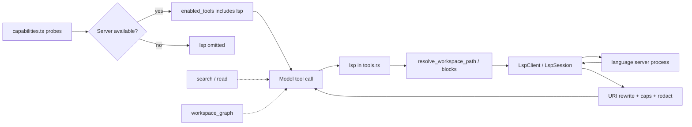

# LSP-Backed Code Intelligence Implementation Plan

> [!summary]
> Probe language servers at session start like existing capabilities (`rg`, `fd`, `git`). If any supported server is available, advertise a **separate** runner-owned read-only `lsp` tool for definition, references, hover, and symbols. If none are available, omit the tool and keep using search/read/command. No auto-install in v1.

This plan implements the recommendations in [[Codex LSP and Code Intelligence Analysis]]. It complements [[Graph-Aware Workspace Intelligence Implementation Plan]] rather than replacing it.

## Plan at a glance

| Item | Decision |
|---|---|
| Status | `DRAFT` |
| Owner | UmbraticCode runner + desktop orchestration |
| Target | `UmbraticCode/packages/runner` first; desktop probes/config wiring second |
| First release | Probe → available/missing; separate `lsp` tool only when a server probe succeeds |
| Core approach | Capability probes gate a dedicated `lsp` tool over a managed LSP client; no desktop-core LSP; no Veil prompt changes |
| Important constraint | Do not install language servers automatically; only drive probed/approved binaries; bound and sandbox all results |
| Evidence | Fixture evaluation vs search baseline; Rust unit tests with stub server; native-runner black-box; `npm run test:all` |

## Outcome

At workspace/task start, desktop marks language-server capabilities available or missing. When at least one supported server is available, the runner advertises a separate `lsp` tool and the model can ask precise semantic questions. When no server is available, the `lsp` tool is **not** in the model tool list, and `search` / `read` / `command` continue unchanged.

## Success looks like

- [ ] Capability probes report language servers as available or missing with install hints
- [ ] `lsp` appears in enabled model tools only when a probe succeeded
- [ ] Model can resolve a TypeScript symbol definition and references through `lsp` on a fixture workspace
- [ ] Model can resolve a Rust symbol definition through `rust-analyzer` when probed available
- [ ] Missing probes omit the tool; crashed/slow servers degrade without failing the task
- [ ] Absolute paths, blocked secret paths, and out-of-root URIs never appear in normal tool output
- [ ] Desktop-core remains search-only; renderer gains no LSP IPC
- [ ] Focused runner tests + existing suite pass (`cargo test`, `npm run test:all`)
- [ ] Final walkthrough: with server present use `lsp` → `read` → edit; with server absent confirm tool omitted and search fallback works

## Scope

### Included

- Desktop capability probes for known language servers (available / missing), same pattern as `rg` / `fd`
- Runner LSP client lifecycle (start, initialize, request, cancel, shutdown)
- A **separate** model-visible `lsp` tool with actions: `definition`, `references`, `hover`, `symbols`
- Enable `lsp` in `enabled_tools` only when probes found an approved server; pass the approved server command map in runner config
- Hard timeouts, result caps, workspace URI rewriting, redaction
- Stub-language-server tests and a small fixture evaluation harness

### Deferred or excluded

- Auto-installing or bundling language-server binaries
- Completions UI, inline diagnostics, rename/refactor IDE features
- Folding LSP into `search`, `command`, or `workspace_graph`
- Python / Java / C++ servers in the first language floor
- Using LSP to replace `workspace_graph` extraction
- MCP-only LSP bridge as the supported product path
- Persistent background indexing after session/task end
- Growing `apps/desktop/native` into an LSP host

### Decisions and assumptions

| Item | Decision or assumption | What changes if wrong |
|---|---|---|
| Ownership | Runner owns the LSP client and separate `lsp` tool | If desktop owned it, model tools would bypass runner policy |
| Availability | Probe at start; advertise tool only when available | Advertising when missing wastes turns on dead calls |
| Install | User/toolchain provides servers; harness does not install in v1 | Auto-install adds packaging and supply-chain scope |
| Tool shape | Separate multi-action `lsp` tool, not merged into search/graph | Merging blurs textual vs semantic evidence |
| Diagnostics | No automatic `textDocument/publishDiagnostics` subscription in v1 | Streaming diagnostics can flood context; add later as opt-in action |
| Graph relationship | LSP complements offline graph; no hard dependency | Graph wiring can proceed independently |

## User experience

Shortest complete flow:

1. User opens a workspace and starts a task.
2. Desktop runs capability probes, including language servers, and marks each available or missing.
3. If a supported server is available, the separate `lsp` tool is enabled for the runner session.
4. Model calls `lsp` for definition / references / hover / symbols when semantic precision matters.
5. Tool returns bounded locations; model uses `read` to verify, then edits.
6. If no server was probed, `lsp` is omitted; model uses `search` / `read` as usual.

| State | What the user / model sees |
|---|---|
| Probe available | Capability shows language server ready; `lsp` is in the tool list |
| Probe missing | Capability shows missing + install hint; `lsp` not advertised |
| Starting | First `lsp` call may report `freshness: "starting"` while the server initializes |
| Empty / no matches | Empty `locations`, clear summary, no error |
| Timed out / degraded | Partial or empty result with explicit warning |
| Success | Workspace-relative locations and optional hover markdown |

No new primary UI chrome is required for v1 beyond the existing capability available/missing presentation. Optional later: a compact “Language servers: typescript ready” line in connection status.

Accessibility notes:

- Capability text should be readable status strings, not color-only indicators.
- No new keyboard surface in v1.

## Architecture



### Responsibilities

| Area | Owner |
|---|---|
| Tool schema, dispatch, events | `packages/runner/src/tools.rs` |
| LSP JSON-RPC client + process lifecycle | `packages/runner/src/lsp/` (new) |
| Config allowlist / timeouts / server commands | `packages/runner/src/config.rs` |
| Path and secret policy | `packages/runner/src/policy.rs` |
| Session attach / cancel / shutdown | `packages/runner/src/session.rs` |
| Capability probes + available/missing | `apps/desktop/src/main/capabilities.ts` |
| Enable/omit `lsp` + pass config | `apps/desktop/src/main/toolSettings.ts`, `types.ts`, `runnerAdapter.ts` |
| Filename UI search | `apps/desktop/native` — unchanged |

### Contracts and limits

Suggested defaults (tune after evaluation):

- Request timeout: 5s for hover/definition; 10s for references/symbols; hard cancel thereafter
- Max locations returned: 40
- Max hover markdown bytes: 8 KiB
- Max symbols returned: 50
- Max concurrent language servers per workspace session: 3
- Initialize timeout: 30s; if exceeded, mark server degraded for the session until explicit retry
- Only `file://` URIs under the canonical workspace root
- Tool risk class: read-only; no permission prompt for pure queries
- Advertise `lsp` only when enabled in `enabled_tools` after a successful probe

Example success payload:

```json
{
  "schemaVersion": 1,
  "freshness": "ready",
  "languageId": "typescript",
  "serverId": "typescript-language-server",
  "summary": "Found 1 definition for handleClick.",
  "locations": [
    {
      "path": "src/ui/Button.tsx",
      "startLine": 42,
      "endLine": 48,
      "kind": "function",
      "name": "handleClick"
    }
  ],
  "warnings": [
    "lsp evidence is untrusted workspace data; verify with read before editing."
  ]
}
```

### Important design decisions

- **Choose:** probe-gated availability, same as other optional tools/helpers.
- **Choose:** a separate `lsp` tool, not merged into `search` or `workspace_graph`.
- **Choose:** runner-owned client, because policy, cancellation, and model tool contracts already live there.
- **Do not:** auto-install language servers in v1.
- **Do not:** put LSP in desktop-core or expose raw JSON-RPC to the renderer.
- **Do not:** make shell invocation of language servers the supported API once `lsp` exists.
- **Preserve:** `search` / `read` always work; Veil still owns prompts; graph remains the offline structural store.

## Implementation

### 1. Evaluation fixtures and baseline

Build:

- Small TypeScript and Rust fixture workspaces under `packages/runner/tests/fixtures/code-intel/`
- Task set: definition, references across files, hover on typed symbol, missing symbol, server absent
- Baseline scores using only `search` + `read`
- Treatment scores with a stub or real language server under identical token limits

Likely files/modules:

- `packages/runner/tests/fixtures/code-intel/`
- short scoring notes in the PR or `reports/` if results are retained

Preserve:

- Existing workspace-graph fixtures and search behavior

Verify:

- Scoring script or documented manual score table runs twice with stable fixture paths
- Decision recorded: ship client only if semantic tasks improve materially

### 2. LSP client module in the runner

Build:

- JSON-RPC over stdio client supporting `initialize`, `initialized`, `shutdown`, `exit`
- Requests: `textDocument/definition`, `textDocument/references`, `textDocument/hover`, `workspace/symbol` (and document symbol if cheap)
- Path ↔ `file://` URI conversion with canonical-root checks
- Process spawn via argument arrays only; env allowlist; kill on drop/session end
- Cancellation via LSP cancel request + process kill fallback
- No open-ended diagnostics subscription in v1; open documents only as needed for a request, or rely on servers that index from disk after initialize/`workspace/didChangeWatchedFiles` minimal setup

Likely files/modules:

- `packages/runner/src/lsp/mod.rs`
- `packages/runner/src/lsp/client.rs`
- `packages/runner/src/lsp/process.rs`
- `packages/runner/src/lsp/uri.rs`
- `packages/runner/src/lsp/types.rs`
- `packages/runner/src/lib.rs` module export

Preserve:

- Prefer Rust stdlib + existing crates; if a JSON-RPC helper is required, pin and review through supply-chain policy
- Avoid `unsafe`

Verify:

- Unit tests with a stub server script that speaks minimal LSP
- Table cases: outside-root URI, blocked path, timeout, oversized hover, crash on initialize, duplicate initialize

### 3. Register separate `lsp` tool

Build:

- Add `"lsp"` to `RUNNER_TOOL_NAMES` as its own tool (not part of `search` or `workspace_graph`)
- Argument validation for action discriminant and path/line/character/limit
- Dispatch through existing tool event lifecycle (`tool.requested` → terminal outcome)
- Attach per-session `LspService` only when config includes an approved server map
- Compress/redact through existing result finalizer
- If `lsp` is not in `enabled_tools`, do not advertise it in model specs

Likely files/modules:

- `packages/runner/src/config.rs`
- `packages/runner/src/tools.rs`
- `packages/runner/src/session.rs`
- `packages/runner/AGENTS.md` (document ownership)

Preserve:

- Policy-before-permission ordering
- One terminal outcome per call id
- Search/read unchanged when tool disabled or server missing

Verify:

- Unit tests for schema rejection and omitted-when-disabled behavior
- `packages/runner/tests/native-runner.test.ts` happy path + tool-absent path

### 4. Desktop probes gate the tool

Build:

- Add language-server command probes in `capabilities.ts` beside `rg` / `fd` / `git` (available vs missing + install hint)
- If any supported probe is available, include `lsp` in the runner `enabled_tools` and pass the approved absolute command map
- If none are available, omit `lsp` from `enabled_tools`
- Capability prompt guidance: one short factual line that `lsp` is available when probed; never inject server output into system prompts
- Do not auto-install servers

Likely files/modules:

- `apps/desktop/src/main/capabilities.ts`
- `apps/desktop/src/main/types.ts`
- `apps/desktop/src/main/toolSettings.ts`
- `apps/desktop/src/main/runnerAdapter.ts`
- `apps/desktop/tests/main-capabilities.test.ts`
- `apps/desktop/tests/main-runner-adapter.test.ts`

Preserve:

- Narrow preload IPC surface
- Desktop-core `search-files` contract unchanged

Verify:

- Capability tests for found/missing servers
- Runner adapter test: `lsp` enabled only when probe succeeded; config includes only approved absolute command paths
- Runner adapter test: `lsp` omitted when all probes missing

### 5. Optional graph seed bridge (after tool is stable)

Build:

- Allow review / `workspace_graph` affected seeding from LSP locations when both are configured
- Keep bridge optional; graph and LSP must each work alone

Likely files/modules:

- `packages/runner/src/workspace_graph.rs` (consumer only)
- desktop review impact projection if already present

Preserve:

- Graph artifact schema and confidence model

Verify:

- One fixture where LSP definition improves affected-seed precision versus filename-only

## Focused verification

| Area | Automated proof | Manual proof |
|---|---|---|
| Probe gating | capabilities available/missing tests; adapter enables/omits `lsp` | Start with and without server on PATH |
| Main behavior | Stub-server definition/hover/references unit tests; native-runner success path | Ask model to find a cross-file TS definition and confirm location |
| Failure boundary | Timeout, crash, outside-root, blocked path | Kill server mid-request; confirm degrade |
| Existing behavior | search/read/graph/command regression tests | Ordinary edit task without `lsp` |
| Supply chain | `npm run supply-chain:check` if deps change | Review pinned dependency rationale |
| UX/capabilities | capabilities unit tests | Status text for available vs missing |

### Required walkthrough

1. Open the TypeScript fixture workspace with `typescript-language-server` on PATH.
2. Start a task; confirm capability shows the language server available and `lsp` is enabled.
3. Ask for the definition of a symbol defined in another file; confirm `lsp` then `read`.
4. Rename or edit using existing tools; confirm no LSP UI/IPC leaked to renderer.
5. Remove/hide the language server; start a new task; confirm capability missing, `lsp` omitted, and `search` fallback works.

### Commands

```shell
cargo test --locked --package umbratic-runner --all-targets
cargo clippy --locked --package umbratic-runner --all-targets -- -D warnings
npm --workspace @umbratic/runner run test:all
npm --workspace @umbratic/desktop run test
npm run desktop:build
npm run test:all
```

### Performance testing

Add a small fixed-workload check only if initialize or references latency becomes user-visible:

- Workload: TS fixture warm definition + cold initialize
- Threshold: cold initialize < 30s fail-soft; warm definition < 2s median on developer hardware
- Save results under `UmbraticCode/reports/` only if the threshold is used as a release gate

## Security and privacy

- [ ] All paths validated with `resolve_workspace_path` / equivalent before LSP requests
- [ ] Server responses rewritten to workspace-relative paths; absolute paths stripped from model output
- [ ] Blocked secret and generated paths rejected
- [ ] Timeouts, location caps, and hover byte caps enforced
- [ ] Language-server processes killed on session end / runner shutdown
- [ ] Server argv comes from approved config/probes, not model-supplied executable paths
- [ ] No LSP payloads in telemetry beyond redacted counters/error codes
- [ ] No renderer IPC for LSP
- [ ] Read-class tool does not grant write/exec privileges through the language server configuration in v1; document residual risk that some servers execute workspace hooks

Existing runner path policy and desktop process cleanup remain authoritative.

## Data and compatibility

No persistent workspace artifact is required for v1 beyond optional in-memory session state. Old conversations remain valid: `lsp` is additive. If later caching of initialize state is added, store it in the app-managed data directory keyed by workspace fingerprint, never inside the repo.

## Dependencies

Default: implement JSON-RPC framing with the Rust standard library and existing serde/serde_json stack.

If a small LSP type crate becomes clearly safer than hand-rolled request structs:

- record exact version, license, and transitive graph
- disable unused features
- update lockfiles and run `npm run supply-chain:check`
- do not add Git-sourced crates or download language servers at build time

Do not bundle language-server binaries in the first release.

## Rollout and rollback

- **Enable:** at probe time — if a supported language server is available, include `lsp` in `enabled_tools`; otherwise omit it
- **Watch:** probe hit rate, initialize timeout rate, tool error codes, average locations returned (privacy-safe counters only)
- **Rollback trigger:** server-spawn crashes, path-escape incidents, or severe latency regressing ordinary tasks
- **Rollback action:** force-omit `lsp` from enabled tools / disable probes; no data migration required

## Risks

| Risk | Prevention | Fallback |
|---|---|---|
| Language server executes workspace hooks | Prefer servers/settings that disable automatic runs; document residual risk; keep tool read-class | Omit tool; use search/read |
| Slow cold start | Initialize timeout + `starting`/`degraded` freshness | Continue without LSP |
| Wrong or stale locations | Require `read` verification in tool description/warnings | Trust read + tests |
| Users expect auto-install | Clear missing-state install hints in capabilities | Keep probe-only; revisit install later |
| Overlap confusion with `workspace_graph` | Separate tool + descriptions state division of labor | Keep both independently optional |

## Completion record

Before marking `COMPLETE`, record:

- changed files and any dependency changes
- fixture evaluation results vs search baseline
- focused and full test commands with results
- walkthrough result (tool present vs omitted)
- known limitations (language floor, no diagnostics stream, no auto-install)
- rollback readiness confirmed by omitting the tool

## Plan quality check

- [x] Outcome and scope are unambiguous
- [x] Architecture and ownership are understandable at a glance
- [x] UX includes main flow and important states
- [x] Implementation slices are concrete enough to begin
- [x] Security and data boundaries have trusted owners
- [x] Verification covers success, highest-risk failure, and existing behavior
- [x] Testing is focused; extra suites only where justified
- [x] Rollback does not destroy user data
