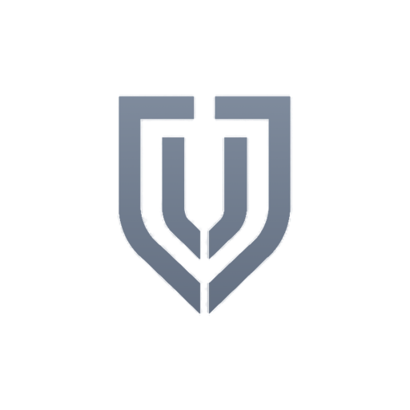
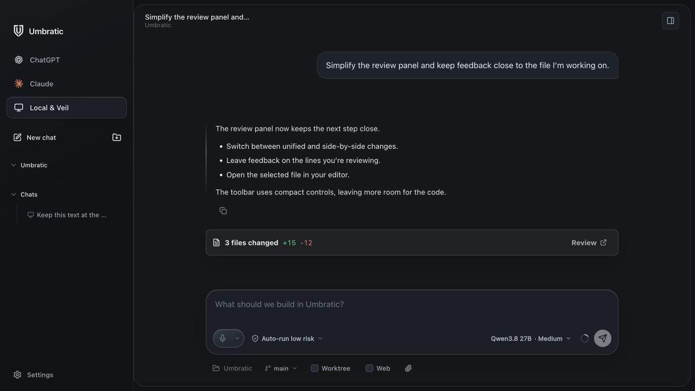
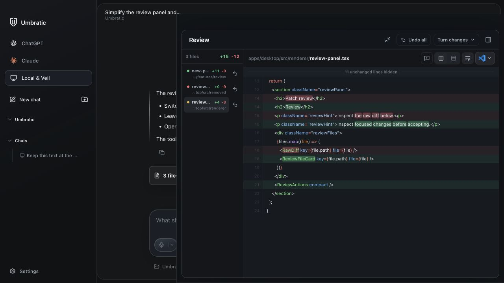

<p align="center">
  
</p>

<h1 align="center">Umbratic</h1>

<p align="center">
  <strong>The desktop AI workspace I build and use.</strong><br>
  Local models, your own server, ChatGPT, or Claude.
</p>

<p align="center">
  <a href="#getting-started">Get started</a> ·
  <a href="https://github.com/Potirniche-Carmine/Umbratic/releases">Releases</a> ·
  <a href="https://umbratic.ai">Website</a> ·
  <a href="CONTRIBUTING.md">Contribute</a>
</p>

I’m [Carmine Potirniche](https://carminepotirniche.com). Umbratic is my personal, open-source project and the desktop AI workspace I use for code, files, and documents. I’m building it around the work I do every day, from a first prompt to reviewing the changes.

There are no Umbratic plans or subscriptions. The source is MIT licensed. Local models use your hardware; connected cloud providers use your own account and its limits.





## Features

- **Code and files.** Search your project, edit files, run commands, and review code changes side by side.
- **Documents.** Create documents, spreadsheets, and presentations. Select text in a document and leave feedback for the next draft.
- **Your models.** Download and run models on your device, or connect to a self-hosted Veil server for shared models and employee access.
- **Cloud workspaces (0.0.3 development).** Use the official Codex or Claude Code runtime with your own subscription, choose an orchestrator and specialist models, and keep a continuous workspace with configurable context resets. See [Cloud runtime setup and limits](docs/cloud-runtimes.md).

The screenshots above show the current renderer with sample workspace content. They are development previews, not a promise that every feature is in the latest packaged release.

- **Follow up while it works.** Enter steers an active response. Shift+Enter queues a follow-up. Image references appear above your sent message.
- **Review in context.** Switch diff layouts, leave line feedback, and open the selected file in your editor from the review toolbar.

**No usage analytics or automatic telemetry uploads.** Local history and diagnostics stay on your device unless you export them. Requests and logs on a company server are controlled by its administrator. See [signing and privacy](CODE_SIGNING_POLICY.md) for network activity and release details.

## Getting started

Use the [source instructions below](#build-and-run), or check [GitHub Releases](https://github.com/Potirniche-Carmine/Umbratic/releases) for published builds.

| Release target | Architecture | Signing |
| --- | --- | --- |
| macOS 13+ | Apple Silicon | Apple Developer ID signed and notarized |
| Windows | x64 / ARM64 | Unsigned |

The release workflow provides checksums and GitHub artifact attestations. Windows may show security warnings for unsigned installers; see the [signing policy](CODE_SIGNING_POLICY.md).

Once the app is running, choose and download a model. Local mode includes Veil and the inference runtime, so it needs no separate server setup. To use a managed server, open **Settings → Company server** and enter its address and enrollment code.

### Build and run

Install the toolchain versions specified in [package.json](package.json) (Node.js/npm), [rust-toolchain.toml](rust-toolchain.toml), [infrastructure/veil/go.mod](infrastructure/veil/go.mod), and [.python-version](.python-version).

Native builds also require Xcode Command Line Tools on macOS, or MSVC Build Tools and Ninja on Windows. Packaging requires CMake 3.21+.

Clone the repository and start the app:

```sh
git clone https://github.com/Potirniche-Carmine/Umbratic.git
cd Umbratic
npm ci --ignore-scripts --omit=peer
cargo fetch --locked
npm run dependencies:provision
npm run desktop:dev
```

To build an unsigned local app on the target operating system:

```sh
npm run desktop:release -- --unsigned --dir
```

Output is written to `target/release/desktop`. Download model weights in the app.

## Self-hosting

[Veil](infrastructure/veil/README.md) is the Go model gateway. The desktop app manages its own local instance; you can also run it separately against a private OpenAI-compatible runtime:

```sh
cd infrastructure/veil
go build ./cmd/veil
```

Follow the [Veil configuration guide](infrastructure/veil/README.md) to run the gateway. For model management, employee enrollment, and HTTPS deployment, use [Veil Console](infrastructure/veil-console/README.md).

## Contributing

Bug reports and focused pull requests are welcome. Start with [Contributing](CONTRIBUTING.md) for setup and verification, or open a [GitHub issue](https://github.com/Potirniche-Carmine/Umbratic/issues) with reproduction steps.

For code changes, run the full suite from the repository root:

```sh
npm run test:all
```

Report vulnerabilities privately using the process in [Security](SECURITY.md).

## License

Umbratic is released under the [MIT License](LICENSE), including free commercial use, modification, and distribution. Dependencies, model weights, and inference runtimes retain their own licenses.
