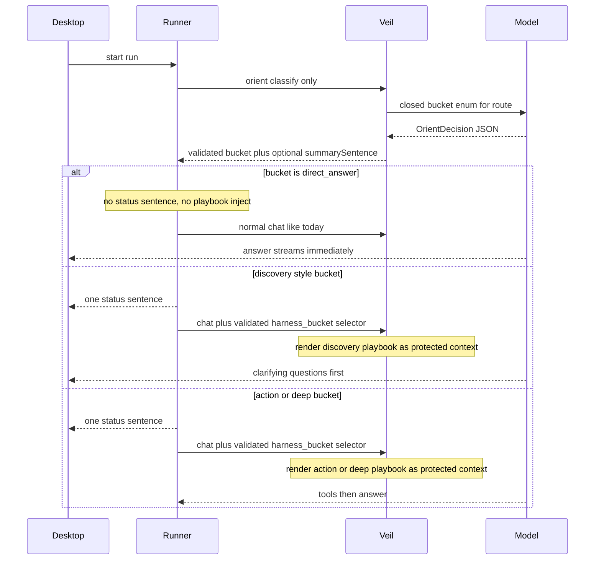

# Intent-Bucket Harness Plan

## Status

This document is the implementation design for hidden intent-bucket harness routing, in-house warm `search`, focused discovery, and scoped deep review. Feature implementation follows the phases at the end; landing this doc does not start that work by itself.

**Implementation status (2026-08-04).** Phases 2–6 are implemented and the deterministic test suite (`npm run test:all`) is green.

Gates now closed:

- **Search performance.** `packages/runner/src/tools/search_performance.rs` builds a 50,000-path synthetic workspace and asserts the plan's two ratios. Measured on a debug build: warm path-mode median 17.9 ms vs 292 ms for a cold walk (**16×**, floor is 3×), and literal content search 40.8 ms vs `grep` 1,078 ms — search is *faster* than the tool it supplements, well inside the "no more than 20% slower" bound. First build (297 ms) and index footprint (51,050 entries / 2.6 MiB) are reported separately rather than folded into the warm number.
- **Classifier fixture size.** [`orient-cases.json`](../packages/runner/tests/fixtures/harness/orient-cases.json) holds 60 engineering / 52 marketing / 52 sales labeled cases, above the ≥50-per-profile bar, with every bucket covered, adversarial "think hard" cases, and referential follow-ups. `internal/prompts/orient_cases_test.go` enforces shape, coverage, and the per-profile floor.

Gates still **not** run, because each needs a live model endpoint: bucket accuracy ≥85%, `direct_answer` and security-only `deep_review` precision ≥95%, the behavioral tool-turn and grill-rate deltas, and added p95 TTFT. Ship default-on only after those pass.

**Deviation from the phase list.** Phase 2 item 9 mapped `search` to a "Searching the codebase" progress row. That row, and the whole pre-tool `assistant.progress.delta`, were removed after live use: the label only restated the tool rows rendered directly beneath it. `PublicProgressSchedule` now emits compaction progress only. Tool calls are self-describing in the activity log.

**Transcript shape.** Assistant prose followed by more workspace activity is narration and renders inside the activity block; only the text that ends a turn is the answer. A turn produces one activity block rather than one per burst of prose. If a turn ends with no text after its last tool, the most recent narration is promoted back out as the answer, so a model that says everything before its tool call is never left with nothing visible.

**Source-size budget.** The 1,000-line budget now applies uniformly except for one pinned exception. `main.ts`, `storage.ts`, `loop_runtime.rs`, and `lsp/mod.rs` were split into real modules and de-grandfathered. `apps/desktop/src/renderer/main.tsx` remains exempt at its exact current size: it is a single ~4,500-line `App` component, and removing the exception means decomposing it into child components — which needs render tests to prove the decomposition preserves behavior, and warrants its own change.

## Goal

Hidden intent buckets keep smaller models from wandering:

1. Classify the user request into one closed bucket for the active harness profile (`engineering` | `marketing` | `sales`).
2. **Most buckets:** show one natural status sentence, then inject that bucket’s soft playbook + preferred skills into the protected prompt for the real work loop.
3. **`direct_answer`:** no status sentence, no playbook ceremony, no “working…” progress theater — stream the answer immediately the way Umbratic does today.
4. Bucket ids and orient decisions are confined to the protected model-runtime↔Veil↔runner path. Playbook text is Veil-owned and appears only in the protected upstream model request. None of them enter runner→desktop events, renderer state, exported diagnostics, or telemetry. Skill ids remain user-visible as today (see Runner / UI rules).

## Fixed product decisions

- Buckets are **hidden harness state only**.
- Profile → route stays as today: [`harnessRouteConfig`](../apps/desktop/src/main/runnerAdapter.ts) → `/api/{profile}/chat`.
- Remove from [`GlobalSystemPrompt`](../infrastructure/veil/internal/prompts/prompts.go) the rule *“Never end a turn by merely saying you will read, inspect, check, or run something…”*.
- Soft plans bias the existing Rust runner tool loop. No second executor. No parallel meta-skill inventory (`grep_code`, etc.).
- Playbooks name real tools (`ls`, `find`, **`search` (primary)**, `grep` (escape hatch), `read`, `edit`, `command`, …) and real skill ids via `read_skill` / harness skill preflight.
- **Prefer `search` over `grep`** for locating paths and content. Keep `grep` available for exact regex/edge cases when `search` is the wrong fit; do not ban `grep`.
- Marketing and sales deliverable work asks for missing **decision-critical** context before drafting. Engineering does the same for planning / PRD / spec / design-doc work. No bucket asks ceremonial questions when the supplied brief is already sufficient.
- **`deep_review` goes deeper on a scoped risk surface, not file-by-file across the whole tree.** Whole-repo “audit everything” on a large codebase must grill for scope first.

## Workspace search: current state and in-house FFF-inspired design

### What exists today

| Surface | Tool | Engine | Role |
| --- | --- | --- | --- |
| Runner (agent) | `ls` / `find` / `grep` | WalkDir + per-call scan ([`enumerate.rs`](../packages/runner/src/tools/enumerate.rs)) | Model workspace tools; **cold walk every grep** |
| Runner | ~~`search`~~ | Deleted during the exact-workspace-tool cleanup | Was overloaded |
| Desktop UI | `search-files` | Custom walkdir + substring ranking ([`native/src/main.rs`](../apps/desktop/native/src/main.rs)) | UI only — not the agent tool |

**No FFF crate is in the tree.** [FFF](https://github.com/dmtrKovalenko/fff) is the reference for *what works* for long-lived agent search — not a dependency to vendor or link.

### Locked approach: learn from FFF, implement ourselves

**Do not add `fff-search`, `@ff-labs/*`, LMDB frecency DBs, or their MCP binary.** Study FFF's architecture and reimplement the subset that fits Umbratic's runner security and dependency policy (stdlib + existing crates like `walkdir` / `regex` / `globset` already in use).

#### Ideas to take from FFF (why they're fast for agents)

1. **Long-lived process + warm index** — build the path index once for the active user run; later queries in that run hit memory instead of re-walking the tree every tool call (main win vs cold `WalkDir`/`grep` each time). Umbratic deliberately refreshes lazily at the next user run for external-edit correctness.
2. **Separate path index vs content search** — fast path/filename lookup from a sorted in-memory path list; content search over candidate files with tight limits.
3. **Agent-oriented result shaping** — bounded hits, relative paths, stable ordering, and a small deterministic path scorer so the model gets fewer useless matches.
4. **Smart-case** — case-insensitive unless the query contains uppercase.
5. **Respect ignore/generated dirs** — map to Umbratic's existing blocked/secret/generated policy.

#### Explicitly out of scope for v1 (FFF features we skip)

- Shipping or wrapping their crate / C lib / Node SDK / MCP server
- LMDB-backed frecency persistence across app restarts
- Full Smith-Waterman / frizbee fuzzy stack unless a tiny substring+token scorer proves insufficient
- Background FS watcher complexity beyond invalidating the index after our own write/edit/apply_patch
- Git status annotations in search results (nice later)

#### What we implement in the runner

Restore first-class tool **`search`** owned by `packages/runner`:

```text
Session start / first search
  -> build PathIndex under cwd (WalkDir once, policy filters, relative paths)
  -> keep SearchIndex service on the session

At the start of each later accepted user run
  -> mark the path generation stale; rebuild lazily only if that run searches

search(query, mode, path, glob?, limit?)
  -> path mode: score/filter PathIndex (substring + token match)
  -> content mode: scan candidate files from index (buffered read,
     skip binary/non-UTF-8/oversize, smart-case literal only; use grep for regex)
  -> return bounded relative hits (path, optional line+text), truncation flags

On write/edit/apply_patch success
  -> patch the indexed path set from typed ToolResult.details
     (write/edit already expose path; apply_patch already exposes effects[])

On every validated command/run_program dispatch, regardless of exit status
  -> mark the whole index stale (generation bump); rebuild lazily on next search
     (a command can mutate before failing, timing out, or being aborted, so
      success-only invalidation is incorrect)
```

`SearchIndex` is an `Arc`-owned service with internal synchronization and a monotonically increasing stale generation; it is not a bare immutable `Arc<PathIndex>`. A build captures its starting generation and may publish only if that generation is still current. The walker uses deterministic filename ordering plus `filter_entry` to prune blocked/generated directories rather than traversing and discarding every descendant. Abort with `search_index_too_large` rather than publishing a partial index if more than 500,000 visible entries are found. `search` is a global execution barrier in `loop_runtime.rs`, so it cannot race a write/edit/apply-patch/command from the same model tool batch. Filesystem walking and content scanning run through `spawn_blocking`; while making progress, the blocking loop checks the run abort flag on a 25 ms cadence and never holds the index lock during filesystem I/O.

#### Exact v1 `search` contract

```json
{
  "query": "required UTF-8 string, 1..512 characters",
  "mode": "path | content",
  "path": "required workspace-relative file or directory; use . for the root",
  "glob": "optional include glob, at most 512 characters",
  "limit": "optional integer 1..200; default 100 for path, 50 for content"
}
```

- `path` mode returns files and directories. Smart-case comparison is case-insensitive unless `query` contains an uppercase character. Score in this order: exact basename, basename prefix, basename substring, full relative-path substring, then all whitespace-separated query tokens present in the relative path. Ties are relative-path lexical order. Results that match none of those rules are omitted; v1 has no edit-distance matcher. When present, `glob` matches either the full workspace-relative path or basename, matching existing `find`/`grep` behavior.
- `content` mode is smart-case literal search only. Candidates come from the indexed file list after `path` and `glob` filtering and are scanned in relative-path lexical order. Skip symlinks, binary/non-UTF-8 files, and files larger than 2 MiB; clip any rendered line at 8 KiB. A hit is one matching line and renders as `path:line: text`. `limit` counts matching lines. Contents are read live and are not cached in v1, so editing an existing file does not stale content data.
- Both modes return typed `details` containing `mode`, `path`, `query`, `resultCount`, `truncated`, and applicable scanned/skipped counts. Model-facing paths are always relative. A successful create adds the file and any newly created parent directories; a delete removes the file; replacing/editing an existing file leaves path membership unchanged. There is no continuation token in v1: a truncated result tells the model to narrow `path`, `glob`, or `query`.
- Regex, context lines, replacement, frecency, file watching, and persistent content indexing are not part of `search`; `grep` remains the regex/context escape hatch.

**Correctness requirements:**

- Same canonical-root, no-symlink-follow, secret/generated blocking as `find`/`grep`
- Size/result caps; no absolute paths in model-facing output
- Deterministic ordering for tests
- Cancellation-aware: poll `session.is_aborted()` inside every walk/scan loop (copy the 25 ms poll pattern from `lsp/mod.rs`). Today's `find`/`grep` loops have no abort check, so this is new code, not inherited behavior; no panic on bad UTF-8
- Tool schema is single-purpose and strict. Define `search` once in the existing generated catalog so the model schema and executor validation cannot drift.

**Keep `grep`** as escape hatch for exact literal/regex line search. **Do not ban `grep`.** Keep `ls` / `find` for listing and explicit globs.

#### Implementation surface (complete change list)

Reference implementation: the deleted tool is recoverable via `git show c16f981:packages/runner/src/tools/search.rs` (query language, smart-case, recency cache) — reference only; the new tool is simpler and index-backed.

Runner (`packages/runner`):

1. `src/config.rs` — add `"search"` to `RUNNER_TOOL_NAMES`.
2. `src/tools/catalog.rs` — add the generated `search` definition next to `grep`, with output kind `search`; update the generated tool-contract golden fixture.
3. `src/tools/surface.rs` — update the `command` description that currently says "Prefer read, ls, find, and grep".
4. `src/tools/request.rs` — add the request type, `ToolRequest::Search`, parse/summary/arguments arms, and `tool_capability_name("search")`.
5. `src/tools/search.rs` — implement `SearchIndex`, path scoring, bounded content scanning, typed details, generation-safe rebuild, and cancellation polling; export/dispatch it from `tools.rs` and `tools/dispatch.rs`.
6. `src/session.rs` — add the shared `SearchIndex` service and update `SessionStore::create`, `test_session`, and direct `Session` test fixtures.
7. `src/loop_runtime.rs` — mark the index stale at accepted-run start and classify `search` as a global execution barrier.
8. `src/tools/dispatch.rs` — update the index after typed write/edit/apply-patch results and mark it stale after every validated command/run_program dispatch.
9. `src/public_progress.rs` — map `"search"` to "Searching the codebase". No `context.rs` classifier change is needed: catalog output kind `search` already selects `search_top_lines` compression.
10. Tests: generated contract/schema tests, policy/root/symlink/generated/secret tests, smart-case and ordering tests, cancellation tests, mutation-staleness tests, `src/tools/tests.rs` capability assertions, direct `Session` fixtures, `tests/native-runner.test.ts`, and the tool-contract golden fixture.

Policy reuse (no new policy code): root confinement via `resolve_workspace_path`, combined secret/generated filtering via `should_skip`, existing size/result caps and redaction.

Desktop (`apps/desktop`) — tool ids are duplicated across the app and `search` is silently filtered out of `enabledTools` unless all of these change together:

1. `src/main/types.ts` — `RunnerToolId` union.
2. `src/main/toolSettings.ts` — `runnerToolIds`.
3. `src/renderer/main.tsx` — the duplicated tool-id union.
4. `src/main/capabilities.ts`, `src/main/policy.ts`, `src/main/main.ts`, `src/main/runnerEventAdapter.ts` — add `search` anywhere workspace read tools are enumerated or classified.
5. `src/main/storage.ts` and storage/policy/runner-adapter tests — enabled-tool normalization flows through `RunnerToolId` and `runnerToolIds`, but exact expected lists must change.
6. `src/renderer/commandDisplay.ts` — add `search` to `workspaceToolLabels` ("Search workspace"). Without it, `isShellRun` falls through and the tool renders as a raw shell command in the UI — a user-visible regression, not cosmetics. Same for `commandDetailLabel` / `activityToolLabel` paths that key off the map.
7. Renderer timeline/markdown tests and `apps/desktop/tests/fixtures/tool-contract.golden.json` — add the tool to exact lists and verify it renders as a workspace read, not a shell command.

**Desktop-core `search-files`:** leave UI helper alone in v1. Optionally later reuse the same in-house path-index ideas.

**Prompt / playbook guidance:** prefer `search` → `read`; `grep` only for exact confirmation; no `command`-based `rg` for routine search.

**Current decision:** `search` returns as the **warm primary** locator; `grep` stays the **exact secondary**. The deleted implementation is historical reference only and does not define the new contract.

### Tool preference order

```text
locate code/content  -> search  (warm in-house index)
list one dir         -> ls
explicit glob tree   -> find
exact line regex     -> grep   (fallback)
open evidence        -> read
```

## Runtime flow


### Orient contract

```text
OrientDecision {
  bucket: string
  summarySentence: string | null
  // exactly null when bucket == direct_answer
  // otherwise exactly one short plain sentence, no JSON, no bucket name
}
```

Validation:

- Decode exactly one JSON object; reject unknown fields and non-string/non-null values.
- `bucket` must be in the active route catalog. A parseable unknown bucket is coerced to that route’s `open_task`; a missing/non-string bucket is invalid.
- If `bucket == direct_answer`: force `summarySentence = null`; runner emits nothing from orient and does not inject a playbook.
- Else: require one non-empty line of at most 240 Unicode scalar values ending in `.` or `!`. This syntactic rule is the complete v1 definition of a status sentence; do not add heuristic sentence parsing. It must not contain a route bucket id as a case-insensitive standalone token. Do not rewrite or substring-strip model output: invalid status text invalidates the decision.
- Any invalid decision returns `invalid_orient_decision`; the runner takes the degradation path. The only coercions are unknown bucket → `open_task` and non-null direct-answer summary → null.
- Orient call itself is non-tool, structured JSON only. It is harness-internal and must not drive long `assistant.progress.delta` “working” UI. Prefer treating orient as a short preflight; user-visible time for `direct_answer` should feel like today’s single generation.

### Orient transport (locked)

Veil today makes exactly one upstream model call per request, has **no structured-output support** (`model.ChatRequest` has no response-format field in either the vLLM or Ollama body builders), and holds **no session state**. The orient call therefore works like compaction, not like chat.

Runner request (strict, bounded):

```text
OrientInput {
  route: "engineering/chat" | "marketing/chat" | "sales/chat"
  requestText: string        // current user run only, 1..32 KiB UTF-8
  previousBucket: string | null
}
```

`requestText` comes from the current run's text parts, not tool results, protected prompt text, skill bodies, or the whole conversation. If it exceeds 32 KiB, retain a UTF-8-safe 16 KiB head and 16 KiB tail with a fixed omission marker. Skip orient for an image-only/blank request. `previousBucket` is the last valid decision for the session and is only a continuity hint for referential follow-ups such as “yes, draft it”; Veil validates it against the route catalog. On orient failure the runner clears this hint and does not reuse the old playbook for the current run.

- **New Veil endpoint `POST /api/internal/orient`**, modeled directly on the compaction handler (`/api/internal/context/compact`): non-streaming, server-prompted, one upstream call, free-form JSON output parsed and **validated server-side** (the `validCompactionSummary` pattern). Apply only the two explicit coercions above; unparseable or otherwise invalid output returns typed error `invalid_orient_decision`.
- **Route key:** the request carries the full route string (`engineering/chat` | `marketing/chat` | `sales/chat`) — the `prompts.go` route-constant spelling, not compaction's bare profile names. One vocabulary, chosen deliberately.
- **Caller is the runner.** Veil stays stateless; one decision per accepted `prompt_async` run, including a queued steer/follow-up, lives in the runner. Tool-loop provider steps reuse that run decision and never re-orient. The runner's Veil route allowlist is widened only inside the dedicated orient client function; ordinary chat still accepts only the three chat paths.
- **Own admission lease.** Orient is admitted as its own request; never hold one lease across orient + chat (that doubles lease hold time under load).
- **Generation profile:** same configured model, `stream: false`, no tools, output capped at 96 tokens, temperature `0`, top-p `1`, reasoning effort `none`, no thinking budget, and no parallel tools. The prompt contains only the protected orient instructions/catalog plus the bounded `OrientInput` as untrusted user content.
- **Latency budget:** runner-side hard timeout is 3 s in server mode and 10 s in local mode. Add trusted `provider.mode: "server" | "local"` to `RunnerConfig`, populate it from desktop endpoint settings, and validate it in runner and desktop policy/tests; do not infer mode from a URL. This design necessarily adds a sequential model call before `direct_answer`, so “parity” means meeting the eval threshold below, not zero added latency.
- **Degradation:** on timeout, transport error, or unrecoverable invalid decision, the runner **skips orient entirely** and runs exactly today's path — no playbook, no status sentence. Orient can only add behavior; it can never block or fail a run.
- Structured-output / grammar-constrained decoding in `ChatRequest` is explicitly out of scope for v1; if it lands later, orient adopts it without changing this contract.

### Playbook injection (non-`direct_answer` only)

Protected system message on the next turn snapshot (Veil-owned text, never client-supplied):

```text
Active task playbook (harness-internal). Follow this soft plan; adapt when evidence changes.
Do not mention playbooks, buckets, or routing to the user.

<PLAYBOOK BODY>

Preferred skills (optional): <ids>
If you will follow a preferred skill, read it completely with read_skill before applying it.
Stop when: <STOP>
Anti-loop: after a tool failure, change the approach; do not repeat an equivalent failing call.
```

**Selector transport, mechanics, and prefix-cache trade-off:**

- For a valid non-`direct_answer` decision, every normal chat request in that run carries optional `harness_bucket`. Add this closed-enum field to Veil's strict `ChatInput`; validate it against the route implied by the endpoint. Omit it for `direct_answer` and all degraded runs. This selector is protected control metadata, not system text.
- Veil renders the playbook from its own `(route, bucket)` catalog and passes the resulting system message through the existing `BuildWithProtectedMessages` slot. The runner never sends playbook text, and `templates.Registry.ProtectedContext` is not involved.
- Veil intersects the bucket's preferred skill ids with the validated `ChatInput.Skills` catalog before rendering. Disabled/unavailable skills are omitted, and each playbook contains enough core behavior to remain useful without a skill.
- The playbook is always the **last** protected system message — after the global prompt, route prompt, and skill catalog. Everything before it stays byte-stable and prefix-cacheable; the cache is invalidated only from the playbook onward, and only when orient/re-orient changes the bucket.
- This is a deliberate exception to the overlay design that moved template metadata off the protected tier for cache stability (`TestRequestOverlayLeavesTheProtectedPrefixStable`). Record the new baseline in that test's terms: the guaranteed-stable protected prefix ends at the skill catalog; the playbook slot after it may vary per run.
- Clients still cannot supply system text (rejected at Veil's policy layer, stripped runner-side). A caller with valid Veil credentials can select only a catalog bucket, never provide prompt text; unknown/cross-route selectors are rejected.
- `TurnSnapshot` owns the optional bucket selector because it changes the request. It does not claim to hash Veil-owned playbook bytes. Veil prompt-assembly tests pin the rendered playbook bytes and protected-prefix ordering.
- On the first guided provider step, the playbook tells the model that the runner has already emitted the one-sentence preamble, so it should call tools or ask the required discovery questions without producing a second status preamble. Later steps retain the global prompt's normal concise-progress behavior.

### Orient/playbook implementation surface

Veil (`infrastructure/veil`):

1. `internal/prompts/` — add the closed route catalogs, orient prompt builder, playbook renderer, and exact catalog/order tests. Keep procedural text out of the short route prompts.
2. `internal/policy/request.go` — add strict `OrientInput` decoding and optional `harness_bucket` on `ChatInput`; route-aware bucket validation occurs before prompt assembly. Update `request_test.go`.
3. `internal/http/server.go` — register `/api/internal/orient` in routing, lifecycle gating, admission, and activity-product route checks; implement the bounded non-streaming handler; pass only a Veil-rendered playbook to `BuildWithProtectedMessages` for normal chat.
4. `internal/http/server_test.go` — cover exact orient request/response shapes, generation parameters, invalid/coerced output, admission release, lifecycle rejection, normal-chat degradation shape, selector validation, and protected message order.
5. `internal/model/` needs no new response-format field in v1; the existing `ChatRequest` fields can express the fixed orient generation profile. Add a model-body test only if setting reasoning to `none`/thinking to nil exposes a provider serialization gap.

Runner (`packages/runner`):

1. `src/config.rs` — add and strictly validate `provider.mode`; update config/test fixtures.
2. `src/veil_client.rs` — add exact orient request/response structs, bounded response decoding, the mode-specific timeout, and optional `harness_bucket` on normal chat bodies. Do not add orient to the ordinary chat-path matcher.
3. `src/session.rs` — store only the previous valid bucket continuity hint; update every `Session` constructor/fixture.
4. `src/turn_snapshot.rs` — own the active run's optional bucket selector and expose it to every normal request/retry snapshot.
5. `src/loop_runtime.rs` — preserve this order: explicit selected-skill preflight → append current user message → orient once → emit zero/one status → enter the existing tool loop. Compaction/context-overflow retries reuse the decision. The status is UI output only and is not appended as an assistant conversation message.
6. `tests/native-runner-provider.ts` and `tests/native-runner.test.ts` — emulate orient separately from chat and assert direct/guided/degraded/steer/follow-up/timeout/abort behavior plus negative event leakage.

Desktop (`apps/desktop`):

1. `src/main/runnerAdapter.ts` — pass endpoint settings mode as `provider.mode`; no bucket field is added.
2. `src/main/policy.ts` and runner-adapter/policy tests — validate the new trusted config field and exact config shape.
3. Runner integration tests enumerate emitted event keys. Adapter/telemetry tests keep their field-by-field projection and prove injected orient-like unknown fields are not forwarded or exported; no renderer feature is added.

## Shared behavioral modes

### Mode A — Direct answer

- No orient sentence.
- No playbook.
- Answer in the first normal generation.
- Tools only if truly required for a factual workspace claim; default is no tools.

### Mode B — Status then act

- Emit one natural sentence (what you’ll check / why / what you’ll do). Not a fixed template.
- Inject playbook.
- Then tool loop or drafting as the playbook says.

### Mode C — Discovery grill (questions first)

- Emit one status sentence that signals clarifying, not building yet.
- Ask a **tight batch of questions** (typically 4–8) covering goal, audience, constraints, success criteria, inputs, out-of-scope, and format.
- **Do not** write the PRD / campaign / proposal / deck until the user answers enough to proceed, unless they explicitly say “just draft with assumptions” — then state assumptions and draft.
- Prefer one grill turn over endless drip questions. If answers are partial, ask only the missing blockers.

### Mode D — Deep pass (scoped, not whole-tree)

- Deeper than a normal review on a **bounded risk surface**.
- Never read every file. Never treat “I opened many files” as completeness.
- Use `search` in targeted waves (auth, secrets, sinks, entrypoints), then `read` only high-signal hits.
- Cap: prefer a fixed budget (e.g. ≤ ~25–40 substantive `read`s per deep pass unless the user expands scope). After the budget, synthesize with explicit **Not covered** gaps.
- If the user asks for a full-codebase / entire-monorepo security review and the tree is large (many packages, huge `node_modules`-excluded but still massive src), **switch to discovery first**: ask which apps/services/paths, threat priorities, and must-cover controls before scanning.
- “Deeper” means more rigor on the chosen surface (trust boundaries, vuln classes, confirmed vs needs-validation), not wider until every path is touched.

---

## Engineering buckets

Catalog for `/api/engineering/chat`.

### 1. `direct_answer`

- **When:** chitchat, “what can you do”, pure conceptual Q with no need to inspect the repo.
- **Mode:** A.
- **Status sentence:** none.
- **Playbook:** none.
- **Skills:** none.
- **Stop:** after the answer.

### 2. `repo_orient`

- **When:** map the repo, “what’s here”, high-level tour.
- **Mode:** B.
- **Example status:** “I’ll scan the top-level layout and key entrypoints so I can give you a clear map of this repo.”
- **Playbook:**
  1. `ls` on `.` ; continue with `nextOffset` if partial.
  2. `search` (and `find` only for explicit globs) for manifests, READMEs, main entrypoints only.
  3. Read a few high-signal files; do not recursively read everything.
  4. Return a short structured map (purpose, major dirs, how to run if evident).
- **Skills:** none required; `umbratic-markdown` only if writing a durable map file the user asked for.
- **Stop:** after the map; no writes unless asked.

### 3. `code_explain`

- **When:** how does X work; explain auth, data flow, module.
- **Mode:** B.
- **Example status:** “I’ll locate the code that owns this behavior and walk through how it actually runs.”
- **Playbook:**
  1. `search` for symbols and paths named in the request (`find` if an explicit glob is enough).
  2. `read` the owning files; follow only necessary references.
  3. Explain with exact paths and symbols; no speculative architecture.
- **Skills:** none; language skills (`umbratic-python`, later `umbratic-cmake`) only if explanation needs run/build context the user asked for.
- **Stop:** after a clear explanation; no edits.

### 4. `debug_failure`

- **When:** crash, exception, failing test, “why is this broken”.
- **Mode:** B.
- **Example status:** “I’ll inspect the failure path and isolate the cause, making changes only if your request calls for them.”
- **Playbook:**
  1. Gather failure evidence (message, log, test name) from the request or workspace.
  2. Locate likely code with `search`/`read` (`grep` only if exact regex is needed).
  3. Reproduce with `command` / `run_program` when safe and useful.
  4. Fix only if the user asked for a fix; otherwise report root cause.
  5. Re-run the failing check after a fix.
- **Skills:** `umbratic-python` when Python; `umbratic-git-worktree` if branch/worktree state matters; `umbratic-cmake` when C/C++ (new default enable — see skills).
- **Stop:** verified fix or a concrete root-cause answer; no tool thrash.

### 5. `code_change`

- **When:** implement, add feature, fix bug with code changes.
- **Mode:** B.
- **Example status:** “I’ll find the right insertion points, make the change, and verify it behaves as requested.”
- **Playbook:**
  1. Evidence pass (`search`/`read`) before any write.
  2. Prefer `edit` / `apply_patch` over rewrite; match repo style.
  3. Verify with the narrowest relevant command or test.
  4. Brief outcome: paths changed + verification result; do not dump full file contents.
- **Skills:** `umbratic-python` / `umbratic-cmake` as language-appropriate; `umbratic-git-worktree` when isolated worktree semantics matter.
- **Stop:** after successful change + verification, or a blocker that needs the user.

### 6. `review_audit`

- **When:** normal code review, quality pass, light “any issues?”.
- **Mode:** B.
- **Example status:** “I’ll review the relevant changes and call out concrete risks, not a generic checklist.”
- **Playbook:**
  1. Determine scope (diff, paths, or area named by user); use git read-only commands if needed.
  2. `search`/`read` the scoped files; note what was and was not covered.
  3. Findings ordered by severity with path/symbol evidence.
  4. No writes unless the user asked to fix findings.
- **Skills:** `umbratic-git-worktree` when review is against task branch/base; `umbratic-security-review` only if security themes appear (else keep light).
- **Stop:** after findings (and optional fix pass if requested).

### 7. `deep_review`

- **When:** explicitly security-focused review, vulnerability analysis, threat modeling, or a request for a deeper-than-normal audit of a named code risk surface. “Think hard” or “deep analysis” alone does not imply security; route those requests by their actual task (`code_explain`, `debug_failure`, `review_audit`, and so on).
- **Mode:** D (+ B status sentence). May enter Mode C first when scope is “whole codebase” and the tree is large.
- **Example status:** “I’ll deep-dive the highest-risk trust boundaries in scope, not every file in the tree.”
- **Scope gate (before heavy tools):**
  - If the user named paths/services/PRs → use that as the surface.
  - If they asked for the **entire** repo/monorepo and size is large → ask: which apps/packages, which threat priorities (auth, secrets, injection, supply chain, …), any must-ignore generated dirs already handled by policy, and what “done” means. Do **not** start a whole-tree read loop.
  - Default surface when vaguely “secure this app”: entrypoints, auth/session, secret handling, dangerous sinks, config, permission checks — discovered via targeted `search` waves, not directory walking every file.
- **Playbook (after scope is clear):**
  1. If `umbratic-security-review` is present in the enabled skill catalog, load it and follow its checklist for the chosen surface. The bucket playbook still contains the core scope/read-budget/reporting rules when the skill is disabled or unavailable.
  2. Wave-based `search` queries (auth tokens, password, exec, eval, deserialize, SQL, path join, SSRF-ish HTTP, permission, CORS, etc. — as skill lists), then `read` only top hits.
  3. Use `grep` only for precise confirmation patterns.
  4. Respect the read budget; then report **Confirmed** / **Needs validation** / **Not covered**.
  5. Default read-only; fix only if asked.
- **Anti-stuck rules (harness playbook text must include these):**
  - Do not `ls`/`find` recursively through the whole tree as a substitute for review.
  - Do not open every search hit; rank and sample.
  - After N similar searches with no new classes of finding, stop and synthesize.
  - Prefer one deep pass + clear gaps over an endless second pass.
- **Skills:** prefer `umbratic-security-review` (new) when enabled; `umbratic-git-worktree` for branch scope; language skills as needed.
- **Stop:** after the scoped deep report with explicit coverage limits.

### 8. `test_verify`

- **When:** run tests, add tests, check that something works.
- **Mode:** B.
- **Example status:** “I’ll identify the right test or check command, run it, and interpret the result.”
- **Playbook:**
  1. Find the project’s test/build command from manifests or repo norms.
  2. Run the narrowest useful command.
  3. Add/adjust tests only if asked.
  4. Report pass/fail with relevant output excerpt.
- **Skills:** `umbratic-python`, `umbratic-cmake` as appropriate.
- **Stop:** after interpreted results.

### 9. `refactor_migrate`

- **When:** restructure, migrate, compare v1/v2 modules, multi-file redesign with implementation.
- **Mode:** B.
- **Example status:** “I’ll compare the relevant areas, sequence safe edits, and verify as I go.”
- **Playbook:**
  1. Scope both sides; `search`/`read` to compare behavior.
  2. Write a short internal sequence (still soft — do not expose bucket).
  3. Apply edits in dependency order; verify after meaningful chunks.
  4. Summarize migrations risks and leftover work.
- **Skills:** language skills; `umbratic-git-worktree` if branch isolation matters.
- **Stop:** after sequenced changes + verification, or a clear plan-only answer if the user asked for a plan not edits — if plan-only, prefer `spec_discovery` instead when requirements are fuzzy.

### 10. `docs_change`

- **When:** update README, comments, existing docs with clear content already known.
- **Mode:** B.
- **Example status:** “I’ll update the docs to match the current behavior and keep the edit scoped.”
- **Playbook:**
  1. Locate the doc files; read current content.
  2. Edit for accuracy; no drive-by code changes.
  3. Keep tone and structure consistent with the repo.
- **Skills:** `umbratic-markdown`.
- **Stop:** after doc edit. If the user wants a new PRD/design from scratch with unclear requirements → `spec_discovery`, not this bucket.

### 11. `spec_discovery`

- **When:** planning, PRD, product spec, design doc, RFC, “help me spec this”, architecture write-up where requirements are incomplete.
- **Mode:** C.
- **Example status:** “Before drafting, I need a few decisions so the spec matches what you actually want.”
- **Playbook:**
  1. Grill in one batch covering: problem, users, goals/non-goals, constraints, success metrics, platforms, data/privacy, integrations, open questions, deliverable format (PRD vs RFC vs checklist).
  2. Wait for answers (or explicit “assume and draft”).
  3. Then outline → draft the doc in-repo or in chat as requested.
  4. Call out assumptions and unresolved decisions explicitly in the draft.
- **Skills:** `umbratic-discovery` (new) + `umbratic-markdown`; `umbratic-product-spec` (new) when drafting PRD/RFC structure.
- **Stop:** after questions if context is insufficient; after draft if context is enough or user waived discovery.

### 12. `open_task`

- **When:** doesn’t cleanly fit; multi-intent blob.
- **Mode:** B, conservative.
- **Example status:** “I’ll take the smallest useful next step from your request and avoid wandering.”
- **Playbook:**
  1. Identify the primary actionable goal from the request.
  2. Complete tightly related requested outcomes together; do not silently drop part of a coherent request merely because only one bucket is available.
  3. If the request contains genuinely independent deliverables that require different workflows, ask which one to do first.
  4. Prefer stopping and asking over speculative multi-hop tool loops.
- **Skills:** none by default.
- **Stop:** after one coherent outcome or a single clarifying question if blocked.

---

## Marketing buckets

Catalog for `/api/marketing/chat`.

**Rule:** every deliverable-producing bucket except `direct_answer` asks one focused discovery batch only when decision-critical inputs for that bucket are missing. Completeness is bucket-specific: for example, `copy_draft` does not require campaign budget, and `research_synth` does not require an offer or channel. Never ask for information that cannot change the requested output. If the supplied source and requested outcome are sufficient, skip discovery and proceed.

### 1. `direct_answer`

- **Mode:** A. Immediate answer. No status. No playbook.
- **Skills:** none.

### 2. `positioning`

- **When:** positioning, differentiation, messaging pillars, brand narrative.
- **Mode:** C then draft.
- **Example status:** “I’ll clarify audience and proof points first so the positioning stays grounded.”
- **Grill for:** audience, category, competitors, proof, forbidden claims, tone, where it will be used.
- **Then:** produce positioning in the requested format; never invent metrics or customer quotes.
- **Skills:** `umbratic-discovery`; `umbratic-markdown`; `umbratic-marketing-brief` (new).

### 3. `campaign_plan`

- **When:** campaign, launch plan, GTM outline.
- **Mode:** C then plan.
- **Example status:** “I need a few campaign inputs before I build a plan you can actually run.”
- **Grill for:** objective, audience, offer, timeline, channels, budget band, assets on hand, KPI, compliance limits.
- **Then:** channel plan + asset list + sequence; flag unknowns.
- **Skills:** `umbratic-discovery`, `umbratic-marketing-brief`, `umbratic-markdown`.

### 4. `copy_draft`

- **When:** landing copy, email, ads, rewrite.
- **Mode:** C (light) then draft — fewer questions if a source draft exists.
- **Example status:** “I’ll confirm audience and constraints, then draft copy against the facts you gave.”
- **Grill for:** audience, CTA, length, tone, must-include / must-avoid, source facts.
- **Then:** draft → tighten; no invented social proof.
- **Skills:** `umbratic-discovery`, `umbratic-markdown`; `umbratic-documents` if DOCX deliverable.

### 5. `asset_build`

- **When:** deck, one-pager, doc, sheet as marketing artifact.
- **Mode:** C then build.
- **Example status:** “Before building the asset, I’ll lock format, audience, and the claims we’re allowed to make.”
- **Grill for:** format (PPTX/DOCX/XLSX/MD), audience, narrative arc, required sections, brand constraints, source facts.
- **Then:** load the matching artifact skill and produce.
- **Skills:** `umbratic-discovery`, `umbratic-presentations` / `umbratic-documents` / `umbratic-spreadsheets` / `umbratic-pdf` as required, `umbratic-markdown` for MD sources.

### 6. `research_synth`

- **When:** synthesize from attachments/workspace research packs.
- **Mode:** B with light C if the synthesis goal is vague.
- **Example status:** “I’ll read the source material and synthesize only what it supports.”
- **Playbook:** read attachments completely when coverage is required → notes → synthesis; mark gaps.
- **Skills:** `umbratic-pdf`, `umbratic-data-analysis` if data-heavy, `umbratic-markdown`.

### 7. `performance_review`

- **When:** analyze campaign/performance numbers the user supplied.
- **Mode:** B; grill only if metrics definitions are missing.
- **Example status:** “I’ll analyze the numbers you provided and keep recommendations tied to that data.”
- **Playbook:** inspect data → validate fields → insights → next actions; no fabricated benchmarks.
- **Skills:** `umbratic-data-analysis`, `umbratic-spreadsheets`, `umbratic-python`.

### 8. `open_task`

- **Mode:** C then smallest deliverable.
- **Example status:** “I’ll clarify what ‘done’ looks like, then produce the smallest useful marketing output.”
- **Skills:** `umbratic-discovery`, then artifact skills as needed.

---

## Sales buckets

Catalog for `/api/sales/chat`.

**Same rule as marketing:** ask for missing account/context before drafting customer-facing material only when the missing facts can change the output. Source-grounded research, analysis, or a narrowly specified rewrite should proceed without a ceremonial grill.

### 1. `direct_answer`

- **Mode:** A. Immediate. No status. No playbook.

### 2. `account_research`

- **When:** account brief from supplied notes/files.
- **Mode:** B / light C if goal of the brief is unclear.
- **Example status:** “I’ll pull a brief from the facts available and mark anything still unknown.”
- **Playbook:** gather only supplied/workspace facts → account brief → open questions list (not invented firmographics).
- **Skills:** `umbratic-discovery`, `umbratic-pdf`/`umbratic-markdown` as sources require; `umbratic-sales-enablement` (new).

### 3. `discovery_prep`

- **When:** prep discovery call, question list, hypotheses.
- **Mode:** C if account context thin; else B.
- **Example status:** “I’ll confirm what we know about the account, then build a focused discovery question set.”
- **Grill/use:** persona, stage, known pain, product wedge, competitive notes, call length.
- **Then:** hypotheses + prioritized questions + listen-fors.
- **Skills:** `umbratic-discovery`, `umbratic-sales-enablement`.

### 4. `proposal_draft`

- **When:** proposal, SOW outline, commercial narrative.
- **Mode:** C then draft.
- **Example status:** “I need requirements and constraints before drafting a proposal that won’t invent terms.”
- **Grill for:** buyer, problem, scope, timeline, pricing posture, must-include legal/compliance notes, success criteria.
- **Then:** grounded proposal sections; label assumptions.
- **Skills:** `umbratic-discovery`, `umbratic-sales-enablement`, `umbratic-documents` / `umbratic-markdown`.

### 5. `objection_handling`

- **When:** handle objections, competitive pushback.
- **Mode:** light C then responses.
- **Example status:** “I’ll ground responses in approved claims and the account context you shared.”
- **Grill for:** exact objection, buyer persona, approved proof, hard limits on claims.
- **Then:** rebuttal + clarifying question + optional proof ask.
- **Skills:** `umbratic-sales-enablement`, `umbratic-discovery`.

### 6. `demo_script`

- **When:** demo flow, talk track.
- **Mode:** C then script.
- **Example status:** “I’ll lock audience and outcomes first, then write a demo flow that stays practical.”
- **Grill for:** audience, duration, success moment, products in scope, environment constraints.
- **Then:** timed flow + talk track + fallback paths.
- **Skills:** `umbratic-sales-enablement`, `umbratic-markdown`; `umbratic-presentations` if deck-linked.

### 7. `enablement_asset`

- **When:** one-pager, leave-behind, internal enablement deck/sheet.
- **Mode:** C then build.
- **Example status:** “Before building the asset, I’ll confirm audience, format, and approved claims.”
- **Skills:** `umbratic-discovery`, `umbratic-sales-enablement`, plus `umbratic-presentations` / `umbratic-documents` / `umbratic-spreadsheets` / `umbratic-pdf`.

### 8. `pipeline_ops`

- **When:** CRM hygiene, stage process, forecasting process help.
- **Mode:** light C then practical steps.
- **Example status:** “I’ll clarify your process constraints, then give concrete pipeline next steps.”
- **Skills:** `umbratic-discovery`; `umbratic-spreadsheets` if operating from a sheet.

### 9. `open_task`

- **Mode:** C then smallest customer-facing useful output.
- **Skills:** `umbratic-discovery`, then enablement/artifact skills.

---

## Skills: current, adjustments, new

### Current system skills (relevant)


| Id                       | Role today                                         |
| ------------------------ | -------------------------------------------------- |
| `umbratic-skill-creator` | Create personal skills (engineering default)       |
| `umbratic-git-worktree`  | Worktree/branch/review git semantics (engineering) |
| `umbratic-markdown`      | Markdown docs/artifacts                            |
| `umbratic-python`        | Python create/run/test                             |
| `umbratic-pdf`           | PDF/OCR-ish document work (business profiles)      |
| `umbratic-data-analysis` | Pandas analysis (business)                         |
| `umbratic-presentations` | PPTX (business)                                    |
| `umbratic-documents`     | DOCX (business)                                    |
| `umbratic-spreadsheets`  | XLSX/CSV (business)                                |


Present on disk but **not** in default [`systemSkillDefinitions` / harness enables](../apps/desktop/src/main/skills.ts): `umbratic-cmake`, `umbratic-ocr` (OCR overlaps `umbratic-pdf`).

### Adjustments to existing skills

1. **`umbratic-markdown`:** add a short section on PRD/design-doc headings only if `umbratic-product-spec` is not added; prefer a dedicated product-spec skill instead and keep markdown focused on format.
2. **`umbratic-git-worktree`:** keep; reference from `review_audit`, `deep_review`, `code_change` when task worktrees matter.
3. **`umbratic-pdf`:** keep as the attachment/PDF path for research buckets; do not require separate OCR skill in v1 defaults.
4. **Harness defaults:**
  - Engineering: add `umbratic-cmake` to definitions + engineering enable set (file already exists).
  - Engineering: enable `umbratic-markdown` (already), plus new discovery/spec/security skills below.
  - Marketing/Sales: keep artifact skills; add discovery + domain skills below.

### Registration mechanics (every skill change)

Adding or enabling a skill touches four places together, plus one renderer duplicate:

1. `apps/desktop/src/main/system-skills/<id>/SKILL.md` — the frontmatter parser is hand-rolled and reads only `name`, `description`, and `paths`; new skills must not rely on any other keys. Directory name is the id (`/^[A-Za-z0-9_-]{1,96}$/`), file must be `SKILL.md`, 512 KB cap.
2. `apps/desktop/src/main/skills.ts` — `systemSkillDefinitions` (anything not in this array is never installed, listed, or enabled — this is why `umbratic-cmake`/`umbratic-ocr` are orphaned on disk today).
3. `apps/desktop/src/main/skills.ts` — `harnessSystemSkillIds` per-profile enable sets.
4. Tests: `tests/main-skills.test.ts` and `tests/main-runner-adapter.test.ts` assert the registry exactly — including negative assertions that must flip when `umbratic-cmake` is enabled (not-installed-on-disk, not-listed, not-a-settings-key, absent-for-marketing).
5. `apps/desktop/src/renderer/previewSupport.ts` keeps a duplicate of the enable map — mirror every change there.

### New skills to add

#### `umbratic-discovery` (all profiles)

- **Purpose:** how to grill without annoying — one tight question batch, blocker vs nice-to-have, when to assume, how to encode answers into a working brief.
- **Use from:** `spec_discovery`, nearly all marketing/sales non-`direct_answer` buckets.
- **Enable:** engineering + marketing + sales.

#### `umbratic-product-spec` (engineering)

- **Purpose:** PRD / RFC / design-doc structure, non-goals, requirements quality bar, acceptance criteria, explicit assumptions section.
- **Use from:** `spec_discovery` after grill.
- **Enable:** engineering.

#### `umbratic-security-review` (engineering)

- **Purpose:** comprehensive defensive security review playbook for in-repo analysis. Prefer depth on a scoped surface. Never instruct building exploit PoCs, weaponized payloads, or attacks against systems — findings stay evidence + impact + fix guidance.
- **Use from:** preferred for `deep_review` when enabled; optional assist for `review_audit` when security-tagged. The protected bucket playbook must remain safe and usable without it because users can disable a system skill.
- **Enable:** engineering.
- **Skill body must include (detailed checklist sections):**
  1. **Scope ritual** — named paths vs whole-repo; when to ask scoping questions; read budget; “Not covered” requirement.
  2. **Method** — targeted `search` waves → selective `read` → synthesize; no whole-tree enumeration.
  3. **Trust boundaries** — external HTTP/IPC, authn/authz, multi-tenant edges, filesystem roots, subprocess boundaries, model/tool boundaries (relevant to Umbratic-like apps).
  4. **Authn/Authz** — session/token handling, password storage, MFA gaps, privilege escalation, IDOR/missing object auth, role checks on mutations.
  5. **Secrets** — hardcoded keys, `.env` leakage, logs/telemetry redaction, tokens in URLs, private keys in repo.
  6. **Injection** — command injection, SQL/NoSQL, template/SST I, path traversal, unsafe deserialization, XSS if web UI, prompt-injection surfaces if LLM-facing.
  7. **SSRF / outbound** — user-controlled URLs, link-local/metadata IPs, redirect following.
  8. **Filesystem** — symlink escape, root confinement, upload/download path rules.
  9. **Crypto / transport** — weak TLS, cookie flags, CSRF, CORS misconfig when present.
  10. **Supply chain / build** — unpinned deps, install scripts, binary downloads (aligned with Umbratic supply-chain norms when reviewing this repo class).
  11. **Concurrency / TOCTOU** — check-then-act on files/permissions when relevant.
  12. **DoS / resource** — unbounded reads, zip bombs, sync blocking on untrusted input (note only when evidence exists).
  13. **Reporting rubric** — severity (critical/high/medium/low/info), evidence path+symbol, impact, fix, **Confirmed** vs **Needs validation** vs **Not covered**.
  14. **Anti-loop** — stop criteria when searches stop yielding new vuln classes.

#### `umbratic-marketing-brief` (marketing)

- **Purpose:** positioning, campaign brief, claim discipline (no invented metrics), message house patterns.
- **Use from:** `positioning`, `campaign_plan`, `copy_draft`.
- **Enable:** marketing.

#### `umbratic-sales-enablement` (sales)

- **Purpose:** account briefs, discovery questions, objection responses, demo scripts, proposal sectioning, claim discipline.
- **Use from:** sales buckets above.
- **Enable:** sales.

### Skills explicitly not added in v1

- Separate OCR skill in harness defaults (use `umbratic-pdf`).
- Generic “planner” skill that duplicates bucket playbooks.
- Per-language skills beyond Python/CMake until another language has a clear system skill need.

---

## Prompt deltas (exact intent)

In [`prompts.go`](../infrastructure/veil/internal/prompts/prompts.go) `GlobalSystemPrompt`:

1. **Delete** the sentence beginning *“Never end a turn by merely saying you will read, inspect, check, or run something…”*.
2. **Keep** optional one-sentence preamble when tools are used; do not require tools in the same turn as a status sentence.
3. **Update tool guidance** currently preferring `ls`/`find`/`grep`: prefer **`search`** for path/content location; keep `ls`/`find` for listing/globs; use **`grep`** only when exact regex/line confirmation is needed; do not use `command` for routine ripgrep.
4. **Orient system prompt** (separate protected prompt for classify call): list the closed bucket enum for the route; require JSON `OrientDecision`; instruct that `summarySentence` is null only for `direct_answer`; sentence must not name buckets; choose `deep_review` only for security/threat-model/deeper-audit intent, never from “think hard” alone; choose `spec_discovery` for PRD/planning/design-doc work only when requirements are incomplete; for marketing/sales choose the matching deliverable bucket rather than `direct_answer`, while leaving the playbook to decide whether discovery is actually needed.

5. **Scope of the deletion (decided):** delete the full sentence including its colon clause ("make the structured tool call in that turn, or provide the complete final answer from results already obtained"). The anti-stall behavior that clause carried moves into the bucket playbooks' stop rules and anti-loop line; do not leave a sentence fragment behind.

**Tests that must change with the cutover:**

- Existing no-bucket assembly counts remain unchanged. Do not rewrite default-path tests to expect a playbook on every request.
- `internal/prompts/prompts_test.go` — update the global-prompt substring assertions for `search`-first guidance and add negative coverage for the deleted promise/tool sentence.
- `internal/prompts/assembly_test.go` — add exact ordering for global → route → skill catalog (when present) → rendered playbook → client messages; assert `direct_answer`/empty selector adds no playbook and every route/bucket pair is cataloged exactly once.
- `internal/policy/request_test.go` — accept a valid `harness_bucket`; reject unknown fields, wrong types, unknown buckets, and buckets from another route.
- `internal/http/server_test.go` — add orient handler/validation/profile/admission tests and chat assembly tests with and without `harness_bucket`. Keep `TestRequestOverlayLeavesTheProtectedPrefixStable`; extend it to prove template overlay changes do not move the protected prefix and playbook variance begins only after the skill catalog.

Route prompts stay short specialization blurbs; procedural bias lives in bucket playbooks.

## Runner / UI rules

- Orient exactly once per accepted `prompt_async` run. A queued steer/follow-up becomes a new accepted run after its dequeue event and therefore orients once; tool-loop steps within that run reuse the same decision.
- `direct_answer`: no orient `assistant.delta`, no playbook message, no extra progress row — behave like today’s immediate answer path.
- Other buckets: exactly one orient `assistant.delta` (`summarySentence`), then normal loop with playbook in protected context.
- **Hidden-bucket invariant (restated):** bucket ids and decisions may travel only on the protected model-runtime↔Veil↔runner path; playbook text is rendered by Veil only into the protected upstream model request. None are placed in runner→desktop [`backendEvents`](../apps/desktop/src/shared/backendEvents.ts), runner config echoes, runner diagnostics, Veil telemetry, or exported conversation telemetry. This must hold at the source: the desktop's `RunnerEventAdapter` field-by-field re-projection is defense-in-depth, not the wall.
- The status sentence is emitted as one `assistant.delta` terminated with a blank line (`\n\n`): the renderer concatenates consecutive deltas with no separator, so an unterminated sentence glues to the model's first token.
- The status sentence becomes part of exported telemetry conversations (telemetry rebuilds transcripts from `assistant.delta` text). Veil validation and runner strict decoding must reject bucket ids before emit; do not rely on a lossy downstream scrubber.
- **Skill chips stay visible (decided).** Explicit user-selected skills retain `origin: harness`; bucket-recommended skills are loaded by the model with `read_skill` and retain `origin: model`. The hidden things are bucket ids and playbook text, not skill ids. Do not add chip suppression or an automatic bucket-skill preflight in v1.
- **Steer ordering stays as implemented:** the runner emits the dequeue acknowledgement, Electron submits the replacement prompt, and the new runner turn orients before its first normal provider request. No desktop-side orient call or bucket field is added; `main-steering.test.ts` keeps this boundary locked.
- Discovery buckets may end the first post-orient generation on questions alone (allowed because the promise-without-tools rule is removed).
- `deep_review` may end on scoping questions when whole-repo + large tree.
- The `SearchIndex` service lives for the runner session, but each accepted user run marks its path generation stale before any tools. This preserves warm repeated search inside a run and observes normal between-turn editor changes without adding a filesystem watcher. Out-of-process path creation during an active run is explicitly not detected in v1; live candidates are still metadata-checked before return/read.
- v1 does not hard-enforce read-only tool allowlists; playbooks state read-only intent in prose. Hard posture can land later.

## Implementation phases

1. **Finalize this design and eval fixtures.** Check in labeled orient cases and behavioral task fixtures before production routing so prompt changes are measurable.
2. **Runner in-house `search` (FFF-inspired, no `fff-search` dep):** generated catalog contract, synchronized session index, blocking-I/O isolation, cancellation, same-batch global barrier, typed mutation patching/coarse command staleness, and all runner/desktop rendering and exact-list tests above. Keep `grep`.
3. **System skills:** add the five new skills through the registration mechanics above; enable `umbratic-cmake` for engineering; mirror `previewSupport.ts`; test profile defaults and user-disable behavior.
4. **Veil orient and playbooks:** add strict `OrientInput`, `/api/internal/orient`, deterministic generation profile, validation/coercion, route catalogs, the `harness_bucket` chat selector, Veil-owned renderer, admission/lifecycle/activity-route integration, protected-prefix tests, and policy decoder tests. Run the labeled classifier eval here; do not continue to default-on runner integration if the classification gates fail.
5. **Runner integration:** add trusted provider mode to desktop→runner config; add the bounded orient client and session continuity hint; preserve explicit-skill preflight before orient; include the optional selector in `TurnSnapshot`/chat requests; emit one validated status; silently degrade on any orient failure; cover initial, direct, tool-loop retry, compaction retry, follow-up, steer, abort, and timeout paths.
6. **Prompt cutover:** delete the full promise/tool sentence, switch global and command guidance to `search` first, and update the prompt tests listed above.
7. **End-to-end evaluation and rollout gate:** run focused project checks throughout, then `npm run test:all`. Ship default-on only when the gates below pass.

The current baseline already has the generated tool catalog, typed `ToolResult.details`, frozen `TurnSnapshot`, generated output-kind compression, and prompt-assembly order tests. This plan extends those mechanisms directly; it does not recreate their old hand-maintained predecessors.

## Acceptance gates

- **Search correctness:** policy/root/symlink/secret/generated behavior matches `find`/`grep`; smart-case/order/caps are deterministic; index results are correct after create/edit/patch/delete and after successful or failed commands; abort settles without a panic or leaked task.
- **Search performance:** on a checked-in synthetic fixture with at least 50,000 paths, median warm path-mode latency is at least 3× faster than rebuilding a cold walk. Equivalent literal content search is no more than 20% slower than current `grep` on the same candidate set. Record first-build time and peak resident-memory delta rather than hiding them in the warm number.
- **Classification:** use at least 50 labeled requests per profile, including referential follow-ups and adversarial keyword cases. Overall bucket accuracy is at least 85%; `direct_answer` precision and security-only `deep_review` precision are each at least 95%; no “think hard” case enters security review without security/audit intent.
- **Behavior:** on at least 10 representative tasks each for `debug_failure`, `code_change`, `deep_review`, spec discovery, campaign work, and proposal work, guided runs do not increase median tool turns; repeated-equivalent tool failures fall by at least 25%; complete briefs trigger no unnecessary grill in at least 90% of cases; incomplete briefs ask one blocker-focused batch and do not invent missing facts.
- **Latency/degradation:** measure orient-to-first-normal-token separately. Added p95 TTFT is at most 1.5 s in server mode and 4 s in local mode on the supported eval models; timeout, invalid JSON, invalid sentence, 429/busy, 5xx, and disconnect all fall back to the current chat path with no user-visible error or stale playbook.
- **Privacy/UI:** exact event-shape and diagnostics tests prove bucket ids, decisions, selectors, and playbook text never cross runner→desktop or enter telemetry. `direct_answer` has no status/progress row; guided runs emit one status with `\n\n`; `search` renders as “Search workspace,” never as a shell command.

## Non-goals

- Visible bucket chips or pipeline UI
- Hardcoded parallel pipeline executors outside the runner loop
- Client-supplied playbooks or desktop system-prompt assembly
- Free-form multi-skill JSON plans in v1
- Rewriting desktop-core UI `search-files` with the same index in the same land (optional later)
- Banning `grep` or deleting `find`/`ls`
- Adding `fff-search` or any FFF package as a dependency
