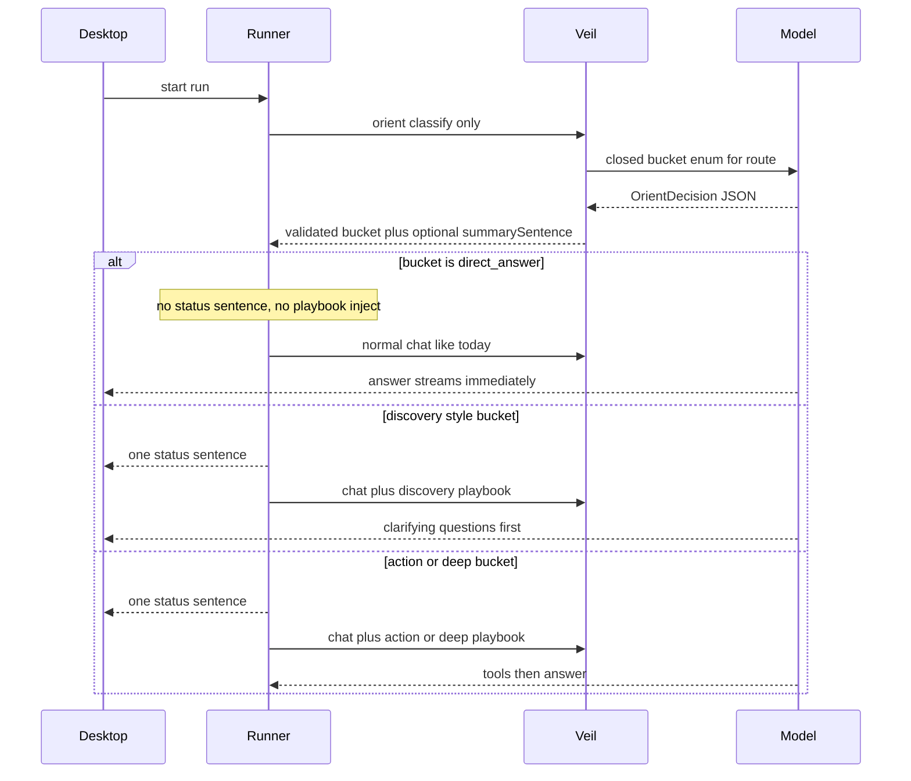

# Intent-Bucket Harness Plan

## Status

This document is the locked design for hidden intent-bucket harness routing, in-house warm `search`, discovery grilling, and scoped deep review (same style as [docs/harness-reliability-plan.md](harness-reliability-plan.md)). Feature implementation follows the phases at the end; landing this doc does not start that work by itself.

## Goal

Hidden intent buckets keep smaller models from wandering:

1. Classify the user request into one closed bucket for the active harness profile (`engineering` | `marketing` | `sales`).
2. **Most buckets:** show one natural status sentence, then inject that bucket’s soft playbook + preferred skills into the protected prompt for the real work loop.
3. **`direct_answer`:** no status sentence, no playbook ceremony, no “working…” progress theater — stream the answer immediately the way Umbratic does today.
4. Bucket ids, playbook text, and the orient decision never leave the runner process — not in runner→desktop events, renderer state, diagnostics, or telemetry. Skill ids remain user-visible as today (see Runner / UI rules).

## Fixed product decisions

- Buckets are **hidden harness state only**.
- Profile → route stays as today: [`harnessRouteConfig`](../apps/desktop/src/main/runnerAdapter.ts) → `/api/{profile}/chat`.
- Remove from [`GlobalSystemPrompt`](../infrastructure/veil/internal/prompts/prompts.go) the rule *“Never end a turn by merely saying you will read, inspect, check, or run something…”*.
- Soft plans bias the existing Rust runner tool loop. No second executor. No parallel meta-skill inventory (`grep_code`, etc.).
- Playbooks name real tools (`ls`, `find`, **`search` (primary)**, `grep` (escape hatch), `read`, `edit`, `command`, …) and real skill ids via `read_skill` / harness skill preflight.
- **Prefer `search` over `grep`** for locating paths and content. Keep `grep` available for exact regex/edge cases when `search` is the wrong fit; do not ban `grep`.
- Marketing and sales non-answer work **must grill for missing context** before producing deliverables. Engineering does the same for planning / PRD / spec / design-doc work.
- **`deep_review` goes deeper on a scoped risk surface, not file-by-file across the whole tree.** Whole-repo “audit everything” on a large codebase must grill for scope first.

## Workspace search: current state and in-house FFF-inspired design

### What exists today

| Surface | Tool | Engine | Role |
| --- | --- | --- | --- |
| Runner (agent) | `ls` / `find` / `grep` | WalkDir + per-call scan ([`enumerate.rs`](../packages/runner/src/tools/enumerate.rs)) | Model workspace tools; **cold walk every grep** |
| Runner | ~~`search`~~ | Deleted by [harness-reliability-plan](harness-reliability-plan.md) (Landed, "Exact workspace tools") | Was overloaded |
| Desktop UI | `search-files` | Custom walkdir + substring ranking ([`native/src/main.rs`](../apps/desktop/native/src/main.rs)) | UI only — not the agent tool |

**No FFF crate is in the tree.** [FFF](https://github.com/dmtrKovalenko/fff) is the reference for *what works* for long-lived agent search — not a dependency to vendor or link.

### Locked approach: learn from FFF, implement ourselves

**Do not add `fff-search`, `@ff-labs/*`, LMDB frecency DBs, or their MCP binary.** Study FFF's architecture and reimplement the subset that fits Umbratic's runner security and dependency policy (stdlib + existing crates like `walkdir` / `regex` / `globset` already in use).

#### Ideas to take from FFF (why they're fast for agents)

1. **Long-lived process + warm index** — index the workspace once per session/cwd; later queries hit memory instead of re-walking the tree every tool call (main win vs cold `WalkDir`/`grep` each time).
2. **Separate path index vs content search** — fast path/filename lookup from a sorted in-memory path list; content search over candidate files with tight limits.
3. **Agent-oriented result shaping** — bounded hits, relative paths, stable ordering, optional "definition-looking line" boost so the model gets fewer useless matches (small heuristic, not their full classifier stack).
4. **Smart-case** — case-insensitive unless the query contains uppercase.
5. **Respect ignore/generated dirs** — map to Umbratic's existing blocked/secret/generated policy.

#### Explicitly out of scope for v1 (FFF features we skip)

- Shipping or wrapping their crate / C lib / Node SDK / MCP server
- LMDB-backed frecency persistence across app restarts
- Full Smith-Waterman / frizbee fuzzy stack unless a tiny substring+token scorer proves insufficient
- Background FS watcher complexity beyond invalidating the index after our own write/edit/apply_patch
- Git status annotations in search results (nice later)

#### What we implement in the runner

Restore first-class tool **`search`** owned by `packages/runner`:

```text
Session start / first search
  -> build PathIndex under cwd (WalkDir once, policy filters, relative paths)
  -> keep Arc<PathIndex> on the session

search(query, mode, path?, glob?, limit, ...)
  -> path mode: score/filter PathIndex (substring / simple fuzzy token match)
  -> content mode: scan candidate files from index (buffered read,
     skip binary/oversize, smart-case literal first; regex only if requested)
  -> return bounded relative hits (path, optional line+text), truncation flags

On write/edit/apply_patch success
  -> invalidate or patch PathIndex for touched paths
     (hook: the success branch of dispatch::execute_tool, which already has the
      session, tool name, and result metadata with zero signature changes;
      apply_patch must surface its committed path set into result metadata)

On command/run_program success
  -> mark the whole index stale (generation bump); rebuild lazily on next search
     (shell commands can mutate the workspace with no path-level signal, so
      coarse staleness is the rule, not per-path patching)
```

**Correctness requirements:**

- Same canonical-root, no-symlink-follow, secret/generated blocking as `find`/`grep`
- Size/result caps; no absolute paths in model-facing output
- Deterministic ordering for tests
- Cancellation-aware: poll `session.is_aborted()` inside every walk/scan loop (copy the 25 ms poll pattern from `lsp/mod.rs`). Today's `find`/`grep` loops have no abort check, so this is new code, not inherited behavior; no panic on bad UTF-8
- Tool schema single-purpose and strict (align with the reliability plan's "One generated tool contract" work; `search` may land on the current hand-maintained contract and is folded into the generated contract with every other tool)

**Keep `grep`** as escape hatch for exact literal/regex line search. **Do not ban `grep`.** Keep `ls` / `find` for listing and explicit globs.

#### Implementation surface (complete change list)

Reference implementation: the deleted tool is recoverable via `git show c16f981:packages/runner/src/tools/search.rs` (query language, smart-case, recency cache) — reference only; the new tool is simpler and index-backed.

Runner (`packages/runner`):

1. `src/config.rs` — add `"search"` to `RUNNER_TOOL_NAMES`.
2. `src/tools/schema.rs` — `search` spec block next to `grep`; also update the `command` tool description text that currently says "Prefer read, ls, find, and grep".
3. `src/tools/request.rs` — `ToolRequest::Search` variant, parse arm, `summary()`, `capability_name()`, `tool_capability_name` (which currently hard-returns `None` for `"search"`), `validate_arguments` allowlist.
4. `src/tools/dispatch.rs` — dispatch arm; export the tool fn from `tools.rs`.
5. `src/session.rs` — `Arc<PathIndex>` field on `Session` (same shape as the `lsp` / `workspace_graph` handles); update both construction sites (`SessionStore::create` and `test_session`).
6. `src/context.rs` — add `search` to `classify_kind` so results get the existing `search_top_lines` compression strategy.
7. `src/public_progress.rs` — map `"search"` to "Searching the codebase".
8. Guard tests that currently assert the deletion must flip in the same land: `src/tools/tests.rs` (no-spec-named-`search`; `tool_capability_name("search")` is `None`) and `tests/native-runner.test.ts` (exact sorted tool-name list).

Policy reuse (no new policy code): root confinement via `resolve_workspace_path`, combined secret/generated filtering via `should_skip`, existing size/result caps and redaction.

Desktop (`apps/desktop`) — tool ids are duplicated across the app and `search` is silently filtered out of `enabledTools` unless all of these change together:

1. `src/main/types.ts` — `RunnerToolId` union.
2. `src/main/toolSettings.ts` — `runnerToolIds`.
3. `src/renderer/main.tsx` — the duplicated tool-id union.
4. `src/main/capabilities.ts`, `src/main/policy.ts`, `src/main/main.ts`, `src/main/runnerEventAdapter.ts` — remaining tool-id references.
5. `src/main/storage.ts` — enabled-tool normalization.
6. `src/renderer/commandDisplay.ts` — add `search` to `workspaceToolLabels` ("Search workspace"). Without it, `isShellRun` falls through and the tool renders as a raw shell command in the UI — a user-visible regression, not cosmetics. Same for `commandDetailLabel` / `activityToolLabel` paths that key off the map.

**Desktop-core `search-files`:** leave UI helper alone in v1. Optionally later reuse the same in-house path-index ideas.

**Prompt / playbook guidance:** prefer `search` → `read`; `grep` only for exact confirmation; no `command`-based `rg` for routine search.

**Reliability-plan amendment (recorded here only):** the reliability plan's landed item "Exact workspace tools" recorded `search` as deleted; that deletion stands as history, but the decision is revised — `search` returns as the **warm primary** locator (in-house FFF-inspired); `grep` stays **exact secondary**. [harness-reliability-plan.md](harness-reliability-plan.md) is deliberately **not edited**: this document is the amendment of record and supersedes that item on this one point. Note the old "Work 6a" / "Work 5" labels no longer exist — that document was reorganized into "Landed and verified" / "Current defects" / numbered "Remaining work" sections that renumber as work lands, so references here use section names, never numbers.

### Tool preference order

```text
locate code/content  -> search  (warm in-house index)
list one dir         -> ls
explicit glob tree   -> find
exact line regex     -> grep   (fallback)
open evidence        -> read
```

## Runtime flow




### Orient contract

```text
OrientDecision {
  bucket: string
  summarySentence: string | null
  // null or omitted when bucket == direct_answer
  // otherwise exactly one short plain sentence, no JSON, no bucket name
}
```

Validation:

- `bucket` must be in the active route catalog; else coerce to that route’s `open_task`.
- If `bucket == direct_answer`: force `summarySentence = null`; runner emits nothing from orient and does not inject a playbook.
- Else: require one non-empty sentence (≤ ~240 chars, single paragraph). Strip any accidental bucket id from the sentence before UI emit.
- Orient call itself is non-tool, structured JSON only. It is harness-internal and must not drive long `assistant.progress.delta` “working” UI. Prefer treating orient as a short preflight; user-visible time for `direct_answer` should feel like today’s single generation.

### Orient transport (locked)

Veil today makes exactly one upstream model call per request, has **no structured-output support** (`model.ChatRequest` has no response-format field in either the vLLM or Ollama body builders), and holds **no session state**. The orient call therefore works like compaction, not like chat:

- **New Veil endpoint `POST /api/internal/orient`**, modeled directly on the compaction handler (`/api/internal/context/compact`): non-streaming, server-prompted, one upstream call, free-form JSON output parsed and **validated server-side** (the `validCompactionSummary` pattern). Invalid or unparseable output is coerced per the validation rules above; if coercion is impossible, typed error `invalid_orient_decision`.
- **Route key:** the request carries the full route string (`engineering/chat` | `marketing/chat` | `sales/chat`) — the `prompts.go` route-constant spelling, not compaction's bare profile names. One vocabulary, chosen deliberately.
- **Caller is the runner.** Veil stays stateless; orient-once-per-run and re-orient tracking live in the runner. The runner's Veil route allowlist (`veil_client.rs`) is widened to include the orient path. Desktop `policy.ts` route assertions are untouched — they govern only `chatEndpointPath`.
- **Own admission lease.** Orient is admitted as its own request; never hold one lease across orient + chat (that doubles lease hold time under load).
- **Latency budget (`direct_answer` parity):** same configured model, `stream: false`, no tools, output capped (~96 tokens), reasoning/thinking disabled for this call, prompt is only the short closed-enum catalog. Runner-side hard timeout: 3 s server mode, 10 s local mode.
- **Degradation:** on timeout, transport error, or unrecoverable invalid decision, the runner **skips orient entirely** and runs exactly today's path — no playbook, no status sentence. Orient can only add behavior; it can never block or fail a run.
- Structured-output / grammar-constrained decoding in `ChatRequest` is explicitly out of scope for v1; if it lands later, orient adopts it without changing this contract.

### Playbook injection (non-`direct_answer` only)

Protected system message on the next turn snapshot (Veil-owned text, never client-supplied):

```text
Active task playbook (harness-internal). Follow this soft plan; adapt when evidence changes.
Do not mention playbooks, buckets, or routing to the user.

<PLAYBOOK BODY>

Preferred skills (optional): <ids>
If you will follow a preferred skill, read it completely with read_skill before applying it.
Stop when: <STOP>
Anti-loop: after a tool failure, change the approach; do not repeat an equivalent failing call.
```

**Mechanics and prefix-cache trade-off:**

- Injection uses the protected-message slot that already exists: `BuildWithProtectedMessages` in Veil's `prompts.go` takes a protected-messages argument that `server.go` currently passes as `nil`, and `templates.Registry.ProtectedContext` is the dormant machinery producing exactly this shape. No new assembly path.
- The playbook is always the **last** protected system message — after the global prompt, route prompt, and skill catalog. Everything before it stays byte-stable and prefix-cacheable; the cache is invalidated only from the playbook onward, and only when orient/re-orient changes the bucket.
- This is a deliberate exception to the overlay design that moved template metadata off the protected tier for cache stability (`TestRequestOverlayLeavesTheProtectedPrefixStable`). Record the new baseline in that test's terms: the guaranteed-stable protected prefix ends at the skill catalog; the playbook slot after it may vary per run.
- Clients still cannot supply system text (rejected at Veil's policy layer, stripped runner-side); the playbook is rendered from Veil-owned catalogs keyed by `(route, bucket)`.

## Shared behavioral modes

### Mode A — Direct answer

- No orient sentence.
- No playbook.
- Answer in the first normal generation.
- Tools only if truly required for a factual workspace claim; default is no tools.

### Mode B — Status then act

- Emit one natural sentence (what you’ll check / why / what you’ll do). Not a fixed template.
- Inject playbook.
- Then tool loop or drafting as the playbook says.

### Mode C — Discovery grill (questions first)

- Emit one status sentence that signals clarifying, not building yet.
- Ask a **tight batch of questions** (typically 4–8) covering goal, audience, constraints, success criteria, inputs, out-of-scope, and format.
- **Do not** write the PRD / campaign / proposal / deck until the user answers enough to proceed, unless they explicitly say “just draft with assumptions” — then state assumptions and draft.
- Prefer one grill turn over endless drip questions. If answers are partial, ask only the missing blockers.

### Mode D — Deep pass (scoped, not whole-tree)

- Deeper than a normal review on a **bounded risk surface**.
- Never read every file. Never treat “I opened many files” as completeness.
- Use `search` in targeted waves (auth, secrets, sinks, entrypoints), then `read` only high-signal hits.
- Cap: prefer a fixed budget (e.g. ≤ ~25–40 substantive `read`s per deep pass unless the user expands scope). After the budget, synthesize with explicit **Not covered** gaps.
- If the user asks for a full-codebase / entire-monorepo security review and the tree is large (many packages, huge `node_modules`-excluded but still massive src), **switch to discovery first**: ask which apps/services/paths, threat priorities, and must-cover controls before scanning.
- “Deeper” means more rigor on the chosen surface (trust boundaries, vuln classes, confirmed vs needs-validation), not wider until every path is touched.

---

## Engineering buckets

Catalog for `/api/engineering/chat`.

### 1. `direct_answer`

- **When:** chitchat, “what can you do”, pure conceptual Q with no need to inspect the repo.
- **Mode:** A.
- **Status sentence:** none.
- **Playbook:** none.
- **Skills:** none.
- **Stop:** after the answer.

### 2. `repo_orient`

- **When:** map the repo, “what’s here”, high-level tour.
- **Mode:** B.
- **Example status:** “I’ll scan the top-level layout and key entrypoints so I can give you a clear map of this repo.”
- **Playbook:**
  1. `ls` on `.` ; continue with `nextOffset` if partial.
  2. `search` (and `find` only for explicit globs) for manifests, READMEs, main entrypoints only.
  3. Read a few high-signal files; do not recursively read everything.
  4. Return a short structured map (purpose, major dirs, how to run if evident).
- **Skills:** none required; `umbratic-markdown` only if writing a durable map file the user asked for.
- **Stop:** after the map; no writes unless asked.

### 3. `code_explain`

- **When:** how does X work; explain auth, data flow, module.
- **Mode:** B.
- **Example status:** “I’ll locate the code that owns this behavior and walk through how it actually runs.”
- **Playbook:**
  1. `search` for symbols and paths named in the request (`find` if an explicit glob is enough).
  2. `read` the owning files; follow only necessary references.
  3. Explain with exact paths and symbols; no speculative architecture.
- **Skills:** none; language skills (`umbratic-python`, later `umbratic-cmake`) only if explanation needs run/build context the user asked for.
- **Stop:** after a clear explanation; no edits.

### 4. `debug_failure`

- **When:** crash, exception, failing test, “why is this broken”.
- **Mode:** B.
- **Example status:** “I’ll reproduce or inspect the failure path, isolate the cause, then fix and verify if you want that.”
- **Playbook:**
  1. Gather failure evidence (message, log, test name) from the request or workspace.
  2. Locate likely code with `search`/`read` (`grep` only if exact regex is needed).
  3. Reproduce with `command` / `run_program` when safe and useful.
  4. Fix only if the user asked for a fix; otherwise report root cause.
  5. Re-run the failing check after a fix.
- **Skills:** `umbratic-python` when Python; `umbratic-git-worktree` if branch/worktree state matters; `umbratic-cmake` when C/C++ (new default enable — see skills).
- **Stop:** verified fix or a concrete root-cause answer; no tool thrash.

### 5. `code_change`

- **When:** implement, add feature, fix bug with code changes.
- **Mode:** B.
- **Example status:** “I’ll find the right insertion points, make the change, and verify it behaves as requested.”
- **Playbook:**
  1. Evidence pass (`search`/`read`) before any write.
  2. Prefer `edit` / `apply_patch` over rewrite; match repo style.
  3. Verify with the narrowest relevant command or test.
  4. Brief outcome: paths changed + verification result; do not dump full file contents.
- **Skills:** `umbratic-python` / `umbratic-cmake` as language-appropriate; `umbratic-git-worktree` when isolated worktree semantics matter.
- **Stop:** after successful change + verification, or a blocker that needs the user.

### 6. `review_audit`

- **When:** normal code review, quality pass, light “any issues?”.
- **Mode:** B.
- **Example status:** “I’ll review the relevant changes and call out concrete risks, not a generic checklist.”
- **Playbook:**
  1. Determine scope (diff, paths, or area named by user); use git read-only commands if needed.
  2. `search`/`read` the scoped files; note what was and was not covered.
  3. Findings ordered by severity with path/symbol evidence.
  4. No writes unless the user asked to fix findings.
- **Skills:** `umbratic-git-worktree` when review is against task branch/base; `umbratic-security-review` only if security themes appear (else keep light).
- **Stop:** after findings (and optional fix pass if requested).

### 7. `deep_review`

- **When:** vulnerabilities, deep security check, deep analysis, “think hard”, thorough audit, threat-model tone.
- **Mode:** D (+ B status sentence). May enter Mode C first when scope is “whole codebase” and the tree is large.
- **Example status:** “I’ll deep-dive the highest-risk trust boundaries in scope, not every file in the tree.”
- **Scope gate (before heavy tools):**
  - If the user named paths/services/PRs → use that as the surface.
  - If they asked for the **entire** repo/monorepo and size is large → ask: which apps/packages, which threat priorities (auth, secrets, injection, supply chain, …), any must-ignore generated dirs already handled by policy, and what “done” means. Do **not** start a whole-tree read loop.
  - Default surface when vaguely “secure this app”: entrypoints, auth/session, secret handling, dangerous sinks, config, permission checks — discovered via targeted `search` waves, not directory walking every file.
- **Playbook (after scope is clear):**
  1. Load `umbratic-security-review` and follow its checklist for the chosen surface.
  2. Wave-based `search` queries (auth tokens, password, exec, eval, deserialize, SQL, path join, SSRF-ish HTTP, permission, CORS, etc. — as skill lists), then `read` only top hits.
  3. Use `grep` only for precise confirmation patterns.
  4. Respect the read budget; then report **Confirmed** / **Needs validation** / **Not covered**.
  5. Default read-only; fix only if asked.
- **Anti-stuck rules (harness playbook text must include these):**
  - Do not `ls`/`find` recursively through the whole tree as a substitute for review.
  - Do not open every search hit; rank and sample.
  - After N similar searches with no new classes of finding, stop and synthesize.
  - Prefer one deep pass + clear gaps over an endless second pass.
- **Skills:** `umbratic-security-review` (new) required; `umbratic-git-worktree` for branch scope; language skills as needed.
- **Stop:** after the scoped deep report with explicit coverage limits.

### 8. `test_verify`

- **When:** run tests, add tests, check that something works.
- **Mode:** B.
- **Example status:** “I’ll identify the right test or check command, run it, and interpret the result.”
- **Playbook:**
  1. Find the project’s test/build command from manifests or repo norms.
  2. Run the narrowest useful command.
  3. Add/adjust tests only if asked.
  4. Report pass/fail with relevant output excerpt.
- **Skills:** `umbratic-python`, `umbratic-cmake` as appropriate.
- **Stop:** after interpreted results.

### 9. `refactor_migrate`

- **When:** restructure, migrate, compare v1/v2 modules, multi-file redesign with implementation.
- **Mode:** B.
- **Example status:** “I’ll compare the relevant areas, sequence safe edits, and verify as I go.”
- **Playbook:**
  1. Scope both sides; `search`/`read` to compare behavior.
  2. Write a short internal sequence (still soft — do not expose bucket).
  3. Apply edits in dependency order; verify after meaningful chunks.
  4. Summarize migrations risks and leftover work.
- **Skills:** language skills; `umbratic-git-worktree` if branch isolation matters.
- **Stop:** after sequenced changes + verification, or a clear plan-only answer if the user asked for a plan not edits — if plan-only, prefer `spec_discovery` instead when requirements are fuzzy.

### 10. `docs_change`

- **When:** update README, comments, existing docs with clear content already known.
- **Mode:** B.
- **Example status:** “I’ll update the docs to match the current behavior and keep the edit scoped.”
- **Playbook:**
  1. Locate the doc files; read current content.
  2. Edit for accuracy; no drive-by code changes.
  3. Keep tone and structure consistent with the repo.
- **Skills:** `umbratic-markdown`.
- **Stop:** after doc edit. If the user wants a new PRD/design from scratch with unclear requirements → `spec_discovery`, not this bucket.

### 11. `spec_discovery`

- **When:** planning, PRD, product spec, design doc, RFC, “help me spec this”, architecture write-up where requirements are incomplete.
- **Mode:** C.
- **Example status:** “Before drafting, I need a few decisions so the spec matches what you actually want.”
- **Playbook:**
  1. Grill in one batch covering: problem, users, goals/non-goals, constraints, success metrics, platforms, data/privacy, integrations, open questions, deliverable format (PRD vs RFC vs checklist).
  2. Wait for answers (or explicit “assume and draft”).
  3. Then outline → draft the doc in-repo or in chat as requested.
  4. Call out assumptions and unresolved decisions explicitly in the draft.
- **Skills:** `umbratic-discovery` (new) + `umbratic-markdown`; `umbratic-product-spec` (new) when drafting PRD/RFC structure.
- **Stop:** after questions if context is insufficient; after draft if context is enough or user waived discovery.

### 12. `open_task`

- **When:** doesn’t cleanly fit; multi-intent blob.
- **Mode:** B, conservative.
- **Example status:** “I’ll take the smallest useful next step from your request and avoid wandering.”
- **Playbook:**
  1. Restate the actionable goal internally via playbook.
  2. One evidence gather → one action or one clear answer.
  3. Prefer stopping and asking over speculative multi-hop tool loops.
- **Skills:** none by default.
- **Stop:** after one coherent outcome or a single clarifying question if blocked.

---

## Marketing buckets

Catalog for `/api/marketing/chat`.

**Rule:** every bucket except `direct_answer` starts with Mode C discovery unless the user already supplied a complete brief (audience, offer, channel, constraints, success criteria, tone, must-use facts). If complete, skip grill and proceed.

### 1. `direct_answer`

- **Mode:** A. Immediate answer. No status. No playbook.
- **Skills:** none.

### 2. `positioning`

- **When:** positioning, differentiation, messaging pillars, brand narrative.
- **Mode:** C then draft.
- **Example status:** “I’ll clarify audience and proof points first so the positioning stays grounded.”
- **Grill for:** audience, category, competitors, proof, forbidden claims, tone, where it will be used.
- **Then:** produce positioning in the requested format; never invent metrics or customer quotes.
- **Skills:** `umbratic-discovery`; `umbratic-markdown`; `umbratic-marketing-brief` (new).

### 3. `campaign_plan`

- **When:** campaign, launch plan, GTM outline.
- **Mode:** C then plan.
- **Example status:** “I need a few campaign inputs before I build a plan you can actually run.”
- **Grill for:** objective, audience, offer, timeline, channels, budget band, assets on hand, KPI, compliance limits.
- **Then:** channel plan + asset list + sequence; flag unknowns.
- **Skills:** `umbratic-discovery`, `umbratic-marketing-brief`, `umbratic-markdown`.

### 4. `copy_draft`

- **When:** landing copy, email, ads, rewrite.
- **Mode:** C (light) then draft — fewer questions if a source draft exists.
- **Example status:** “I’ll confirm audience and constraints, then draft copy against the facts you gave.”
- **Grill for:** audience, CTA, length, tone, must-include / must-avoid, source facts.
- **Then:** draft → tighten; no invented social proof.
- **Skills:** `umbratic-discovery`, `umbratic-markdown`; `umbratic-documents` if DOCX deliverable.

### 5. `asset_build`

- **When:** deck, one-pager, doc, sheet as marketing artifact.
- **Mode:** C then build.
- **Example status:** “Before building the asset, I’ll lock format, audience, and the claims we’re allowed to make.”
- **Grill for:** format (PPTX/DOCX/XLSX/MD), audience, narrative arc, required sections, brand constraints, source facts.
- **Then:** load the matching artifact skill and produce.
- **Skills:** `umbratic-discovery`, `umbratic-presentations` / `umbratic-documents` / `umbratic-spreadsheets` / `umbratic-pdf` as required, `umbratic-markdown` for MD sources.

### 6. `research_synth`

- **When:** synthesize from attachments/workspace research packs.
- **Mode:** B with light C if the synthesis goal is vague.
- **Example status:** “I’ll read the source material and synthesize only what it supports.”
- **Playbook:** read attachments completely when coverage is required → notes → synthesis; mark gaps.
- **Skills:** `umbratic-pdf`, `umbratic-data-analysis` if data-heavy, `umbratic-markdown`.

### 7. `performance_review`

- **When:** analyze campaign/performance numbers the user supplied.
- **Mode:** B; grill only if metrics definitions are missing.
- **Example status:** “I’ll analyze the numbers you provided and keep recommendations tied to that data.”
- **Playbook:** inspect data → validate fields → insights → next actions; no fabricated benchmarks.
- **Skills:** `umbratic-data-analysis`, `umbratic-spreadsheets`, `umbratic-python`.

### 8. `open_task`

- **Mode:** C then smallest deliverable.
- **Example status:** “I’ll clarify what ‘done’ looks like, then produce the smallest useful marketing output.”
- **Skills:** `umbratic-discovery`, then artifact skills as needed.

---

## Sales buckets

Catalog for `/api/sales/chat`.

**Same rule as marketing:** except `direct_answer`, grill for missing account/context before drafting customer-facing material.

### 1. `direct_answer`

- **Mode:** A. Immediate. No status. No playbook.

### 2. `account_research`

- **When:** account brief from supplied notes/files.
- **Mode:** B / light C if goal of the brief is unclear.
- **Example status:** “I’ll pull a brief from the facts available and mark anything still unknown.”
- **Playbook:** gather only supplied/workspace facts → account brief → open questions list (not invented firmographics).
- **Skills:** `umbratic-discovery`, `umbratic-pdf`/`umbratic-markdown` as sources require; `umbratic-sales-enablement` (new).

### 3. `discovery_prep`

- **When:** prep discovery call, question list, hypotheses.
- **Mode:** C if account context thin; else B.
- **Example status:** “I’ll confirm what we know about the account, then build a focused discovery question set.”
- **Grill/use:** persona, stage, known pain, product wedge, competitive notes, call length.
- **Then:** hypotheses + prioritized questions + listen-fors.
- **Skills:** `umbratic-discovery`, `umbratic-sales-enablement`.

### 4. `proposal_draft`

- **When:** proposal, SOW outline, commercial narrative.
- **Mode:** C then draft.
- **Example status:** “I need requirements and constraints before drafting a proposal that won’t invent terms.”
- **Grill for:** buyer, problem, scope, timeline, pricing posture, must-include legal/compliance notes, success criteria.
- **Then:** grounded proposal sections; label assumptions.
- **Skills:** `umbratic-discovery`, `umbratic-sales-enablement`, `umbratic-documents` / `umbratic-markdown`.

### 5. `objection_handling`

- **When:** handle objections, competitive pushback.
- **Mode:** light C then responses.
- **Example status:** “I’ll ground responses in approved claims and the account context you shared.”
- **Grill for:** exact objection, buyer persona, approved proof, hard limits on claims.
- **Then:** rebuttal + clarifying question + optional proof ask.
- **Skills:** `umbratic-sales-enablement`, `umbratic-discovery`.

### 6. `demo_script`

- **When:** demo flow, talk track.
- **Mode:** C then script.
- **Example status:** “I’ll lock audience and outcomes first, then write a demo flow that stays practical.”
- **Grill for:** audience, duration, success moment, products in scope, environment constraints.
- **Then:** timed flow + talk track + fallback paths.
- **Skills:** `umbratic-sales-enablement`, `umbratic-markdown`; `umbratic-presentations` if deck-linked.

### 7. `enablement_asset`

- **When:** one-pager, leave-behind, internal enablement deck/sheet.
- **Mode:** C then build.
- **Example status:** “Before building the asset, I’ll confirm audience, format, and approved claims.”
- **Skills:** `umbratic-discovery`, `umbratic-sales-enablement`, plus `umbratic-presentations` / `umbratic-documents` / `umbratic-spreadsheets` / `umbratic-pdf`.

### 8. `pipeline_ops`

- **When:** CRM hygiene, stage process, forecasting process help.
- **Mode:** light C then practical steps.
- **Example status:** “I’ll clarify your process constraints, then give concrete pipeline next steps.”
- **Skills:** `umbratic-discovery`; `umbratic-spreadsheets` if operating from a sheet.

### 9. `open_task`

- **Mode:** C then smallest customer-facing useful output.
- **Skills:** `umbratic-discovery`, then enablement/artifact skills.

---

## Skills: current, adjustments, new

### Current system skills (relevant)


| Id                       | Role today                                         |
| ------------------------ | -------------------------------------------------- |
| `umbratic-skill-creator` | Create personal skills (engineering default)       |
| `umbratic-git-worktree`  | Worktree/branch/review git semantics (engineering) |
| `umbratic-markdown`      | Markdown docs/artifacts                            |
| `umbratic-python`        | Python create/run/test                             |
| `umbratic-pdf`           | PDF/OCR-ish document work (business profiles)      |
| `umbratic-data-analysis` | Pandas analysis (business)                         |
| `umbratic-presentations` | PPTX (business)                                    |
| `umbratic-documents`     | DOCX (business)                                    |
| `umbratic-spreadsheets`  | XLSX/CSV (business)                                |


Present on disk but **not** in default [`systemSkillDefinitions` / harness enables](../apps/desktop/src/main/skills.ts): `umbratic-cmake`, `umbratic-ocr` (OCR overlaps `umbratic-pdf`).

### Adjustments to existing skills

1. **`umbratic-markdown`:** add a short section on PRD/design-doc headings only if `umbratic-product-spec` is not added; prefer a dedicated product-spec skill instead and keep markdown focused on format.
2. **`umbratic-git-worktree`:** keep; reference from `review_audit`, `deep_review`, `code_change` when task worktrees matter.
3. **`umbratic-pdf`:** keep as the attachment/PDF path for research buckets; do not require separate OCR skill in v1 defaults.
4. **Harness defaults:**
  - Engineering: add `umbratic-cmake` to definitions + engineering enable set (file already exists).
  - Engineering: enable `umbratic-markdown` (already), plus new discovery/spec/security skills below.
  - Marketing/Sales: keep artifact skills; add discovery + domain skills below.

### Registration mechanics (every skill change)

Adding or enabling a skill touches four places together, plus one renderer duplicate:

1. `apps/desktop/src/main/system-skills/<id>/SKILL.md` — the frontmatter parser is hand-rolled and reads only `name`, `description`, and `paths`; new skills must not rely on any other keys. Directory name is the id (`/^[A-Za-z0-9_-]{1,96}$/`), file must be `SKILL.md`, 512 KB cap.
2. `apps/desktop/src/main/skills.ts` — `systemSkillDefinitions` (anything not in this array is never installed, listed, or enabled — this is why `umbratic-cmake`/`umbratic-ocr` are orphaned on disk today).
3. `apps/desktop/src/main/skills.ts` — `harnessSystemSkillIds` per-profile enable sets.
4. Tests: `tests/main-skills.test.ts` and `tests/main-runner-adapter.test.ts` assert the registry exactly — including negative assertions that must flip when `umbratic-cmake` is enabled (not-installed-on-disk, not-listed, not-a-settings-key, absent-for-marketing).
5. `apps/desktop/src/renderer/previewSupport.ts` keeps a duplicate of the enable map — mirror every change there.

### New skills to add

#### `umbratic-discovery` (all profiles)

- **Purpose:** how to grill without annoying — one tight question batch, blocker vs nice-to-have, when to assume, how to encode answers into a working brief.
- **Use from:** `spec_discovery`, nearly all marketing/sales non-`direct_answer` buckets.
- **Enable:** engineering + marketing + sales.

#### `umbratic-product-spec` (engineering)

- **Purpose:** PRD / RFC / design-doc structure, non-goals, requirements quality bar, acceptance criteria, explicit assumptions section.
- **Use from:** `spec_discovery` after grill.
- **Enable:** engineering.

#### `umbratic-security-review` (engineering)

- **Purpose:** comprehensive defensive security review playbook for in-repo analysis. Prefer depth on a scoped surface. Never instruct building exploit PoCs, weaponized payloads, or attacks against systems — findings stay evidence + impact + fix guidance.
- **Use from:** `deep_review` (required); optional assist for `review_audit` when security-tagged.
- **Enable:** engineering.
- **Skill body must include (detailed checklist sections):**
  1. **Scope ritual** — named paths vs whole-repo; when to ask scoping questions; read budget; “Not covered” requirement.
  2. **Method** — targeted `search` waves → selective `read` → synthesize; no whole-tree enumeration.
  3. **Trust boundaries** — external HTTP/IPC, authn/authz, multi-tenant edges, filesystem roots, subprocess boundaries, model/tool boundaries (relevant to Umbratic-like apps).
  4. **Authn/Authz** — session/token handling, password storage, MFA gaps, privilege escalation, IDOR/missing object auth, role checks on mutations.
  5. **Secrets** — hardcoded keys, `.env` leakage, logs/telemetry redaction, tokens in URLs, private keys in repo.
  6. **Injection** — command injection, SQL/NoSQL, template/SST I, path traversal, unsafe deserialization, XSS if web UI, prompt-injection surfaces if LLM-facing.
  7. **SSRF / outbound** — user-controlled URLs, link-local/metadata IPs, redirect following.
  8. **Filesystem** — symlink escape, root confinement, upload/download path rules.
  9. **Crypto / transport** — weak TLS, cookie flags, CSRF, CORS misconfig when present.
  10. **Supply chain / build** — unpinned deps, install scripts, binary downloads (aligned with Umbratic supply-chain norms when reviewing this repo class).
  11. **Concurrency / TOCTOU** — check-then-act on files/permissions when relevant.
  12. **DoS / resource** — unbounded reads, zip bombs, sync blocking on untrusted input (note only when evidence exists).
  13. **Reporting rubric** — severity (critical/high/medium/low/info), evidence path+symbol, impact, fix, **Confirmed** vs **Needs validation** vs **Not covered**.
  14. **Anti-loop** — stop criteria when searches stop yielding new vuln classes.

#### `umbratic-marketing-brief` (marketing)

- **Purpose:** positioning, campaign brief, claim discipline (no invented metrics), message house patterns.
- **Use from:** `positioning`, `campaign_plan`, `copy_draft`.
- **Enable:** marketing.

#### `umbratic-sales-enablement` (sales)

- **Purpose:** account briefs, discovery questions, objection responses, demo scripts, proposal sectioning, claim discipline.
- **Use from:** sales buckets above.
- **Enable:** sales.

### Skills explicitly not added in v1

- Separate OCR skill in harness defaults (use `umbratic-pdf`).
- Generic “planner” skill that duplicates bucket playbooks.
- Per-language skills beyond Python/CMake until another language has a clear system skill need.

---

## Prompt deltas (exact intent)

In [`prompts.go`](../infrastructure/veil/internal/prompts/prompts.go) `GlobalSystemPrompt`:

1. **Delete** the sentence beginning *“Never end a turn by merely saying you will read, inspect, check, or run something…”*.
2. **Keep** optional one-sentence preamble when tools are used; do not require tools in the same turn as a status sentence.
3. **Update tool guidance** currently preferring `ls`/`find`/`grep`: prefer **`search`** for path/content location; keep `ls`/`find` for listing/globs; use **`grep`** only when exact regex/line confirmation is needed; do not use `command` for routine ripgrep.
4. **Orient system prompt** (separate protected prompt for classify call): list the closed bucket enum for the route; require JSON `OrientDecision`; instruct that `summarySentence` is null only for `direct_answer`; sentence must not name buckets; choose `deep_review` for vulnerability/deep security/deep analysis/think-hard; choose `spec_discovery` for PRD/planning/design-doc with incomplete requirements; for marketing/sales prefer discovery-capable buckets over `direct_answer` whenever a deliverable is requested.

5. **Scope of the deletion (decided):** delete the full sentence including its colon clause ("make the structured tool call in that turn, or provide the complete final answer from results already obtained"). The anti-stall behavior that clause carried moves into the bucket playbooks' stop rules and anti-loop line; do not leave a sentence fragment behind.

**Tests that must change with the cutover:**

- `internal/prompts/prompts_test.go` — the message-count/index assertions: `TestBuildAddsGlobalAndRoutePrompts` asserts exactly 3 messages, the skill-catalog test asserts 4, and `TestBuildKeepsProtectedMessagesBeforeClientMessages` pins protected messages at index 2; a playbook message shifts all of these. The substring-allowlist test (`TestGlobalAndEngineeringPromptsKeepGeneralScope`) does not assert either deleted sentence, but gains entries for the new `search`-first wording.
- `internal/http/server_test.go` — the three index-pinned assembly tests (global/route/user count, skill-catalog position, template-overlay position) hard-code message counts and positions and must be updated together with `TestRequestOverlayLeavesTheProtectedPrefixStable` (see playbook mechanics above for its new baseline).

Route prompts stay short specialization blurbs; procedural bias lives in bucket playbooks.

## Runner / UI rules

- Orient once per user run; re-orient on steer/follow-up that changes the request.
- `direct_answer`: no orient `assistant.delta`, no playbook message, no extra progress row — behave like today’s immediate answer path.
- Other buckets: exactly one orient `assistant.delta` (`summarySentence`), then normal loop with playbook in protected context.
- **Hidden-bucket invariant (restated): bucket ids, playbook text, and the OrientDecision never leave the runner process.** They are never placed in runner→desktop [`backendEvents`](../apps/desktop/src/shared/backendEvents.ts), runner config echoes, diagnostics, or telemetry. This must hold at the source: the desktop's `RunnerEventAdapter` field-by-field re-projection drops unknown fields and is defense-in-depth, but it is not the wall — `parseBackendUiEvent` spreads unknown fields through, and `diagnostics.ts` logs whole event shapes into a user-exportable file with key-name redaction only.
- The status sentence is emitted as one `assistant.delta` terminated with a blank line (`\n\n`): the renderer concatenates consecutive deltas with no separator, so an unterminated sentence glues to the model's first token.
- The status sentence becomes part of exported telemetry conversations (telemetry rebuilds transcripts from `assistant.delta` text). That is fine by design, but it makes the emit-time bucket-id strip the **only** scrubber — enforce it in the runner with a test; there is no downstream one.
- **Skill chips stay visible (decided).** `skill.requested` already renders the skill id and `origin: harness` to the user; a harness-loaded `umbratic-security-review` chip during a deep review is acceptable. The hidden things are bucket ids and playbook text, not skill ids. Do not add chip suppression.
- **Re-orient on steer is runner-side**, inside the dequeued steer turn: after the steer's `run.queue.updated` dequeue ack, before that turn's first provider request. No desktop-side preflight — the steer path's ordering is test-locked (`main-steering.test.ts`) and the bucket must not enter the main process.
- Discovery buckets may end the first post-orient generation on questions alone (allowed because the promise-without-tools rule is removed).
- `deep_review` may end on scoping questions when whole-repo + large tree.
- Session should keep a warm in-house path index for `search` across tool calls in the same run.
- v1 does not hard-enforce read-only tool allowlists; playbooks state read-only intent in prose. Hard posture can land later.

## Implementation phases

1. ~~Land `docs/intent-bucket-harness-plan.md`~~ (this document; it is the amendment of record for the reliability plan's `search` decision — that file is not edited).
2. **Runner in-house `search` (FFF-inspired, no `fff-search` dep):** session PathIndex, path+content modes, in-loop cancellation polling, invalidation hooks (dispatch success branch for write/edit/apply_patch + coarse staleness after command/run_program), and the complete runner **and desktop** change list above — including the `commandDisplay.ts` label and the guard-test flips; keep `grep`; update Veil tool-preference prompt text and the runner public-progress label.
3. Add new system skills (especially comprehensive `umbratic-security-review`) via the registration mechanics above; enable `umbratic-cmake` for engineering (flip its negative test assertions; mirror `previewSupport.ts`).
4. Veil: `POST /api/internal/orient` (compaction-modeled: non-streaming, own admission lease, server-side validation/coercion, `invalid_orient_decision`), bucket catalogs keyed by full route strings, playbook renderer (search-first + deep_review anti-stuck text) on the existing protected-message slot, tests.
5. Runner: orient preflight with hard timeout and silent-skip degradation, `direct_answer` short-circuit, playbook injection on the turn snapshot, re-orient inside dequeued steer turns, `veil_client.rs` allowlist widening, emit-time bucket-id strip test.
6. Prompt cutover (full-sentence deletion including the colon clause; `search`-first preference) + `prompts_test.go` **and** `server_test.go` updates listed under Prompt deltas.
7. Eval: warm-search vs cold-grep latency on repeated queries; small-model loop reduction on `debug_failure` / `code_change` / `deep_review`; confirm deep_review asks scope on huge whole-repo asks; discovery quality on specs/campaigns/proposals; `direct_answer` UX parity (orient adds at most its timeout budget in the worst case, and nothing when skipped).

**Sequencing against the reliability plan** (by section name — that document renumbers as work lands and is not edited by this plan; these requirements live here): its "Fix fresh-code defects" and "Server hardening and Gate B harness" items are independent and may land anytime. `search` may land on the current hand-maintained tool contract and is folded into "One generated tool contract" with every other tool — whichever lands second absorbs the other. The "Explicit turn snapshot" must grow to include the orient decision and the injected playbook's content hash once this plan lands, since both alter prompt assembly. "Prompt and compaction cleanup" stays last and treats the post-intent-bucket prompt assembly as its baseline.

## Non-goals

- Visible bucket chips or pipeline UI
- Hardcoded parallel pipeline executors outside the runner loop
- Client-supplied playbooks or desktop system-prompt assembly
- Free-form multi-skill JSON plans in v1
- Rewriting desktop-core UI `search-files` with the same index in the same land (optional later)
- Banning `grep` or deleting `find`/`ls`
- Adding `fff-search` or any FFF package as a dependency

