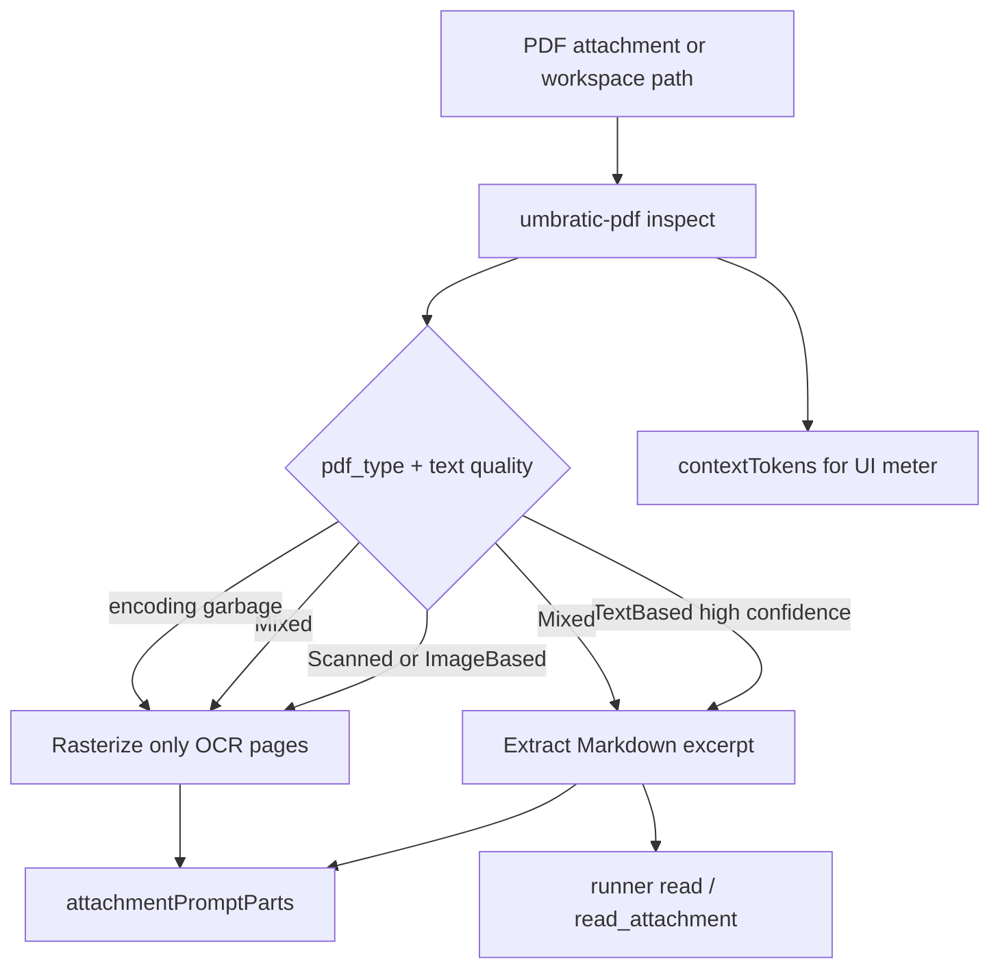

# Native PDF Inspector for Umbratic

Build a first-party Rust PDF inspector inspired by Firecrawl’s [pdf-inspector](https://github.com/firecrawl/pdf-inspector) classify-then-route design (not as a dependency). Wire it into desktop attachment prompts and runner reads, and replace today’s flat 512-token PDF estimate with route-aware text/image accounting.

## Context

Firecrawl pdf-inspector is a pure-Rust pipeline whose valuable ideas for Umbratic are **routing**, not the npm/crate package itself:

1. **Classify first** (`TextBased` / `Scanned` / `ImageBased` / `Mixed`) by sampling content streams for `Tj`/`TJ` vs image ops (~10–50ms).
2. **Per-page OCR routing** via `pages_needing_ocr` instead of all-or-nothing.
3. **Extract structured Markdown** for native-text PDFs (layout, headings, tables) without OCR.
4. **Text-quality / encoding-issue detection** so garbled CID/ToUnicode output falls back to vision/OCR.
5. **Single document load** shared between detect + extract; only dependency is [`lopdf`](https://crates.io/crates/lopdf).

Umbratic today always rasterizes attached PDFs to up to **12 page images** via `pdf-to-img` in [`apps/desktop/src/main/main.ts`](../apps/desktop/src/main/main.ts) / [`pdfRendererWorker.ts`](../apps/desktop/src/main/pdfRendererWorker.ts). Runner [`read` / `read_attachment`](../packages/runner/src/tools/read.rs) refuse binaries. UI estimates treat unscannable PDFs as **`CONTEXT_FILE_TOKENS = 512`** in [`contextWindow.ts`](../apps/desktop/src/shared/contextWindow.ts) even though the real prompt can cost **`min(pages, 12) × 1600`**.

Do **not** grow [`apps/desktop/native`](../apps/desktop/native/AGENTS.md) (search-only). Do **not** add `@firecrawl/pdf-inspector` or git-sourced crates.

## Target architecture



## Placement

Add a new workspace crate **`packages/pdf`** (`umbratic-pdf`):

- Library API used by the runner.
- Small CLI binary spawned by Electron main (same pattern as desktop-core), returning JSON on stdout.
- Workspace member beside `packages/runner` in root [`Cargo.toml`](../Cargo.toml).
- Sole PDF parse dependency: **`lopdf`** (exact version, locked, supply-chain reviewed). No Firecrawl code, no vendored copy of their crate.

Public JSON shape (CLI + runner-facing):

```ts
{
  pdfType: "text_based" | "scanned" | "image_based" | "mixed",
  pageCount: number,
  confidence: number,
  pagesNeedingOcr: number[],      // 1-indexed
  hasEncodingIssues: boolean,
  ocrRecommended: boolean,
  markdown?: string,              // omitted in detect-only mode
  estimatedTokens: number         // route-aware heuristic for UI
}
```

## What to reimplement (ideas, not their codebase)

### Phase 1 — ship value fast (classify + plain extract + routing + estimates)

| Idea from Firecrawl | Umbratic implementation |
| --- | --- |
| Content-stream classification | Sample pages (`Sample(8)` default), count text ops vs image ops, emit type + confidence + `pages_needing_ocr` |
| Shared load | One `lopdf::Document` for detect + extract |
| Encoding / garbage fallback | Port the *heuristics* (U+FFFD runs, alnum ratio, dollar-as-space); skip cipher-stats until needed |
| Markdown for agents | Phase 1: reading-order plain text → light Markdown (paragraphs + page markers). Good enough for routing + estimates |
| Token-efficient output | Cap extract by existing `attachmentPromptTokenBudget`; compact whitespace |

### Phase 2 — quality (after Phase 1 lands)

- Position-aware items, column histogram / reading order, font-size heading tiers.
- Dual table detection (rects + alignment) only if agent PDF QA still needs Python/Poppler for structure.
- Broader ToUnicode / CID handling when encoding-issue rate is high on real attachments.

**Out of Phase 1 scope:** full Firecrawl table stack, bcmaps corpus, WASM/NAPI bindings, browser builds.

## Integration points

### 1. Desktop attachment prompt ([`main.ts`](../apps/desktop/src/main/main.ts) `attachmentPromptParts`)

Replace unconditional `pdfAttachmentImageParts` with:

1. Run `umbratic-pdf inspect --full` (size-bounded, same 25 MiB cap).
2. **TextBased** + `!hasEncodingIssues` + confidence ≥ ~0.7 → inject Markdown excerpt under the existing text budget (same path as UTF-8 attachments), plus a short note that full text is available via `read` / `read_attachment`. **Do not** rasterize.
3. **Scanned / ImageBased** → keep current vision render (cap 12).
4. **Mixed** → Markdown for text pages + rasterize **only** `pages_needing_ocr` ∩ first 12.
5. Inspect failure / encrypted → fall back to today’s render path (or clear failure message).
6. Keep explicit OCR-intent path (`promptLooksLikeOcrTask`) as an additive digest; prefer native extract when text layer is good.

Update [`umbratic-pdf/SKILL.md`](../apps/desktop/src/main/system-skills/umbratic-pdf/SKILL.md): prefer native inspect/extract; use Poppler/pdfplumber for generation/visual QA and when native extract reports encoding issues.

### 2. Accurate estimates ([`attachmentContext.ts`](../apps/desktop/src/main/attachmentContext.ts) + [`contextWindow.ts`](../apps/desktop/src/shared/contextWindow.ts))

On attach / refresh, set `ChatAttachment.contextTokens` from inspect:

- Text path: `estimateAttachmentTextTokens(markdown)` capped by remaining attachment budget.
- Vision path: `pagesRendered * CONTEXT_IMAGE_TOKENS` (+ any OCR digest tokens).
- Mixed: sum of both.

Teach `estimateContextUsage` that `.pdf` without measured tokens is **not** a 512 stub: either require inspect before meter, or use a PDF-specific fallback of `CONTEXT_IMAGE_TOKENS` (honest default) instead of `CONTEXT_FILE_TOKENS`.

### 3. Runner tools ([`packages/runner/src/tools/read.rs`](../packages/runner/src/tools/read.rs))

For `.pdf` paths / attachments: call `umbratic-pdf` extract and return bounded Markdown (paged or offset/limit), instead of “Refusing to read binary file”. Keep binary refusal for other NUL files. Align runner preflight image accounting with whatever desktop actually injected.

### 4. Capabilities / packaging

- Probe `umbratic-pdf` binary in [`capabilities.ts`](../apps/desktop/src/main/capabilities.ts).
- Build/ship the CLI with desktop packaging the same way as desktop-core / runner.
- Lockfile + `npm run supply-chain:check` after adding `lopdf`.

## Estimate / quality impact

| Scenario | Today (UI / prompt) | After Phase 1 |
| --- | --- | --- |
| Text PDF, 10 pages | UI **512**; prompt up to **12 × 1600 = 19 200** image tokens | UI ≈ real Markdown tokens (often **2–8k** within 50% budget); **0** page images |
| Scanned PDF, 10 pages | UI **512**; prompt **16 000** | UI **16 000**; prompt unchanged but meter honest |
| Mixed, 2 of 20 need OCR | Always rasterize first 12 | Text for most pages + **2 × 1600** images |

Firecrawl’s published claim (~**54%** of PDFs are native-text and skip OCR) maps directly to Umbratic latency and context: those attachments stop paying vision cost and stop underreporting the meter by ~30×.

Expected Phase 1 wins:

- **Meter accuracy:** eliminate the systematic PDF undercount (512 vs up to 19k).
- **Context headroom:** text-based PDFs typically free **10k+** tokens vs always-vision.
- **Latency:** skip `pdf-to-img` worker for text-based attachments (hundreds of ms–seconds saved).
- **Agent quality:** readable Markdown + page markers beats lossy page screenshots for text docs; vision reserved for real scans.

Phase 2 improves table/column fidelity; it does **not** change the big estimate/routing win from Phase 1.

## Correctness constraints

- Renderer stays presentation-only; inspect runs in main / runner only.
- Bound bytes, pages, and output tokens; no unbounded Markdown dump into the prompt.
- Encrypted / malformed PDFs fail closed to current vision or an explicit error — never silent empty text.
- Do not preserve dual “always vision + also full extract” for TextBased (no compatibility shims).
- Keep Poppler / pdfplumber as optional **generation and visual QA** tools; native inspector owns **read/routing**.

## Verification

- Rust unit tests: synthetic content streams for TextBased vs Scanned vs Mixed; garbage/encoding heuristics; token estimate helper.
- Desktop tests: `attachmentPromptParts` routing matrix; `contextTokens` for PDF attachments; meter no longer uses 512 for PDFs.
- Runner tests: `read` / `read_attachment` on a small fixture PDF returns Markdown; non-PDF binaries still refused.
- Focused checks while developing; finish with `npm run test:all` plus `cargo test` / `clippy` for `umbratic-pdf` and runner.

## Suggested ship order

1. Crate + CLI detect/extract (plain text) + fixtures.
2. Desktop inspect wiring + estimate fix (largest user-visible win).
3. Runner PDF read path + skill/capability updates.
4. Phase 2 layout/tables only if extract quality still forces Poppler for common agent tasks.

## Implementation todos

1. Add `packages/pdf` (`umbratic-pdf`) with `lopdf`: classify, plain extract, JSON CLI, fixtures.
2. Wire `attachmentPromptParts` to classify-then-route; Mixed per-page vision; skill/capability updates.
3. Set `ChatAttachment.contextTokens` from inspect; fix PDF fallback in `estimateContextUsage`.
4. Teach runner `read` / `read_attachment` to return bounded PDF Markdown instead of binary refuse.
5. Add unit/integration coverage; run cargo checks and `npm run test:all`.
